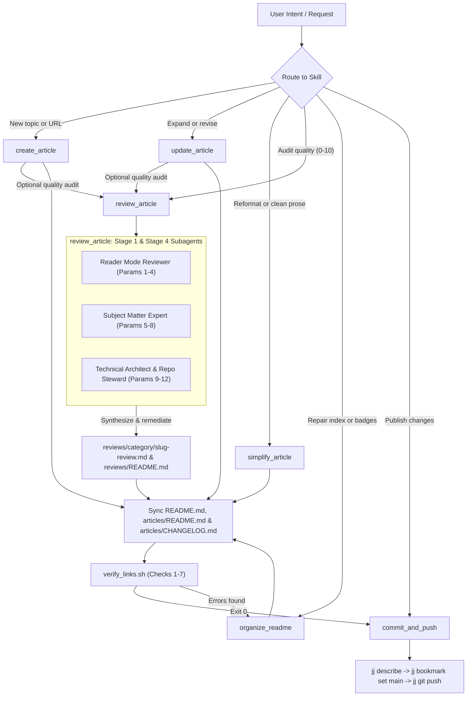

# ThoughtsInWords Agent Skills Directory

Welcome to the agentic control plane for **ThoughtsInWords** ([Root Overview](../../README.md) | [Full Article Index](../../articles/README.md) | [Review Reports Index](../../reviews/README.md) | [Activity Changelog](../../articles/CHANGELOG.md)).

The `.agent/skills/` folder houses **6 modular agent skills** (backed by 8 Markdown specification, reference, and template files) that automate the complete lifecycle of the digital garden: ingesting and authoring articles, enforcing licensing and metadata invariants, refactoring structure, running multi-subagent `0–10` architectural audits, reconciling repository indexes, and publishing via Jujutsu (`jj`).

---

## 1. Technical & AI Architect Assessment (`0–10` Scale)

Before cataloging individual capabilities, this control plane is evaluated across **required architectural scale** and **per-skill engineering maturity** (`0.0–10.0`).

### 1.1 Scale Required Across AI & Technical System Parameters (`0–10`)

| # | Architectural Parameter | Scale Required (`0–10`) | Scope & Engineering Rationale |
| :-: | :--- | :---: | :--- |
| **1** | **Discovery & Context Window Scale** | `2.5` | Small, bounded surface area: 6 skill directories (8 files, 520 lines total), easily indexed in a single context pass without retrieval chunking. |
| **2** | **Agentic Compute & Orchestration Scale** | `2.0` / `7.5` | `2.0` for static index/skill discovery; peaks at `7.5` at runtime in `review_article`, which spawns 3 parallel independent subagents with state re-verification. |
| **3** | **State Mutation & Blast Radius Scale** | `1.5` / `8.0` | `1.5` for documenting `.agent/skills/README.md`; `8.0` across the skills themselves, which mutate articles, root/category/review indexes, changelogs, and remote VCS history. |
| **4** | **Cross-Skill Dependency & DAG Coupling Scale** | `8.0` | High workflow coupling: `create_article`, `update_article`, `simplify_article`, and `review_article` share badge exclusivity, changelog sync, and index contracts enforced by `organize_readme` and `verify_links.sh`. |
| **5** | **Governance & Repository Invariant Scale** | `9.0` | Strict invariant surface: Hybrid Window `[NEW]` math, `[UPDATED]` exclusivity, Pure Open-Source Systems mandate, immutable `**Date:**`, and a 12-parameter `0–10` review rubric. |
| **6** | **Verification & Deterministic Gate Scale** | `8.5` | Backed by a deterministic Python validation suite inside [`verify_links.sh`](../../verify_links.sh) running Checks 1–7 across articles, indexes, cross-links, and review reports. |
| **7** | **Documentation Depth & Dual-Audience Ergonomics** | `8.0` | Must serve both **human maintainers** (navigating workflows, invariants, and VCS rules) and **AI agents** (fast capability routing, preconditions, and execution contracts). |
| **8** | **Operational Maintenance & Drift-Prevention Scale** | `6.5` | Skills change infrequently, but any change to badge rules, rubric weights, or `verify_links.sh` checks requires synchronized updates across skills and this README. |

### 1.2 Architectural Maturity Scorecard of Existing Skills (`0–10`)

Each skill in `.agent/skills/` is rated below across 5 architectural dimensions (`0.0–10.0`):

| Skill | Determinism | Invariant Coverage | Multi-Agent Orchestration | Verification Coupling | Idempotency & Safety | Composite (`0–10`) | Key Architectural Observation |
| :--- | :---: | :---: | :---: | :---: | :---: | :---: | :--- |
| [`review_article`](./review_article/SKILL.md) | `8.5` | `9.5` | `9.5` | `9.5` | `8.5` | **`9.1`** | Strongest architecture: 5-stage fan-out/fan-in pipeline with separated rubric (`references/`) and template (`resources/`), plus Checks 1–7 validation. |
| [`organize_readme`](./organize_readme/SKILL.md) | `9.0` | `9.5` | `2.0` | `9.5` | `9.0` | **`7.8`** | Acts as the deterministic reconciler and repair layer for index drift, orphan files, naming violations, and `[NEW]`/`[UPDATED]` parity. |
| [`create_article`](./create_article/SKILL.md) | `8.0` | `9.0` | `3.0` | `9.0` | `7.5` | **`7.3`** | Clear step-by-step authoring contract with Hybrid Window math and Pure Open-Source guardrails; optionally chains into `review_article`. |
| [`update_article`](./update_article/SKILL.md) | `8.5` | `9.0` | `3.0` | `9.0` | `8.0` | **`7.7`** | Protects immutable `**Date:**`, enforces `[NEW]` vs. `[UPDATED]` mutual exclusivity, and keeps in-article and repo changelogs aligned. |
| [`simplify_article`](./simplify_article/SKILL.md) | `7.5` | `8.5` | `2.0` | `9.0` | `8.0` | **`7.0`** | Strict link/reference preservation contract; references a legacy `view_file` tool name rather than staying tool-agnostic. |
| [`commit_and_push`](./commit_and_push/SKILL.md) | `8.5` | `5.0` | `1.0` | `4.0` | `6.5` | **`5.0`** | Clean 3-step `jj` sequence (`describe`, `bookmark set`, `git push`), but lacks a built-in pre-push `verify_links.sh` gate and force-assumes `main`. |

> **Architect's Note on Scoring:** The `Multi-Agent Orchestration` score reflects whether a skill requires subagent fan-out (`review_article` does; atomic skills like `commit_and_push` intentionally do not). `Composite` is the equal-weighted mean across the 5 columns.

---

## 2. End-to-End Agentic Workflow & Skill Topology

All content skills form a directed workflow converging on [`verify_links.sh`](../../verify_links.sh) before publication through Jujutsu (`jj`).



---

## 3. Skills Capability Directory

| Skill | Folder | Trigger Intents | Primary Mutated Targets | Verification Gate |
| :--- | :--- | :--- | :--- | :--- |
| **Create Article** | [`create_article/`](./create_article/SKILL.md) | "create a new article", "add a summary of [URL]" | `articles/<category>/<slug>.md`, `README.md`, `articles/README.md`, `articles/CHANGELOG.md` | `bash verify_links.sh` (Checks 1–7) |
| **Update Article** | [`update_article/`](./update_article/SKILL.md) | "update article", "expand", "revise", "add a section to" | Existing article, `README.md`, `articles/README.md`, `articles/CHANGELOG.md` | `bash verify_links.sh` (Checks 1–7) |
| **Simplify Article** | [`simplify_article/`](./simplify_article/SKILL.md) | "simplify article", "make readable", "clean up format" | Existing article, `README.md`, `articles/README.md`, `articles/CHANGELOG.md` | `bash verify_links.sh` (Checks 1–7) + link preservation check |
| **Review and Verify Article** | [`review_article/`](./review_article/SKILL.md) | Multi-persona quality audit, `0–10` scoring, architectural review | Target article, `reviews/<category>/<slug>-review.md`, `reviews/README.md`, indexes & changelog | `bash verify_links.sh` (Checks 1–7) |
| **Organize README** | [`organize_readme/`](./organize_readme/SKILL.md) | "organize readme", "fix links", "update index" | `README.md`, `articles/README.md`, `articles/CHANGELOG.md`, broken internal links | `bash verify_links.sh` (Checks 1–7) |
| **Commit and Push with JJ** | [`commit_and_push/`](./commit_and_push/SKILL.md) | Save progress and push working copy to git remote | Jujutsu (`jj`) revision description, `main` bookmark, remote git repository | Manual / `jj git fetch` conflict check |

### 3.1 Create Article (`create_article`)

* **Specification:** [`create_article/SKILL.md`](./create_article/SKILL.md)
* **Core Capabilities:**
  * **Topic Classification:** Inspects existing subdirectories under `articles/` (`ai`, `cloud-native`, `design`, `devops`, `distributed-systems`, `environment`, `frontend`, `licensing`, `philosophy`, `testing`, `tools`, `travel`) and assigns a matching category—forbidding date-based folders.
  * **Structured Ingestion & Authoring:** Summarizes URLs or topic briefs into `articles/<category>/<kebab-case-slug>.md` with required `**Date:** Month Day, Year` metadata, `## Summary`, `## Key Points`, `## Related Articles` (2–3 relative `.md` cross-links), and initial `## Changelog`.
  * **Pure Open-Source Filtering:** Rejects or replaces non-qualifying proprietary, commercial-only, or open-core ("Community Edition") tools and injects the standardized `Scope & Licensing Note`.
  * **Hybrid Window `[NEW]` Rotation:** Prepends the article to `Recent Additions` in root `README.md`, keeps `[NEW]` on all articles published within 7 days of the newest `**Date:**` (bounded by min `3`, max `5`), evicts older badges, updates `articles/README.md` counts and alphabetical index, and logs additions/rotations in `articles/CHANGELOG.md`.

### 3.2 Update Article (`update_article`)

* **Specification:** [`update_article/SKILL.md`](./update_article/SKILL.md)
* **Core Capabilities:**
  * **Immutable Creation Metadata:** Preserves the original `**Date:** Month Day, Year` and adds/updates `**Last Updated:** Month Day, Year` directly beneath it.
  * **In-Article Changelog Management:** Ensures `## Changelog` sits at the bottom of the article (after `## Related Articles` and `## References`) in reverse chronological order, seeding `Initial publication.` if creating `## Changelog` for the first time.
  * **`[NEW]` vs. `[UPDATED]` Exclusivity:** Keeps `[NEW]` if the article is already in the active `Recent Additions` cohort; otherwise promotes the article to `Recently Updated (Revision Trail, Max 5)` in `README.md` and `articles/README.md`, evicting any 6th entry.
  * **Compliance & Cross-Linking:** Re-checks pure open-source compliance on both existing and newly added content, refreshes `## Related Articles`, and logs the revision in `articles/CHANGELOG.md`.

### 3.3 Simplify Article (`simplify_article`)

* **Specification:** [`simplify_article/SKILL.md`](./simplify_article/SKILL.md)
* **Core Capabilities:**
  * **Structural & Readability Refactoring:** Normalizes header hierarchy (`#` → `##` → `###`), breaks up dense prose walls, separates cluttered lists, enforces blank lines around headers/lists, and introduces Mermaid diagrams when complex workflows warrant visualization.
  * **Zero-Loss Reference Guarantee:** Strictly forbids deleting existing `## References`, `## Related Articles`, `## Changelog` history, footnotes, or inline anchor links—confirming 100% link retention post-edit.
  * **Licensing & Trail Sync:** Enforces the pure open-source scope check, updates `**Last Updated:**`, prepends a simplification bullet to `## Changelog`, and syncs repository trails per `update_article`.

### 3.4 Review and Verify Article (`review_article`)

* **Specification:** [`review_article/SKILL.md`](./review_article/SKILL.md)
* **Supporting Artifacts:**
  * Evaluation rubric & philosophy alignment rules: [`review_article/references/rubric-and-repo-alignment.md`](./review_article/references/rubric-and-repo-alignment.md)
  * Canonical report schema: [`review_article/resources/report-template.md`](./review_article/resources/report-template.md)
* **Core Capabilities (5-Stage Multi-Subagent Pipeline):**
  1. **Stage 1 — Parallel Before Audit:** Launches 3 read-only subagents in parallel, each scoring 4 dedicated parameters on a `0.0–10.0` scale:
     * **Reader Mode Reviewer (Parameters 1–4):** Executive clarity & hook, narrative flow & cognitive load, visual aids & scannability, accessibility & actionable takeaway.
     * **Subject Matter Expert Reviewer (Parameters 5–8):** Technical/domain accuracy, depth of insight & edge cases, citations/specifications/evidence, domain completeness & currency.
     * **Technical Architect & Repo Concept Reviewer (Parameters 9–12):** Architectural soundness & pure open-source trade-offs, **ThoughtsInWords** philosophy alignment (guarding against the *"Engineer's Philosophy"* pitfall of oversimplifying systemic problems as trivial "bugs"), digital garden interconnectivity, and repository lifecycle compliance.
  2. **Stage 2 — Conflict-Free Synthesis:** Deduplicates findings into `Critical`, `High`, `Medium`, and `Low` remediation items while preserving citations and `**Date:**`.
  3. **Stage 3 — Article Remediation & Metadata Linking:** Applies edits, injects `**Last Updated:**`, adds the bidirectional `**Review:**` link, enforces the `Scope & Licensing Note`, and prepends to `## Changelog`.
  4. **Stage 4 — Re-Verification & Report Generation:** Sends the updated article back to the 3 subagents for verified **After** scores, computes Persona Sub-Averages, Overall Composite Score, and Deltas, and writes `reviews/<category>/<slug>-review.md`.
  5. **Stage 5 — Repository Sync & Health Gate:** Updates `reviews/README.md`, syncs `README.md`, `articles/README.md`, and `articles/CHANGELOG.md`, and runs `bash verify_links.sh` (Checks 1–7).

### 3.5 Organize README (`organize_readme`)

* **Specification:** [`organize_readme/SKILL.md`](./organize_readme/SKILL.md)
* **Core Capabilities:**
  * **Full-Tree Discovery & Naming Audit:** Scans all `.md` files under `articles/` (excluding `articles/README.md` and `articles/CHANGELOG.md`), verifying topic-folder placement, lowercase `kebab-case.md` naming, and zero empty directories.
  * **Self-Healing Link Resolution:** Verifies every link in `articles/README.md`, `articles/CHANGELOG.md`, `README.md`, and internal article cross-links, updating broken paths when files were moved or renamed.
  * **Index & Cohort Reconciliation:** Inserts unlisted articles alphabetically using title-first formatting (`- [Title](category/slug.md)`), recomputes the exact Hybrid Window `[NEW]` cohort and top-5 `[UPDATED]` revision trail, enforces 1-to-1 parity between `README.md` and `articles/README.md`, and syncs total/category article counts.

### 3.6 Commit and Push with JJ (`commit_and_push`)

* **Specification:** [`commit_and_push/SKILL.md`](./commit_and_push/SKILL.md)
* **Core Capabilities:**
  * **Jujutsu (`jj`) Publication Flow:** Executes `jj describe -m "..."`, advances the `main` bookmark to `@` (`jj bookmark set main -r @`), and pushes to the git remote (`jj git push`), noting `jj git fetch` + rebase recovery on conflicts.
  * **Operational Note:** Because this skill does not explicitly invoke `bash verify_links.sh`, agents should verify Checks 1–7 pass prior to executing `commit_and_push`.

---

## 4. Cross-Skill Repository Invariants & Governance Contract

Every content skill enforces four shared architectural contracts:

1. **Pure Open-Source Systems Mandate:** Articles covering tools, frameworks, or platforms must exclusively feature OSI-approved pure open-source systems (full feature set self-hostable without vendor lock-in or paywalled tiers). Proprietary, commercial-only, and open-core ("Community Edition") systems are excluded, and qualifying articles include:
   ```markdown
   > **Scope & Licensing Note:** This article strictly covers pure open-source systems. Premium, proprietary/vendor-locked, and community-edition (open-core) systems are currently not included.
   ```
2. **Hybrid Window `[NEW]` & `[UPDATED]` Exclusivity:**
   * `[NEW]` applies to all articles published within **7 days** of the newest article's `**Date:**`, clamped to a minimum of `3` and maximum of `5`: `expected_count = min(5, max(3, count_within_7_days))`.
   * `[UPDATED]` applies to at most **5** revised articles (`**Last Updated:**` + `## Changelog`) that do **not** currently hold `[NEW]`.
   * Both badge sets must match 1-to-1 between root [`README.md`](../../README.md) and [`articles/README.md`](../../articles/README.md).
3. **Naming & Layout Discipline:** All articles live at `articles/<category>/<kebab-case>.md`; all review reports live at `reviews/<category>/<kebab-case>-review.md`. Date-based directories, uppercase letters, underscores in article filenames, and empty directories are prohibited.
4. **Automated Verification Gate ([`verify_links.sh`](../../verify_links.sh)):**
   * **Check 1 / 1b / 1c:** Every relative `.md` link in `articles/README.md`, `README.md`, and `articles/CHANGELOG.md` resolves on disk.
   * **Check 2:** Zero orphan articles (every article on disk is indexed in `articles/README.md`).
   * **Check 3:** Every internal relative `.md` cross-link inside every article resolves cleanly.
   * **Check 4:** Zero empty directories under `articles/` and 100% lowercase `kebab-case.md` compliance.
   * **Check 5:** Hybrid Window `[NEW]` cohort accuracy and article count parity across both READMEs.
   * **Check 6:** Revision trail integrity (`**Last Updated:**` format and date ordering, `## Changelog` entries, `[UPDATED]` cap of 5, mutual exclusivity with `[NEW]`, and `articles/CHANGELOG.md` presence).
   * **Check 7:** Review report structure (`reviews/<category>/<slug>-review.md`), `reviews/README.md` indexing, bidirectional article ↔ report linking, and required `0–10` scorecard/persona sections.

---

## 5. Directory Structure

```text
.agent/skills/
├── README.md                                          # This architectural overview & capability index
├── commit_and_push/
│   └── SKILL.md                                       # Jujutsu (jj) commit, bookmark, and push workflow
├── create_article/
│   └── SKILL.md                                       # New article authoring, OS-only filter & [NEW] lifecycle
├── organize_readme/
│   └── SKILL.md                                       # Index reconciliation, link healing & badge sync
├── review_article/
│   ├── SKILL.md                                       # 5-stage multi-subagent 0-10 audit & remediation pipeline
│   ├── references/
│   │   └── rubric-and-repo-alignment.md               # 12-parameter 0-10 rubric & ThoughtsInWords philosophy checks
│   └── resources/
│       └── report-template.md                         # Canonical Before/After review report template
├── simplify_article/
│   └── SKILL.md                                       # Structure/readability cleanup with strict link preservation
└── update_article/
    └── SKILL.md                                       # Article revision, changelog & [UPDATED] trail sync
```

---

## 6. Architectural Plans & Skill-to-Agent Migration Roadmap (`plan/`)

Detailed `0–10` architectural assessments and the blueprint for evolving these skills into a hybrid control plane (thin routing skills + scoped subagents + `run_workflow` pipelines + single-writer `index-reconciler`) live in the repository's [`plan/`](../../plan/README.md) folder:

* **[Architectural Plans Index](../../plan/README.md):** Overview and executive summary of the Skill-to-Agent roadmap.
* **[01 — Skills Capability & Scale Assessment (`0–10`)](../../plan/01-skills-capability-and-scale-assessment.md):** Prompt specification audit (`4.2 → 9.2`), 8-parameter AI/technical system scale evaluation, and current skill maturity scorecard.
* **[02 — Skills-to-Agents Evaluation & Target Architecture](../../plan/02-skills-to-agents-evaluation-and-architecture.md):** 6-parameter conversion ROI matrix (`9.5` for `review_article` down to `2.0` for `commit_and_push`), 6 required architectural changes, JSON handoff/scorecard contracts, and target hybrid Mermaid topology.
* **[03 — Phased Migration Execution Plan](../../plan/03-phased-migration-execution-plan.md):** Step-by-step Phases 1–3 implementation tasks and verification acceptance criteria.
