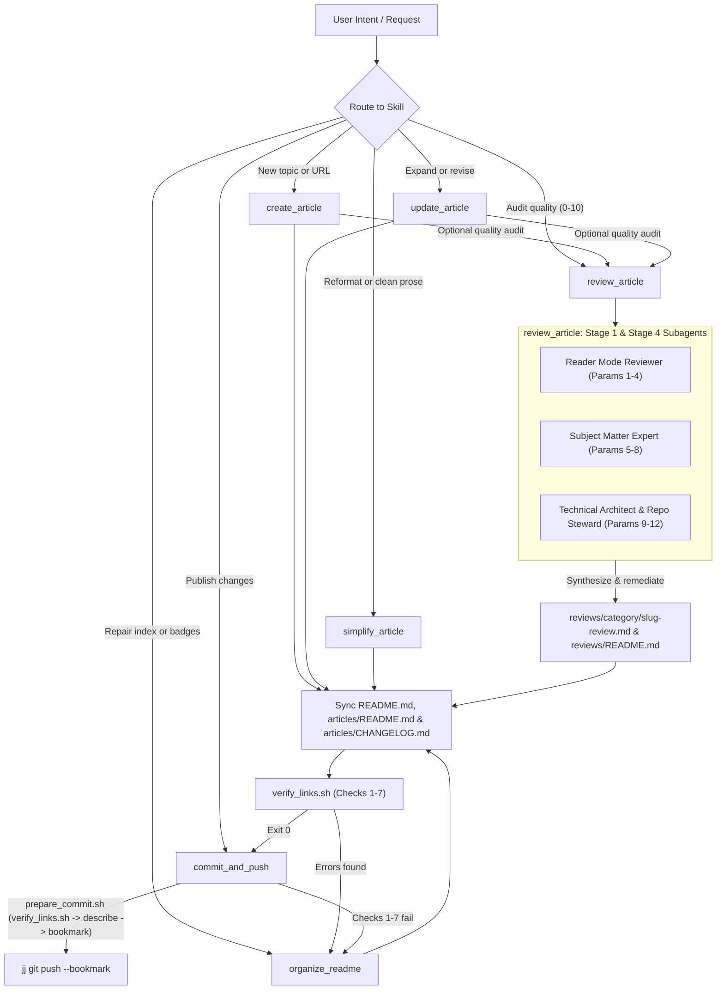

# ThoughtsInWords Agent Skills Directory

Welcome to the agentic control plane for **ThoughtsInWords** ([Root Overview](../../README.md) | [Full Article Index](../../articles/README.md) | [Review Reports Index](../../reviews/README.md) | [Activity Changelog](../../articles/CHANGELOG.md) | [Repository Rules](../rules/AGENTS.md)).

The `.agent/skills/` folder houses **6 modular agent skills** (backed by 8 Markdown specification, reference, and template files plus 1 pre-push verification/staging script, totaling 486 lines across the 9 skill/script files) governed by the always-on workspace rule [`.agent/rules/AGENTS.md`](../rules/AGENTS.md) (34 lines). Together they automate the complete lifecycle of the digital garden: ingesting and authoring articles, enforcing licensing and metadata invariants, refactoring structure, running multi-subagent `0–10` architectural audits, reconciling repository indexes, and publishing via Jujutsu (`jj`).

---

## 1. Technical & AI Architect Assessment (`0–10` Scale)

Before cataloging individual capabilities, this control plane is evaluated across **required architectural scale** and **per-skill engineering maturity** (`0.0–10.0`).

### 1.1 Scale Required Across AI & Technical System Parameters (`0–10`)

| # | Architectural Parameter | Scale Required (`0–10`) | Scope & Engineering Rationale |
| :-: | :--- | :---: | :--- |
| **1** | **Discovery & Context Window Scale** | `2.5` | Small, bounded surface area: 1 always-on rule file (`AGENTS.md`, 34 lines) + 6 skill directories (8 Markdown files + 1 script, 486 lines), easily indexed in a single context pass without retrieval chunking. |
| **2** | **Agentic Compute & Orchestration Scale** | `2.0` / `7.5` | `2.0` for static index/skill discovery; peaks at `7.5` at runtime in `review_article`, which spawns 3 parallel independent subagents with state re-verification. |
| **3** | **State Mutation & Blast Radius Scale** | `1.5` / `8.0` | `1.5` for documenting `.agent/skills/README.md`; `8.0` across the skills themselves, which mutate articles, root/category/review indexes, changelogs, and remote VCS history. |
| **4** | **Cross-Skill Dependency & DAG Coupling Scale** | `8.0` | High workflow coupling: `create_article`, `update_article`, `simplify_article`, and `review_article` inherit invariants from `.agent/rules/AGENTS.md` and delegate index/badge/changelog sync to `organize_readme` and `verify_links.sh`. |
| **5** | **Governance & Repository Invariant Scale** | `9.0` | Strict invariant surface centralized in `.agent/rules/AGENTS.md`: Hybrid Window `[NEW]` math, `[UPDATED]` exclusivity, Pure Open-Source Systems mandate, immutable `**Date:**`, and a 12-parameter `0–10` review rubric. |
| **6** | **Verification & Deterministic Gate Scale** | `8.5` | Backed by a deterministic Python validation suite inside [`verify_links.sh`](../../verify_links.sh) running Checks 1–7 across articles, indexes, cross-links, and review reports. |
| **7** | **Documentation Depth & Dual-Audience Ergonomics** | `8.0` | Must serve both **human maintainers** (navigating workflows, invariants, and VCS rules) and **AI agents** (fast capability routing, preconditions, and execution contracts). |
| **8** | **Operational Maintenance & Drift-Prevention Scale** | `6.5` | Centralizing declarative invariants into `.agent/rules/AGENTS.md` and trail mutation into `organize_readme` eliminates multi-file rule drift when badge rules or licensing boilerplates evolve. |

### 1.2 Architectural Maturity Scorecard of Existing Skills (`0–10`)

Each skill in `.agent/skills/` is rated below across 5 architectural dimensions (`0.0–10.0`):

| Skill | Determinism | Invariant Coverage | Multi-Agent Orchestration | Verification Coupling | Idempotency & Safety | Composite (`0–10`) | Key Architectural Observation |
| :--- | :---: | :---: | :---: | :---: | :---: | :---: | :--- |
| [`review_article`](./review_article/SKILL.md) | `8.5` | `9.5` | `9.5` | `9.5` | `8.5` | **`9.1`** | Strongest architecture: 5-stage fan-out/fan-in pipeline backed by `.agent/rules/AGENTS.md`, separated rubric (`references/`) and template (`resources/`), `organize_readme` trail handoff, and Checks 1–7 validation. |
| [`organize_readme`](./organize_readme/SKILL.md) | `9.5` | `9.5` | `3.0` | `9.5` | `9.5` | **`8.2`** | *(Remediated from `7.8` via Option 4)* Canonical procedural reconciler owning all `README.md`, `articles/README.md`, and `articles/CHANGELOG.md` mutations, `[NEW]`/`[UPDATED]` parity, and self-healing link checks. |
| [`update_article`](./update_article/SKILL.md) | `9.0` | `9.5` | `4.0` | `9.5` | `9.0` | **`8.2`** | *(Remediated from `7.7` via Option 4)* Deduplicated via `.agent/rules/AGENTS.md`; protects immutable `**Date:**`, manages in-article `## Changelog`, and delegates index/badge/changelog trails to `organize_readme`. |
| [`create_article`](./create_article/SKILL.md) | `8.5` | `9.5` | `4.0` | `9.5` | `8.5` | **`8.0`** | *(Remediated from `7.3` via Option 4)* Deduplicated authoring workflow inheriting Invariants 1–3 from `.agent/rules/AGENTS.md`, delegating `[NEW]`/index reconciliation to `organize_readme`, and optionally chaining into `review_article`. |
| [`simplify_article`](./simplify_article/SKILL.md) | `8.5` | `9.5` | `3.5` | `9.5` | `9.0` | **`8.0`** | *(Remediated from `7.0` via Option 4)* Tool-agnostic wording (removed legacy `view_file` coupling), inherits Pure Open-Source & metadata invariants from `.agent/rules/AGENTS.md`, preserves 100% of links, and delegates trail sync to `organize_readme`. |
| [`commit_and_push`](./commit_and_push/SKILL.md) | `9.5` | `9.0` | `2.0` | `9.5` | `9.0` | **`7.8`** | Two-phase guarded `jj` workflow via [`prepare_commit.sh`](./commit_and_push/scripts/prepare_commit.sh): enforces `verify_links.sh` (Checks 1–7) before `jj describe` / `jj bookmark set`, parameterizes target bookmark (default `main`), and routes failures to `organize_readme`. |

> **Architect's Note on Scoring:** The `Multi-Agent Orchestration` score reflects whether a skill requires subagent fan-out (`review_article` does; atomic skills like `commit_and_push` intentionally do not). `Composite` is the equal-weighted mean across the 5 columns.

---

## 2. End-to-End Agentic Workflow & Skill Topology

All content skills form a directed workflow converging on [`verify_links.sh`](../../verify_links.sh) before publication through Jujutsu (`jj`).



---

## 3. Skills Capability Directory

| Skill | Folder | Trigger Intents | Primary Mutated Targets | Verification Gate |
| :--- | :--- | :--- | :--- | :--- |
| **Create Article** | [`create_article/`](./create_article/SKILL.md) | "create a new article", "add a summary of [URL]" | `articles/<category>/<slug>.md`, `README.md`, `articles/README.md`, `articles/CHANGELOG.md` | `bash verify_links.sh` (Checks 1–7) |
| **Update Article** | [`update_article/`](./update_article/SKILL.md) | "update article", "expand", "revise", "add a section to" | Existing article, `README.md`, `articles/README.md`, `articles/CHANGELOG.md` | `bash verify_links.sh` (Checks 1–7) |
| **Simplify Article** | [`simplify_article/`](./simplify_article/SKILL.md) | "simplify article", "make readable", "clean up format" | Existing article, `README.md`, `articles/README.md`, `articles/CHANGELOG.md` | `bash verify_links.sh` (Checks 1–7) + link preservation check |
| **Review and Verify Article** | [`review_article/`](./review_article/SKILL.md) | Multi-persona quality audit, `0–10` scoring, architectural review | Target article, `reviews/<category>/<slug>-review.md`, `reviews/README.md`, indexes & changelog | `bash verify_links.sh` (Checks 1–7) |
| **Organize README** | [`organize_readme/`](./organize_readme/SKILL.md) | "organize readme", "fix links", "update index" | `README.md`, `articles/README.md`, `articles/CHANGELOG.md`, broken internal links | `bash verify_links.sh` (Checks 1–7) |
| **Commit and Push with JJ** | [`commit_and_push/`](./commit_and_push/SKILL.md) | Save progress and push working copy to git remote | Jujutsu (`jj`) revision description, target bookmark (default `main`), remote git repository | `prepare_commit.sh` (`bash verify_links.sh` Checks 1–7) before `jj describe` / `bookmark set` / `jj git push` |

### 3.1 Create Article (`create_article`)

* **Specification:** [`create_article/SKILL.md`](./create_article/SKILL.md)
* **Core Capabilities:**
  * **Topic Classification:** Inspects existing subdirectories under `articles/` (`ai`, `cloud-native`, `design`, `devops`, `distributed-systems`, `environment`, `frontend`, `licensing`, `philosophy`, `testing`, `tools`, `travel`) and assigns a matching category—forbidding date-based folders per [`.agent/rules/AGENTS.md`](../rules/AGENTS.md) Invariant 2.
  * **Structured Ingestion & Authoring:** Summarizes URLs or topic briefs into `articles/<category>/<kebab-case-slug>.md` enforcing [`.agent/rules/AGENTS.md`](../rules/AGENTS.md) Invariants 1–3 (`**Date:** Month Day, Year`, `Scope & Licensing Note` for pure open-source systems, `## Summary`, `## Key Points`, `## Related Articles` with 2–3 relative `.md` cross-links, and initial `## Changelog`).
  * **Trail Reconciliation Handoff:** Delegates alphabetical index insertion, Hybrid Window `[NEW]` rotation, count updates, and `articles/CHANGELOG.md` (`* **Added:**` / `* **Rotated (\`[NEW]\`):**`) entries to [`organize_readme/SKILL.md`](./organize_readme/SKILL.md), optionally chaining into `review_article`.

### 3.2 Update Article (`update_article`)

* **Specification:** [`update_article/SKILL.md`](./update_article/SKILL.md)
* **Core Capabilities:**
  * **Immutable Metadata & In-Article Changelog:** Enforces [`.agent/rules/AGENTS.md`](../rules/AGENTS.md) Invariant 3—preserving the original `**Date:** Month Day, Year`, updating `**Last Updated:** Month Day, Year`, and prepending reverse-chronological entries to bottom `## Changelog` (seeding `Initial publication.` if missing).
  * **Licensing & Cross-Linking:** Validates [`.agent/rules/AGENTS.md`](../rules/AGENTS.md) Invariant 1 (Pure Open-Source Systems Mandate & `Scope & Licensing Note`) across existing and added content, and refreshes `## Related Articles`.
  * **Trail Reconciliation Handoff:** Delegates `[NEW]` vs. `[UPDATED]` exclusivity enforcement, `Recently Updated (Max 5)` rotation across both READMEs, and `articles/CHANGELOG.md` (`* **Updated:**`) entries to [`organize_readme/SKILL.md`](./organize_readme/SKILL.md).

### 3.3 Simplify Article (`simplify_article`)

* **Specification:** [`simplify_article/SKILL.md`](./simplify_article/SKILL.md)
* **Core Capabilities:**
  * **Structural & Readability Refactoring:** Tool-agnostic refactoring that normalizes header hierarchy (`#` → `##` → `###`), breaks up dense prose walls, separates cluttered lists, enforces blank lines around headers/lists, and introduces Mermaid diagrams when complex workflows warrant visualization.
  * **Zero-Loss Reference Guarantee:** Strictly forbids deleting existing `## References`, `## Related Articles`, `## Changelog` history, footnotes, or inline anchor links—confirming 100% link retention post-edit.
  * **Governance & Trail Sync:** Enforces [`.agent/rules/AGENTS.md`](../rules/AGENTS.md) Invariants 1 & 3 (pure open-source compliance, `**Last Updated:**`, `## Changelog` prepending) and delegates repo trail updates (`* **Simplified:**`) to [`organize_readme/SKILL.md`](./organize_readme/SKILL.md).

### 3.4 Review and Verify Article (`review_article`)

* **Specification:** [`review_article/SKILL.md`](./review_article/SKILL.md)
* **Supporting Artifacts:**
  * Always-on invariants: [`.agent/rules/AGENTS.md`](../rules/AGENTS.md)
  * Evaluation rubric & philosophy alignment rules: [`review_article/references/rubric-and-repo-alignment.md`](./review_article/references/rubric-and-repo-alignment.md)
  * Canonical report schema: [`review_article/resources/report-template.md`](./review_article/resources/report-template.md)
* **Core Capabilities (5-Stage Multi-Subagent Pipeline):**
  1. **Stage 1 — Parallel Before Audit:** Launches 3 read-only subagents in parallel, each scoring 4 dedicated parameters on a `0.0–10.0` scale:
     * **Reader Mode Reviewer (Parameters 1–4):** Executive clarity & hook, narrative flow & cognitive load, visual aids & scannability, accessibility & actionable takeaway.
     * **Subject Matter Expert Reviewer (Parameters 5–8):** Technical/domain accuracy, depth of insight & edge cases, citations/specifications/evidence, domain completeness & currency, plus Invariant 1 (pure open-source compliance).
     * **Technical Architect & Repo Concept Reviewer (Parameters 9–12):** Architectural soundness & pure open-source trade-offs, **ThoughtsInWords** philosophy alignment (guarding against the *"Engineer's Philosophy"* pitfall of oversimplifying systemic problems as trivial "bugs"), digital garden interconnectivity, and Invariants 1–3 compliance.
  2. **Stage 2 — Conflict-Free Synthesis:** Deduplicates findings into `Critical`, `High`, `Medium`, and `Low` remediation items while preserving citations and `**Date:**` and flagging Invariant 1 violations.
  3. **Stage 3 — Article Remediation & Metadata Linking:** Applies edits, injects `**Last Updated:**`, adds the bidirectional `**Review:**` link, enforces Invariant 1 (`Scope & Licensing Note`), and prepends to `## Changelog`.
  4. **Stage 4 — Re-Verification & Report Generation:** Sends the updated article back to the 3 subagents for verified **After** scores, computes Persona Sub-Averages, Overall Composite Score, and Deltas, and writes `reviews/<category>/<slug>-review.md`.
  5. **Stage 5 — Repository Sync & Health Gate:** Updates `reviews/README.md`, delegates index/changelog sync (`* **Reviewed & Updated:**`) to [`organize_readme/SKILL.md`](./organize_readme/SKILL.md), and runs `bash verify_links.sh` (Checks 1–7).

### 3.5 Organize README (`organize_readme`)

* **Specification:** [`organize_readme/SKILL.md`](./organize_readme/SKILL.md)
* **Core Capabilities:**
  * **Full-Tree Discovery & Naming Audit:** Scans all `.md` files under `articles/` (excluding `articles/README.md` and `articles/CHANGELOG.md`), enforcing [`.agent/rules/AGENTS.md`](../rules/AGENTS.md) Invariant 2 (topic-folder placement, lowercase `kebab-case.md` naming, zero empty directories).
  * **Self-Healing Link Resolution:** Verifies every link in `articles/README.md`, `articles/CHANGELOG.md`, `README.md`, and internal article cross-links, updating broken paths when files were moved or renamed.
  * **Canonical Index, Badge & Changelog Reconciliation:** Inserts unlisted articles alphabetically using title-first formatting (`- [Title](category/slug.md)`), recomputes the exact Hybrid Window `[NEW]` cohort and top-5 `[UPDATED]` revision trail (Invariant 4), enforces 1-to-1 parity between `README.md` and `articles/README.md`, records standardized `articles/CHANGELOG.md` entries (`Added`, `Updated`, `Simplified`, `Reviewed & Updated`, `Rotated (\`[NEW]\`)`), and syncs total/category article counts.

### 3.6 Commit and Push with JJ (`commit_and_push`)

* **Specification:** [`commit_and_push/SKILL.md`](./commit_and_push/SKILL.md)
* **Supporting Scripts:** [`commit_and_push/scripts/prepare_commit.sh`](./commit_and_push/scripts/prepare_commit.sh)
* **Core Capabilities:**
  * **Two-Phase Guarded `jj` Publication Flow:** Phase 1 executes `prepare_commit.sh` locally (`set -euo pipefail`) to run `bash verify_links.sh` (Checks 1–7) **before** executing `jj describe -m "..."` and `jj bookmark set <bookmark> -r @` (default `main`). Phase 2 executes `jj git push --bookmark <bookmark>` only after Phase 1 exits `0`, isolating network access strictly to the push step.
  * **Hard Gate & Self-Healing Routing:** Aborts before any bookmark mutation if Checks 1–7 fail, forbids manual bypass, and routes index/badge/link drift to [`organize_readme`](./organize_readme/SKILL.md) before retrying.

---

## 4. Cross-Skill Repository Invariants & Governance Contract

Declarative repository invariants are centralized as an always-on workspace rule in [`.agent/rules/AGENTS.md`](../rules/AGENTS.md) (eliminating per-skill boilerplate), while procedural index/badge/changelog reconciliation is centralized in [`organize_readme/SKILL.md`](./organize_readme/SKILL.md) and enforced by [`verify_links.sh`](../../verify_links.sh):

1. **Invariant 1 — Pure Open-Source Systems Mandate & `Scope & Licensing Note`:** Articles covering tools, frameworks, or platforms must exclusively feature OSI-approved pure open-source systems (full feature set self-hostable without vendor lock-in or paywalled tiers), excluding proprietary, commercial-only, and open-core ("Community Edition") systems and carrying the canonical `Scope & Licensing Note` callout defined in [`.agent/rules/AGENTS.md`](../rules/AGENTS.md).
2. **Invariant 2 — Naming & Layout Discipline:** All articles live at `articles/<category>/<kebab-case>.md`; all review reports live at `reviews/<category>/<kebab-case>-review.md`. Date-based directories, uppercase letters, underscores in article filenames, and empty directories are prohibited.
3. **Invariant 3 — Immutable Metadata & Section Ordering:** Immutable `**Date:** Month Day, Year`, updated `**Last Updated:** Month Day, Year` (when revised), optional `**Review:**` link, and bottom section order (`## Related Articles` → `## References` → `## Changelog`).
4. **Invariant 4 — Hybrid Window `[NEW]`, `[UPDATED]` Exclusivity & Trail Parity:**
   * `[NEW]` applies to all articles published within **7 days** of the newest article's `**Date:**`, clamped to min `3` and max `5`: `expected_count = min(5, max(3, count_within_7_days))`.
   * `[UPDATED]` applies to at most **5** revised articles (`**Last Updated:**` + `## Changelog`) that do **not** currently hold `[NEW]`.
   * Both badge sets and counts must match 1-to-1 between root [`README.md`](../../README.md) and [`articles/README.md`](../../articles/README.md), with events logged via [`organize_readme`](./organize_readme/SKILL.md) in [`articles/CHANGELOG.md`](../../articles/CHANGELOG.md).
5. **Automated Verification Gate ([`verify_links.sh`](../../verify_links.sh)):**
   * **Check 1 / 1b / 1c:** Every relative `.md` link in `articles/README.md`, `README.md`, and `articles/CHANGELOG.md` resolves on disk.
   * **Check 2:** Zero orphan articles (every article on disk is indexed in `articles/README.md`).
   * **Check 3:** Every internal relative `.md` cross-link inside every article resolves cleanly.
   * **Check 4:** Zero empty directories under `articles/` and 100% lowercase `kebab-case.md` compliance.
   * **Check 5:** Hybrid Window `[NEW]` cohort accuracy and article count parity across both READMEs.
   * **Check 6:** Revision trail integrity (`**Last Updated:**` format and date ordering, `## Changelog` entries, `[UPDATED]` cap of 5, mutual exclusivity with `[NEW]`, and `articles/CHANGELOG.md` presence).
   * **Check 7:** Review report structure (`reviews/<category>/<slug>-review.md`), `reviews/README.md` indexing, bidirectional article ↔ report linking, and required `0–10` scorecard/persona sections.

---

## 5. Directory Structure

```text
.agent/
├── rules/
│   └── AGENTS.md                                      # Always-on governance invariants (OS-only, layout, metadata, badges)
└── skills/
    ├── README.md                                      # This architectural overview & capability index
    ├── commit_and_push/
    │   ├── SKILL.md                                   # Two-phase guarded Jujutsu (jj) publication workflow
    │   └── scripts/
    │       └── prepare_commit.sh                      # Atomic pre-push verify_links.sh gate & jj bookmark stager
    ├── create_article/
    │   └── SKILL.md                                   # New article authoring -> AGENTS.md + organize_readme handoff
    ├── organize_readme/
    │   └── SKILL.md                                   # Canonical owner for index, badge & CHANGELOG reconciliation
    ├── review_article/
    │   ├── SKILL.md                                   # 5-stage multi-subagent 0-10 audit & remediation pipeline
    │   ├── references/
    │   │   └── rubric-and-repo-alignment.md           # 12-parameter 0-10 rubric & ThoughtsInWords philosophy checks
    │   └── resources/
    │       └── report-template.md                     # Canonical Before/After review report template
    ├── simplify_article/
    │   └── SKILL.md                                   # Tool-agnostic structure/readability cleanup with link preservation
    └── update_article/
        └── SKILL.md                                   # Article revision -> AGENTS.md + organize_readme handoff
```

---

## 6. Architectural Plans & Skill-to-Agent Migration Roadmap (`plan/`)

Detailed `0–10` architectural assessments and the blueprint for evolving these skills into a hybrid control plane (thin routing skills + scoped subagents + `run_workflow` pipelines + single-writer `index-reconciler`) live in the repository's [`plan/`](../../plan/README.md) folder:

* **[Architectural Plans Index](../../plan/README.md):** Overview and executive summary of the Skill-to-Agent roadmap.
* **[01 — Skills Capability & Scale Assessment (`0–10`)](../../plan/01-skills-capability-and-scale-assessment.md):** Prompt specification audit (`4.2 → 9.2`), 8-parameter AI/technical system scale evaluation, and current skill maturity scorecard.
* **[02 — Skills-to-Agents Evaluation & Target Architecture](../../plan/02-skills-to-agents-evaluation-and-architecture.md):** 6-parameter conversion ROI matrix (`9.5` for `review_article` down to `2.0` for `commit_and_push`), 6 required architectural changes, JSON handoff/scorecard contracts, and target hybrid Mermaid topology.
* **[03 — Phased Migration Execution Plan](../../plan/03-phased-migration-execution-plan.md):** Step-by-step Phases 1–3 implementation tasks and verification acceptance criteria.
