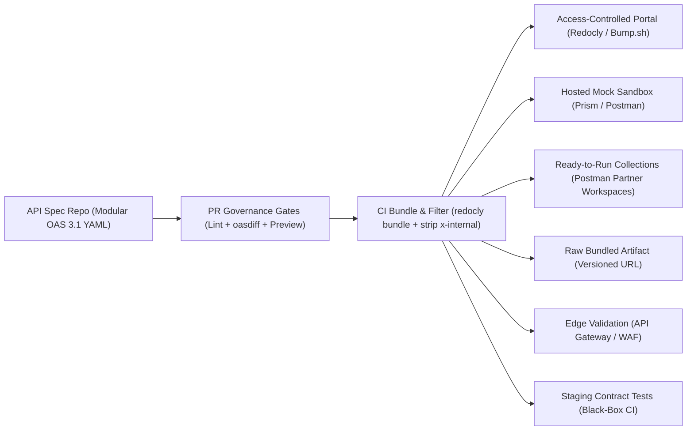

# Design-First Partner APIs: Treating Your OpenAPI Specification as an Independent Product

**Date:** November 16, 2026

## Summary

Building a partner-facing API using a tech-stack-agnostic, design-first approach requires decoupling the API contract from both your backend implementation and your partners' technology stacks. Rather than treating the OpenAPI Specification (OAS) as generated code documentation, treat it as an **independent product** with its own repository, automated governance and release pipeline, and multi-channel partner delivery ([[1](https://bump.sh/)], [[2](https://commercetools.com/blog/what-s-a-technology-agnostic-approach-and-why-is-it-a-core-trait-of-composable-commerce)], [[3](https://devblogs.microsoft.com/ise/design-api-first-with-typespec/)]).

---

## Key Points

* **Decoupled Repository Architecture:** Store modular OpenAPI 3.1 domain files in a dedicated specification repository, bundle them into self-contained `openapi.yaml` and `openapi.json` artifacts, and strip internal metadata before distribution.
* **Automated Governance & Breaking-Change Gates:** Enforce style rules via [Redocly CLI](https://redocly.com/redocly-cli) or [Spectral](http://www.getspectral.sh/), block breaking changes on pull requests with [oasdiff](https://www.oasdiff.com/start-trial), and publish ephemeral PR documentation previews for co-design.
* **Multi-Channel Partner Distribution:** Automatically publish each tagged release to an access-controlled portal, a hosted mock sandbox, ready-to-run API collections, and versioned raw OpenAPI artifacts.
* **Backend Alignment Without Tech Lock-In:** Enforce the bundled contract at the network edge (API Gateway or WAF) and validate staging deployments using black-box contract tests without coupling to backend code.

---

## Architecture Overview

---

## 1. Decoupled Repository Architecture

Keeping the contract isolated from implementation code ensures neither internal framework constraints nor partner stacks dictate interface design ([[1](https://commercetools.com/blog/what-s-a-technology-agnostic-approach-and-why-is-it-a-core-trait-of-composable-commerce)]):

* **Dedicated Specification Repository:** Maintain the API contract in its own API Specification Repository rather than inside any backend service repository. This prevents language-specific serialization quirks or framework annotations from leaking into partner contracts.
* **Modular Domain Files:** Split OpenAPI 3.1 YAML files by resource and shared schema (for example, `paths/orders.yaml` and `components/schemas/error.yaml`). Modular organization enables multiple architects and domain reviewers to collaborate concurrently without Git merge conflicts ([[1](https://apisyouwonthate.com/blog/redocly-cli/)], [[2](https://redocly.com/blog/combining-openapis)]).
* **Single Bundled Release Artifact:** Use a CLI bundler such as [Redocly CLI](https://redocly.com/redocly-cli) (`redocly bundle`) during CI builds to resolve all `$ref` pointers into clean, self-contained `openapi.yaml` and `openapi.json` artifacts. Because many partner code generators and API gateways fail on multi-file `$ref` trees, always distribute the bundled artifact ([[1](https://redocly.com/docs/cli/commands/bundle)], [[2](https://github.com/Redocly/redocly-cli)], [[3](https://apisyouwonthate.com/blog/redocly-cli/)]).
* **Internal Metadata Filtering:** Strip internal annotations—such as `x-internal` extensions, internal server URLs, or administrative endpoints—during the bundling step so partners only see their authorized surface area.

---

## 2. Automated Governance & Breaking-Change Gates

Because partners begin integrating against the specification before backend implementation is complete, strict automated checks on every Pull Request (PR) are essential ([[1](https://specmatic.io/appearance/api-design-first-in-practise-an-experience-report/)], [[2](https://devblogs.microsoft.com/ise/design-api-first-with-typespec/)]):

* **Lint for Consistency and Completeness:** Enforce style rules using [Redocly CLI](https://redocly.com/redocly-cli) or [Spectral](http://www.getspectral.sh/) to verify that every endpoint includes a unique `operationId`, clear descriptions, explicit authentication schemes, and standardized error responses (such as RFC 9457 Problem Details) ([[1](https://redocly.com/redocly-cli)], [[2](https://github.com/Redocly/redocly-cli)]).
* **Block Accidental Breaking Changes:** Run [oasdiff](https://www.oasdiff.com/start-trial) in CI to compare every PR against the latest published partner release. Configure the pipeline to fail automatically if a change removes a field, narrows a data type, or alters a required parameter without a major version bump ([[1](https://daily.dev/posts/detect-breaking-api-changes-with-typescript-openapi-2k8gjlx8a)]).
* **Generate PR Previews for Partner Co-Design:** Render temporary preview documentation on every pull request so product managers, security reviewers, and design-partner leads can inspect the visual contract before merging ([[1](https://redocly.com/blog/api-first)], [[2](https://bump.sh/)]).

---

## 3. Multi-Channel Partner Distribution

Partners consume APIs differently depending on their engineering maturity and toolchain preferences. On every tagged release, publish the bundled OpenAPI artifact to four automated distribution channels:

| Distribution Channel | Recommended Tooling | Why Partners Need It |
| :--- | :--- | :--- |
| **Access-Controlled Portal** | [Redocly](https://redocly.com/) or [Bump.sh](https://bump.sh/) | Provides searchable reference documentation, automated changelogs, and SSO/role-based access control so only approved partners can view the specification. |
| **Hosted Mock Sandbox** | [Stoplight Prism](https://github.com/stoplightio/prism) or [Postman Mock Servers](https://learning.postman.com/docs/design-apis/mock-apis/mock-servers/overview) | Delivers a live URL immediately after contract approval so partners can build and test integrations before backend deployment is finished. |
| **Ready-to-Run Collections** | [Postman Partner Workspaces](https://www.postman.com/solutions/partner-api-management/) | Automatically syncs the bundled OpenAPI spec into pre-configured request collections with environment variables for instant manual testing. |
| **Raw Bundled Artifact** | Versioned URL (`v1.2.0/openapi.yaml`) | Enables partners using any language (Java, C#, Python, Go, TypeScript) to generate native client SDKs with their preferred toolchain. |

> **Tooling & Licensing Note:** Core CLI engines such as [Redocly CLI](https://github.com/Redocly/redocly-cli), [Spectral](http://www.getspectral.sh/), [Stoplight Prism](https://github.com/stoplightio/prism), and the open-source `oasdiff` CLI are freely available for local and CI workflows. Hosted multi-tenant portals with SSO/RBAC, team workspaces, and enterprise breaking-change governance (such as [Redocly](https://redocly.com/) portals, [Bump.sh](https://bump.sh/), [Postman Partner Workspaces](https://www.postman.com/solutions/partner-api-management/), and [oasdiff](https://www.oasdiff.com/start-trial) hosted tiers) include commercial or subscription plans.

---

## 4. Ensuring Backend Alignment Without Tech Lock-In

To prevent the backend implementation from drifting away from the shared partner contract over time:

* **Validate Traffic at the Edge:** Load the bundled OpenAPI specification directly into your API Gateway or Web Application Firewall (WAF) to enforce schema validation on incoming partner requests and outgoing responses at runtime.
* **Run Black-Box Contract Tests:** Run spec-driven testing tools against your staging environment in CI to fire generated requests derived from your OpenAPI examples and verify response schemas, status codes, and headers without inspecting or coupling to backend source code.

---

## Next Steps & Further Exploration

When implementing this architecture in production, three follow-up design areas typically require concrete standards:

1. **Repository & CI/CD Blueprint:** A reference Git directory layout paired with GitHub Actions or GitLab CI workflows for linting, breaking-change diffing, filtering, and multi-channel release publishing.
2. **Versioning & Deprecation Policies:** Choosing URL vs. header versioning strategies alongside standardized `Deprecation` and `Sunset` response headers.
3. **Authentication & Event Callbacks:** Structuring partner authentication schemes and asynchronous webhook callback definitions cleanly in OpenAPI 3.1.

---

## Related Articles

- [OpenAPI Specification v3.2.0: Highlights and Changes](openapi-spec-v3-2-0-highlights.md) — upcoming OpenAPI capabilities including multipurpose tags, streaming schemas, and refined HTTP method modeling.
- [Understanding Headless Delivery Models: API-First Architecture for Multi-Channel Delivery](understanding-headless-delivery-models.md) — decoupling backend domain engines from consumer-facing channels through API-first contracts.
- [API Health and Future Capabilities: Non-Functional Requirements for APIs](api-health-and-nfr.md) — non-functional requirements across maintainability, versioning, security, and developer experience.
- [Monorepo vs Polyrepo: Heterogeneous Projects and the Single Developer Journey](monorepo-polyrepo-single-developer.md) — trade-offs of separating repositories across heterogeneous stacks versus unified tooling.

---

## References

- [Bump.sh — API Documentation & Changelog Platform](https://bump.sh/)
- [commercetools — What's a Technology-Agnostic Approach and Why Is It a Core Trait of Composable Commerce?](https://commercetools.com/blog/what-s-a-technology-agnostic-approach-and-why-is-it-a-core-trait-of-composable-commerce)
- [Microsoft ISE Developer Blog — Design API First with TypeSpec](https://devblogs.microsoft.com/ise/design-api-first-with-typespec/)
- [APIs You Won't Hate — Redocly CLI](https://apisyouwonthate.com/blog/redocly-cli/)
- [Redocly Blog — Combining OpenAPIs](https://redocly.com/blog/combining-openapis)
- [Redocly CLI Overview](https://redocly.com/redocly-cli)
- [Redocly CLI Documentation — `bundle` Command](https://redocly.com/docs/cli/commands/bundle)
- [Redocly CLI on GitHub](https://github.com/Redocly/redocly-cli)
- [Specmatic — API Design-First in Practice: An Experience Report](https://specmatic.io/appearance/api-design-first-in-practise-an-experience-report/)
- [Spectral — Open-Source JSON/YAML Linter](http://www.getspectral.sh/)
- [oasdiff — OpenAPI Breaking Change Detection](https://www.oasdiff.com/start-trial)
- [daily.dev — Detect Breaking API Changes with TypeScript and OpenAPI](https://daily.dev/posts/detect-breaking-api-changes-with-typescript-openapi-2k8gjlx8a)
- [Redocly Blog — API-First Workflows](https://redocly.com/blog/api-first)
- [Redocly Platform](https://redocly.com/)
- [Stoplight Prism on GitHub](https://github.com/stoplightio/prism)
- [Postman Docs — Mock Servers Overview](https://learning.postman.com/docs/design-apis/mock-apis/mock-servers/overview)
- [Postman Solutions — Partner API Management](https://www.postman.com/solutions/partner-api-management/)

---

## Changelog

- **Nov 16, 2026:** Initial publication covering decoupled OpenAPI 3.1 repository architecture, automated PR governance gates, multi-channel partner distribution, and edge/staging contract verification.
