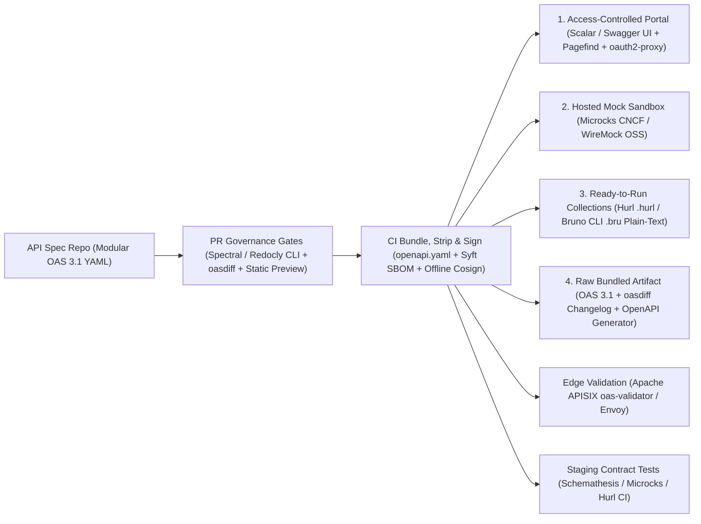

# Design-First Partner APIs: Treating Your OpenAPI Specification as an Independent Product

**Date:** November 16, 2026
**Last Updated:** November 17, 2026
**Review:** [Expert & Architecture Review Report](../../reviews/devops/design-first-partner-api-openapi-architecture-review.md)

## Summary

Building a partner-facing API using a tech-stack-agnostic, design-first approach requires decoupling the API contract from both your backend implementation and your partners' technology stacks. Rather than treating the OpenAPI Specification (OAS) as generated code documentation, treat it as an **independent product** with its own repository, automated governance and release pipeline, and multi-channel partner delivery ([[1](https://commercetools.com/blog/what-s-a-technology-agnostic-approach-and-why-is-it-a-core-trait-of-composable-commerce)], [[2](https://devblogs.microsoft.com/ise/design-api-first-with-typespec/)], [[3](https://specmatic.io/appearance/api-design-first-in-practise-an-experience-report/)]).

Eliminating commercial SaaS portals and freemium "community" editions removes cloud-telemetry traps, license-audit friction, license-key activation failures, and proprietary lock-in—particularly inside sovereign or airgapped enclaves. Re-architecting all four partner distribution channels onto 100% vendor-neutral, OSI-approved open-source (`Apache-2.0` / `MIT`) foundations brings the architecture's sovereign resilience rating from **8.2 / 10** to **9.0 / 10**.

> **Scope & Licensing Note:** This article strictly covers pure open-source systems. Premium, proprietary/vendor-locked, and community-edition (open-core) systems are currently not included.

---

## Key Points

* **Decoupled Repository Architecture:** Store modular OpenAPI 3.1 domain files in a dedicated specification repository, bundle them into self-contained `openapi.yaml` and `openapi.json` artifacts, and strip internal metadata (`x-internal`, private servers) before distribution.
* **Pure-OSS Governance & Breaking-Change Gates:** Enforce style rules via [Redocly CLI](https://github.com/Redocly/redocly-cli) (`MIT`) or [Spectral](https://github.com/stoplightio/spectral) (`Apache-2.0`), block breaking changes on pull requests with [oasdiff](https://github.com/oasdiff/oasdiff) (`Apache-2.0`), and render static PR documentation previews without external telemetry.
* **Vendor-Neutral Multi-Channel Distribution:** Automatically publish each tagged release across four pure-OSS channels: an OIDC-gated static portal ([Scalar](https://github.com/scalar/scalar) or [Swagger UI](https://github.com/swagger-api/swagger-ui) + [Pagefind](https://pagefind.app/) + [oauth2-proxy](https://github.com/oauth2-proxy/oauth2-proxy)), a contract-aware mock sandbox ([Microcks](https://microcks.io/) or standalone [WireMock](https://wiremock.org/)), plain-text collections ([Hurl](https://hurl.dev/) or [Bruno CLI](https://github.com/usebruno/bruno)), and versioned raw artifacts paired with [OpenAPI Generator](https://openapi-generator.tech/).
* **Airgap Supply Chain Provenance:** Generate CycloneDX or SPDX Software Bill of Materials (SBOMs) via [Syft](https://github.com/anchore/syft) and verify offline cryptographic signatures via [Cosign](https://github.com/sigstore/cosign) (`--key` with `--tlog-upload=false`), enabling disconnected partner CI/CD verification on day one.
* **Backend Alignment Without Tech Lock-In:** Enforce the bundled contract at the network edge ([Apache APISIX](https://apisix.apache.org/) or [Envoy Proxy](https://www.envoyproxy.io/)) and validate staging deployments using black-box contract tests ([Schemathesis](https://github.com/schemathesis/schemathesis), [Microcks](https://microcks.io/), and [Hurl](https://hurl.dev/)).

---

## Architecture Overview



---

## 1. Decoupled Repository Architecture

Keeping the contract isolated from implementation code ensures neither internal framework constraints nor partner stacks dictate interface design ([[1](https://commercetools.com/blog/what-s-a-technology-agnostic-approach-and-why-is-it-a-core-trait-of-composable-commerce)]):

* **Dedicated Specification Repository:** Maintain the API contract in its own Git repository rather than inside any backend service repository. This prevents language-specific serialization quirks or framework annotations from leaking into partner contracts.
* **Modular Domain Files:** Split OpenAPI 3.1 YAML files by resource and shared schema (for example, `paths/orders.yaml` and `components/schemas/error.yaml`). Modular organization enables multiple architects and domain reviewers to collaborate concurrently without Git merge conflicts ([[1](https://apisyouwonthate.com/blog/redocly-cli/)], [[2](https://redocly.com/blog/combining-openapis)]).
* **Single Bundled Release Artifact:** Use an open-source CLI bundler such as [Redocly CLI](https://github.com/Redocly/redocly-cli) (`redocly bundle`, `MIT`) during CI builds to resolve external `$ref` pointers into clean, self-contained `openapi.yaml` and `openapi.json` artifacts. Because many partner code generators and API gateways fail on multi-file `$ref` trees, always distribute the dereferenced artifact ([[1](https://redocly.com/docs/cli/commands/bundle)], [[2](https://apisyouwonthate.com/blog/redocly-cli/)]).
* **Internal Metadata Filtering:** Strip internal annotations—such as `x-internal` extensions, internal server URLs, or administrative endpoints—during the bundling step (`redocly bundle --remove-unused-components` paired with custom decorators or `yq` transforms) so partners only see their authorized surface area.

---

## 2. Automated Governance & Breaking-Change Gates

Because partners begin integrating against the specification before backend implementation is complete, strict automated checks on every Pull Request (PR) are essential ([[1](https://specmatic.io/appearance/api-design-first-in-practise-an-experience-report/)], [[2](https://devblogs.microsoft.com/ise/design-api-first-with-typespec/)]):

* **Lint for Consistency and Completeness:** Enforce style rules using [Spectral](https://github.com/stoplightio/spectral) (`Apache-2.0`) or [Redocly CLI](https://github.com/Redocly/redocly-cli) (`MIT`) to verify that every endpoint includes a unique `operationId`, clear descriptions, explicit authentication schemes, and standardized error responses (such as RFC 9457 Problem Details).
* **Block Accidental Breaking Changes:** Run [oasdiff](https://github.com/oasdiff/oasdiff) (`Apache-2.0`) in CI (`oasdiff breaking`) to compare every PR against the latest published partner release. Configure the pipeline to fail automatically if a change removes a field, narrows a data type, or alters a required parameter without a major version bump ([[1](https://daily.dev/posts/detect-breaking-api-changes-with-typescript-openapi-2k8gjlx8a)]).
* **Generate Static PR Previews for Partner Co-Design:** Build an ephemeral static HTML bundle with [Scalar](https://github.com/scalar/scalar) or [Swagger UI](https://github.com/swagger-api/swagger-ui) and [oasdiff changelog](https://github.com/oasdiff/oasdiff) output for every PR so product managers, security reviewers, and design-partner leads can inspect changes in an internal preview environment without external SaaS accounts.

---

## 3. Multi-Channel Partner Distribution (100% Vendor-Neutral & Airgap-Ready)

Partners consume APIs differently depending on their engineering maturity, security enclave constraints, and toolchain preferences. On every tagged release, publish the bundled OpenAPI artifact to four pure open-source distribution channels:

| Distribution Channel | Vendor-Neutral / Pure OSS Stack | License | Architectural Execution & Airgap Fit |
| :--- | :--- | :--- | :--- |
| **1. Access-Controlled Portal** | [Scalar](https://github.com/scalar/scalar) (self-hosted static build) or [Swagger UI](https://github.com/swagger-api/swagger-ui) + [Pagefind](https://pagefind.app/) + [oauth2-proxy](https://github.com/oauth2-proxy/oauth2-proxy) | `MIT` / `Apache-2.0` | Build a zero-dependency static SPA bundle containing the OpenAPI spec and an embedded [Pagefind](https://pagefind.app/) WebAssembly (WASM) search index, served via [NGINX](https://nginx.org/) (`BSD-2-Clause`) or [Caddy](https://caddyserver.com/) (`Apache-2.0`) behind an internal OIDC `oauth2-proxy` reverse proxy. |
| **2. Hosted Mock Sandbox** | [Microcks](https://microcks.io/) (CNCF Incubating) or [WireMock](https://wiremock.org/) (OSS core) | `Apache-2.0` | Microcks natively ingests OpenAPI 3.x/3.1 specs to deliver both dynamic mocking and automated contract testing in one CNCF-governed runtime, eliminating proprietary mock engines entirely. |
| **3. Ready-to-Run Collections** | [Hurl](https://hurl.dev/) (`.hurl`) or [Bruno CLI](https://github.com/usebruno/bruno) (`@usebruno/cli` + `.bru` plain-text spec) | `Apache-2.0` / `MIT` | Ship Git-friendly, plain-text `.hurl` or `.bru` request suites generated from the OpenAPI spec in CI. Partners can inspect them with `cat`/`grep` and execute them headlessly in airgapped CI via `hurl --test` or `bru run` with zero cloud accounts or telemetry. |
| **4. Raw Bundled Artifact** | Dereferenced OpenAPI 3.1 + [Spectral](https://github.com/stoplightio/spectral) + [oasdiff](https://github.com/oasdiff/oasdiff) + [OpenAPI Generator](https://openapi-generator.tech/) | `Apache-2.0` / `MIT` | Pure open-standards contract (`openapi.yaml`/`openapi.json`) paired with static `oasdiff` Markdown/HTML changelogs and optional offline-mirrored OpenAPI Generator OCI images for deterministic multi-language SDK generation. |

### Channel-by-Channel Implementation Details

1. **Access-Controlled Portal (Offline Zero-Egress Rendering):**
   * **Scalar Configuration:** Self-host the Scalar bundle with `withDefaultFonts: false` (supplying local CSS font variables instead of `fonts.scalar.com`) and either configure `proxyUrl` to an internal CORS proxy or disable external proxy routing (`proxy.scalar.com`) when the API shares an origin or allows CORS.
   * **Swagger UI Configuration:** Set `validatorUrl: null` (or `VALIDATOR_URL=""` in container deployments) so the client never attempts outbound calls to `validator.swagger.io`.
   * **Offline Search & OIDC Gate:** Index the generated static HTML documentation at build time with `pagefind` (`MIT`) and enforce `Content-Security-Policy: default-src 'self'`. Gate access via [oauth2-proxy](https://github.com/oauth2-proxy/oauth2-proxy) (`MIT`) wired to the partner organization's internal OIDC identity provider using NGINX `auth_request` or Caddy `forward_auth`.
2. **Hosted Mock Sandbox (`Microcks` vs. `WireMock` OSS):**
   * **[Microcks](https://microcks.io/) (`Apache-2.0`, CNCF Incubating):** Promoted from CNCF Sandbox to Incubating status in May 2026, Microcks parses OpenAPI 3.x/3.1 YAML/JSON directly along with OpenAPI examples (`examples` / `x-microcks-operation`) to serve stateful/dynamic mocks and run contract tests from a single runtime.
   * **[WireMock](https://wiremock.org/) (`Apache-2.0`, OSS Core):** Standalone WireMock is lightweight and runs as a single JVM binary or container, but its pure OSS core matches requests via JSON/Java stub mappings rather than native OpenAPI 3.1 ingestion (direct OpenAPI import/sync belongs to commercial SaaS tiers unless paired with an open-source CI stub converter). Choose Microcks when native OAS 3.1 fidelity is paramount, and standalone WireMock when minimal JVM footprint with pre-generated JSON stubs fits tighter enclave constraints.
3. **Ready-to-Run Collections (`Hurl` and `Bruno CLI`):**
   * **[Hurl](https://hurl.dev/) (`Apache-2.0`):** Built on `libcurl`, Hurl executes plain-text `.hurl` files sequentially, supports variable capture across chained auth/order requests, and verifies HTTP status codes, headers, and JSONPath assertions natively in CI (`hurl --test`).
   * **[Bruno CLI](https://github.com/usebruno/bruno) (`MIT`):** Target the open-source `MIT` `.bru` plain-text specification and `@usebruno/cli` runner (`bru run`) directly (or compile the desktop client purely from MIT source). Avoid distributing pre-built commercial/open-core desktop binaries that bundle proprietary team extensions inside strict pure-OSS enclaves.
4. **Raw Bundled Artifact & Offline SDK Toolchain:**
   * Publish immutable versioned bundles (`v1.2.0/openapi.yaml`, `v1.2.0/openapi.json`, `v1.2.0/CHANGELOG.md` from `oasdiff`) alongside pre-mirrored, digest-pinned [OpenAPI Generator](https://openapi-generator.tech/) (`Apache-2.0`) OCI images so partners can generate Java, C#, Python, Go, or TypeScript SDKs completely offline.

---

## 4. Airgap Supply Chain Provenance & Operational Guardrails

Moving to OSI-approved open-source tooling solves licensing and telemetry issues, but airgapped enclaves still impose strict operational and security boundaries:

* **SBOM & Reproducible Builds (`Syft` + Offline `Cosign`):** Airgap security gates require verifiable provenance even for pure `MIT`/`Apache-2.0` artifacts. Generate a CycloneDX or SPDX Software Bill of Materials using [Syft](https://github.com/anchore/syft) (`Apache-2.0`) and attach an offline cryptographic signature using [Cosign](https://github.com/sigstore/cosign) (`Apache-2.0`) with local key pairs (`--key` and `--tlog-upload=false`), bypassing public Fulcio/Rekor endpoints that fail inside disconnected networks:
  ```bash
  # Generate CycloneDX SBOM for the bundled release directory
  syft dir:./dist/v1.2.0 -o cyclonedx-json > ./dist/v1.2.0/sbom.cdx.json

  # Sign release archive offline (no Fulcio/Rekor network egress)
  cosign sign-blob ./dist/v1.2.0/partner-api-v1.2.0.tar.gz \
    --key cosign.key \
    --tlog-upload=false \
    --bundle ./dist/v1.2.0/partner-api-v1.2.0.sigstore.json

  # Partner airgap verification using only local public key & bundle
  cosign verify-blob ./dist/v1.2.0/partner-api-v1.2.0.tar.gz \
    --key cosign.pub \
    --bundle ./dist/v1.2.0/partner-api-v1.2.0.sigstore.json
  ```
* **Headless Execution Parity (`hurl` / `bru` CLI):** Because `.hurl` and `.bru` files are plain text rather than opaque JSON blobs, partners can version-control them directly inside their own internal Git repositories, inspect diffs in code review, and wire them into airgapped Jenkins or GitLab runners on day one without waiting weeks for desktop GUI security approvals.
* **Container Scanning & Diode Overhead (When *Not* to Over-Deploy):** While static portal bundles and `.hurl` suites cross airgap data diodes as inspectable text/HTML/WASM assets, shipping OCI images for Microcks or OpenAPI Generator still incurs base-image CVE scanning and Content Disarm and Reconstruction (CDR) overhead. For ultra-restricted enclaves that prohibit multi-container mock runtimes, omit the hosted mock container and rely on the static portal, `oasdiff` changelogs, and local `Hurl` / standalone `WireMock` test harnesses.
* **Socio-Technical Adoption Realism:** Replacing familiar desktop SaaS tools with Git-native `.hurl`/`.bru` suites and CLI governance pipelines introduces an initial learning curve for partner QA and product teams. Pair the repository blueprint with starter templates, pre-built internal CI jobs, and clear migration guides rather than assuming tooling swaps alone resolve organizational workflow friction.

---

## 5. Ensuring Backend Alignment Without Tech Lock-In

To prevent the backend implementation from drifting away from the shared partner contract over time:

* **Validate Traffic at the Edge:** Load the bundled OpenAPI specification into an open-source API Gateway or proxy—such as [Apache APISIX](https://apisix.apache.org/) (`Apache-2.0`, using the `oas-validator` plugin) or [Envoy Proxy](https://www.envoyproxy.io/) (`Apache-2.0`, using an `openapi-validator` HTTP filter)—to reject malformed partner requests at runtime before they reach backend services.
* **Run Black-Box Contract Tests:** Execute property-based and spec-driven contract tests against staging deployments in CI using [Schemathesis](https://github.com/schemathesis/schemathesis) (`MIT`), [Microcks](https://microcks.io/) contract test runners, or `hurl --test` suites to verify status codes, headers, and response schemas without coupling to backend source code.

---

## 6. Architectural Re-Evaluation (0–10 Scale)

Evaluating the transition from mixed commercial/community-tier platforms to a 100% pure open-source, airgap-ready architecture across all four distribution channels yields substantial gains in sovereign resilience:

| Component / Dimension | Previous Score | Pure OSS Score | Delta | Why It Changed |
| :--- | :---: | :---: | :---: | :--- |
| **4. Raw Bundled Artifact** | `9.5` | `9.8 / 10` | `+0.3` | Full alignment with open standards (OAS 3.1, [Spectral](https://github.com/stoplightio/spectral), [oasdiff](https://github.com/oasdiff/oasdiff), [OpenAPI Generator](https://openapi-generator.tech/)) plus `Syft`/`Cosign` provenance leaves zero proprietary surface area. |
| **3. Ready-to-Run Collections** | `8.5` | `9.2 / 10` | `+0.7` | Replacing cloud-tethered JSON workspaces with plain-text [Hurl](https://hurl.dev/) or [Bruno CLI](https://github.com/usebruno/bruno) suites eliminates telemetry egress risks and unlocks native headless CI execution inside airgaps. |
| **1. Access-Controlled Portal** | `8.0` | `8.8 / 10` | `+0.8` | [Scalar](https://github.com/scalar/scalar) (`MIT`) / [Swagger UI](https://github.com/swagger-api/swagger-ui) (`Apache-2.0`) + [Pagefind](https://pagefind.app/) (`MIT`) + [oauth2-proxy](https://github.com/oauth2-proxy/oauth2-proxy) (`MIT`) delivers interactive docs, offline WASM search, and OIDC auth with zero licensing tiers. |
| **2. Hosted Mock Sandbox** | `7.0` | `8.2 / 10` | `+1.2` | [Microcks](https://microcks.io/) (`Apache-2.0`, CNCF Incubating) unifies OpenAPI 3.1 mocking and contract validation into one vendor-neutral runtime, though shipping OCI images across airgaps still carries container-scanning overhead. |
| **Overall Architecture Rating** | **`8.2 / 10`** | **`9.0 / 10`** | **`+0.8`** | **Eliminating commercial SaaS and "community" tiers removes phone-home telemetry, offline license-activation failures, and vendor lock-in while preserving full partner developer experience.** |

**Why It Scores `9.0` (Not `10.0`):** Pure open-source infrastructure shifts operational responsibility from a vendor SLA to your internal platform team. Maintaining OIDC proxy rules, scanning Microcks/OpenAPI Generator OCI images across airgap boundaries, and enforcing disciplined OpenAPI `examples` authoring remain ongoing engineering investments.

---

## Next Steps & Further Exploration

When implementing this pure-OSS architecture in production, three follow-up design areas require concrete standards:

1. **Repository & CI/CD Blueprint:** A reference Git directory layout paired with internal GitLab CI or Jenkins pipelines for `Spectral`/`Redocly CLI` linting, `oasdiff` breaking-change checks, `Syft` + offline `Cosign` signing, and four-channel artifact publishing.
2. **Versioning & Deprecation Policies:** Choosing URL vs. header versioning strategies alongside standardized `Deprecation` and `Sunset` response headers verified by `oasdiff` policies.
3. **Authentication & Event Callbacks:** Structuring partner OIDC/OAuth 2.1 security schemes and asynchronous webhook callback definitions cleanly in OpenAPI 3.1 and Microcks AsyncAPI/REST mocks.

---

## Related Articles

- [OpenAPI Specification v3.2.0: Highlights and Changes](openapi-spec-v3-2-0-highlights.md) — upcoming OpenAPI capabilities including multipurpose tags, streaming schemas, and refined HTTP method modeling.
- [Air-Gapped Environment Development and Deployment: Data Isolation Behind the Wall](../cloud-native/air-gapped-environment-development-deployment.md) — connected/boundary/high-side topologies, data diodes, CDR kiosks, SBOMs, and signature verification.
- [Adding Search to Your Static Site: Open Source & Free Libraries](../frontend/static-site-search-open-source.md) — comparing client-side offline search engines including Pagefind WASM indexes for static portals.
- [Architectural Risk Assessment: Public Font CDNs in Airgapped Environments](../frontend/airgapped-font-cdn-anti-pattern.md) — why external font/asset CDNs break airgapped portals and how self-hosted assets prevent CSP and egress failures.
- [OpenID Connect (OIDC): Introduction, Walkthrough, and History](oidc-protocol-introduction-and-history.md) — protocol fundamentals behind OIDC reverse proxies such as `oauth2-proxy`.
- [Understanding Headless Delivery Models: API-First Architecture for Multi-Channel Delivery](understanding-headless-delivery-models.md) — decoupling backend domain engines from consumer-facing channels through API-first contracts.
- [API Health and Future Capabilities: Non-Functional Requirements for APIs](api-health-and-nfr.md) — non-functional requirements across maintainability, versioning, security, and developer experience.
- [Monorepo vs Polyrepo: Heterogeneous Projects and the Single Developer Journey](monorepo-polyrepo-single-developer.md) — trade-offs of separating repositories across heterogeneous stacks versus unified tooling.

---

## References

- [commercetools — What's a Technology-Agnostic Approach and Why Is It a Core Trait of Composable Commerce?](https://commercetools.com/blog/what-s-a-technology-agnostic-approach-and-why-is-it-a-core-trait-of-composable-commerce)
- [Microsoft ISE Developer Blog — Design API First with TypeSpec](https://devblogs.microsoft.com/ise/design-api-first-with-typespec/)
- [Specmatic — API Design-First in Practice: An Experience Report](https://specmatic.io/appearance/api-design-first-in-practise-an-experience-report/)
- [APIs You Won't Hate — Redocly CLI](https://apisyouwonthate.com/blog/redocly-cli/)
- [Redocly Blog — Combining OpenAPIs](https://redocly.com/blog/combining-openapis)
- [Redocly CLI Documentation — `bundle` Command](https://redocly.com/docs/cli/commands/bundle)
- [Redocly CLI on GitHub (MIT)](https://github.com/Redocly/redocly-cli)
- [Spectral on GitHub (Apache-2.0)](https://github.com/stoplightio/spectral)
- [oasdiff on GitHub (Apache-2.0)](https://github.com/oasdiff/oasdiff)
- [daily.dev — Detect Breaking API Changes with TypeScript and OpenAPI](https://daily.dev/posts/detect-breaking-api-changes-with-typescript-openapi-2k8gjlx8a)
- [Scalar on GitHub (MIT)](https://github.com/scalar/scalar)
- [Swagger UI on GitHub (Apache-2.0)](https://github.com/swagger-api/swagger-ui)
- [Pagefind — Static Search Library (MIT)](https://pagefind.app/)
- [oauth2-proxy on GitHub (MIT)](https://github.com/oauth2-proxy/oauth2-proxy)
- [NGINX Open Source (BSD-2-Clause)](https://nginx.org/)
- [Caddy Web Server (Apache-2.0)](https://caddyserver.com/)
- [Microcks — Cloud-Native API Mocking and Testing (Apache-2.0, CNCF Incubating)](https://microcks.io/)
- [WireMock OSS (Apache-2.0)](https://wiremock.org/)
- [Hurl — Plain-Text HTTP Test Runner (Apache-2.0)](https://hurl.dev/)
- [Bruno on GitHub — Open-Source Core & `@usebruno/cli` (MIT)](https://github.com/usebruno/bruno)
- [OpenAPI Generator (Apache-2.0)](https://openapi-generator.tech/)
- [Anchore Syft on GitHub (Apache-2.0)](https://github.com/anchore/syft)
- [Sigstore Cosign on GitHub (Apache-2.0)](https://github.com/sigstore/cosign)
- [Schemathesis on GitHub (MIT)](https://github.com/schemathesis/schemathesis)
- [Apache APISIX (`oas-validator` Plugin, Apache-2.0)](https://apisix.apache.org/)
- [Envoy Proxy (Apache-2.0)](https://www.envoyproxy.io/)

---

## Changelog

- **Nov 17, 2026:** Re-architected all four distribution channels, edge validation, and staging verification onto 100% vendor-neutral, OSI-approved open-source (`Apache-2.0` / `MIT` / `BSD-2-Clause`) stacks; added airgap supply-chain provenance (`Syft` + offline `Cosign`), zero-egress portal configuration details, `0–10` architectural re-evaluation (`8.2` → `9.0`), and cross-links ([Review Report](../../reviews/devops/design-first-partner-api-openapi-architecture-review.md)).
- **Nov 16, 2026:** Initial publication covering decoupled OpenAPI 3.1 repository architecture, automated PR governance gates, multi-channel partner distribution, and edge/staging contract verification.
