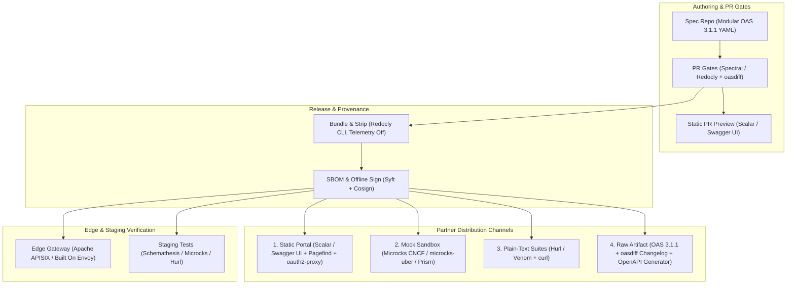

# Design-First Partner APIs: Treating Your OpenAPI Specification as an Independent Product

**Date:** November 16, 2026
**Last Updated:** November 26, 2026
**Review:** [Expert & Architecture Review Report](../../reviews/devops/design-first-partner-api-openapi-architecture-review.md)

## Summary

Building a partner-facing API using a tech-stack-agnostic, design-first approach requires decoupling the API contract from both your backend implementation and your partners' technology stacks. Rather than treating the OpenAPI Specification (OAS) as generated code documentation, treat it as an **independent product** with its own repository, automated governance and release pipeline, and multi-channel partner delivery ([[1](https://commercetools.com/blog/what-s-a-technology-agnostic-approach-and-why-is-it-a-core-trait-of-composable-commerce)], [[2](https://devblogs.microsoft.com/ise/design-api-first-with-typespec/)], [[3](https://specmatic.io/appearance/api-design-first-in-practise-an-experience-report/)]).

Coupling partner portals, mock sandboxes, and request collections to commercial SaaS platforms or open-core ("community edition") tiers introduces outbound telemetry traps, offline license-activation failures, paywalled core features, and long-term vendor lock-in—particularly inside regulated, sovereign, or airgapped enclaves. Standardizing all four partner distribution channels, edge validation, and black-box contract testing on pure, OSI-approved open-source (`Apache-2.0` / `MIT` / `BSD-2-Clause`) foundations eliminates external runtime dependencies while preserving a complete partner developer experience.

> **Scope & Licensing Note:** This article strictly covers pure open-source systems. Premium, proprietary/vendor-locked, and community-edition (open-core) systems are currently not included.

---

## Key Points

* **Decoupled Spec Repository:** Maintain modular OpenAPI 3.1.1 files in a dedicated Git repository, bundle them into self-contained `openapi.yaml`/`openapi.json` artifacts with [Redocly CLI](https://github.com/Redocly/redocly-cli), and strip internal metadata before distribution.
* **Automated PR Governance:** Enforce API style consistency via [Spectral](https://github.com/stoplightio/spectral) or [Redocly CLI](https://github.com/Redocly/redocly-cli), block accidental breaking changes on every pull request with [oasdiff](https://github.com/oasdiff/oasdiff), and publish static PR previews without external SaaS accounts.
* **Zero-Egress Multi-Channel Delivery:** Publish each tagged release across four pure-OSS channels: an authenticated static portal ([Scalar](https://github.com/scalar/scalar) + [Pagefind](https://pagefind.app/)), a contract-aware mock sandbox ([Microcks](https://microcks.io/)), plain-text executable collections ([Hurl](https://hurl.dev/)), and versioned specs paired with [OpenAPI Generator](https://openapi-generator.tech/).
* **Airgap Supply Chain Provenance:** Generate CycloneDX or SPDX Software Bill of Materials (SBOMs) with [Syft](https://github.com/anchore/syft) and verify offline cryptographic signatures with [Cosign](https://github.com/sigstore/cosign) so disconnected partner pipelines can validate releases before ingestion.
* **Tech-Agnostic Backend Alignment:** Enforce request contracts at the network edge ([Apache APISIX](https://apisix.apache.org/) or [Built On Envoy](https://builtonenvoy.io/extensions/openapi-validator)) and validate staging deployments using black-box contract tests ([Schemathesis](https://github.com/schemathesis/schemathesis) and [Microcks](https://microcks.io/)).

---

## Architecture Overview

Code-first APIs bottleneck partner onboarding by forcing integrators to wait on backend sprints while leaking internal framework quirks into public contracts. Meanwhile, SaaS-tethered developer portals fail security reviews when partners operate behind strict egress controls or sovereign enclave boundaries. Decoupling the contract into its own release pipeline enables parallel partner integration and offline verification from day one.



---

## 1. Decoupled Repository Architecture

Keeping the contract isolated from implementation code ensures neither internal framework constraints nor partner stacks dictate interface design ([[1](https://commercetools.com/blog/what-s-a-technology-agnostic-approach-and-why-is-it-a-core-trait-of-composable-commerce)]), mirroring the principles of [headless API-first delivery](understanding-headless-delivery-models.md):

```text
partner-api-spec/
├── openapi.yaml                  # Root OpenAPI 3.1.1 entrypoint
├── redocly.yaml                  # Lint rules, telemetry: off, x-internal decorators
├── paths/
│   ├── orders.yaml               # Resource-scoped path definitions
│   └── webhooks.yaml             # Partner callback webhook definitions
├── components/
│   ├── schemas/                  # Shared domain models & RFC 9457 error schema
│   ├── examples/                 # Realistic payloads powering mocks & docs
│   └── securitySchemes/          # OAuth 2.1 / OIDC definitions
├── collections/                  # CI-verified .hurl / Venom request suites
└── dist/                         # Tagged release bundles, changelogs, SBOMs, signatures
```

* **Dedicated Specification Repository:** Maintain the API contract in its own Git repository rather than inside any backend service repository. This prevents language-specific serialization quirks or framework annotations from leaking into partner contracts and simplifies tracking future [OpenAPI specification evolutions](openapi-spec-v3-2-0-highlights.md).
* **Modular Domain Files:** Split [OpenAPI 3.1.1](https://spec.openapis.org/oas/v3.1.1.html) YAML files by resource and shared schema (for example, `paths/orders.yaml` and `components/schemas/error.yaml`). Modular organization enables multiple architects and domain reviewers to collaborate concurrently without Git merge conflicts ([[1](https://apisyouwonthate.com/blog/redocly-cli/)], [[2](https://redocly.com/blog/combining-openapis)]).
* **Bundled vs. Fully Dereferenced Release Artifacts:** Use [Redocly CLI](https://github.com/Redocly/redocly-cli) (`redocly bundle`, `MIT`) during CI builds to combine external multi-file `$ref` trees into self-contained `openapi.yaml` and `openapi.json` artifacts whose references resolve to local `#/components/...` pointers ([[1](https://redocly.com/docs/cli/commands/bundle)], [[2](https://apisyouwonthate.com/blog/redocly-cli/)]). **Distribute bundled artifacts by default rather than fully dereferenced ones (`--dereferenced`):** full dereferencing inlines every schema at every call site, which breaks circular schema references (such as nested category trees) and degrades [OpenAPI Generator](https://openapi-generator.tech/) output into anonymous duplicate models instead of clean named classes.
* **Internal Metadata Filtering & Zero Telemetry:** Configure Redocly CLI's built-in `remove-x-internal` and `remove-unused-components` decorators in `redocly.yaml` to strip internal annotations (`x-internal: true`), private server URLs, and administrative endpoints during bundling so partners only see their authorized surface area. Always set `REDOCLY_TELEMETRY=off` in CI (or `telemetry: off` in `redocly.yaml`) to disable Redocly CLI's default opt-out telemetry inside airgapped and sovereign pipelines.

---

## 2. Automated Governance & Breaking-Change Gates

Because partners begin integrating against the specification before backend implementation is complete, strict automated checks on every Pull Request (PR) are essential ([[1](https://specmatic.io/appearance/api-design-first-in-practise-an-experience-report/)], [[2](https://devblogs.microsoft.com/ise/design-api-first-with-typespec/)]):

* **Lint for Consistency and Completeness:** Enforce style rules using [Spectral](https://github.com/stoplightio/spectral) (`Apache-2.0`) or [Redocly CLI](https://github.com/Redocly/redocly-cli) (`MIT`) to verify that every endpoint includes a unique `operationId`, clear descriptions, realistic `examples`, explicit authentication schemes, and standardized error responses using [IETF RFC 9457 Problem Details](https://www.rfc-editor.org/rfc/rfc9457) (standardized JSON HTTP error payloads).
* **Block Accidental Breaking Changes:** Run [oasdiff](https://github.com/oasdiff/oasdiff) (`Apache-2.0`) in CI (`oasdiff breaking`) to compare every PR against the latest published partner release ([[1](https://daily.dev/posts/detect-breaking-api-changes-with-typescript-openapi-2k8gjlx8a)], [Breaking Changes Guide](https://github.com/oasdiff/oasdiff/blob/main/docs/BREAKING-CHANGES.md)). Configure the pipeline to fail automatically if a change removes a field, narrows a data type, or alters a required parameter without a major version bump.
* **OpenAPI 3.1 `oasdiff` Caveats:** Because `oasdiff` relies on Go's `kin-openapi` parser, test advanced JSON Schema 2020-12 constructs—particularly `$dynamicRef`/`$dynamicAnchor` resolution and `components.pathItems`—early in your governance ruleset, and pass `--auto-upgrade` whenever diffing a legacy OpenAPI 3.0 release against a new OpenAPI 3.1.1 PR.
* **Generate Static PR Previews for Partner Co-Design:** Build an ephemeral static HTML bundle with [Scalar](https://github.com/scalar/scalar) or [Swagger UI](https://github.com/swagger-api/swagger-ui) alongside `oasdiff changelog` output for every PR so product managers, security reviewers, and design-partner leads can inspect changes internally without external SaaS accounts.

```bash
# Minimal pure-OSS PR governance gate (zero external telemetry)
export REDOCLY_TELEMETRY=off
redocly lint openapi.yaml
redocly bundle openapi.yaml -o dist/candidate/openapi.yaml
oasdiff breaking dist/latest/openapi.yaml dist/candidate/openapi.yaml --fail-on ERR
oasdiff changelog dist/latest/openapi.yaml dist/candidate/openapi.yaml -f markdown > dist/candidate/CHANGELOG.md
```

---

## 3. Multi-Channel Partner Distribution (100% Vendor-Neutral & Airgap-Ready)

Partners consume APIs differently depending on their engineering maturity, security enclave constraints, and toolchain preferences. On every tagged release, publish the bundled OpenAPI artifact across four pure open-source distribution channels:

| Distribution Channel | Pure-OSS Stack | License | Role & Airgap Fit |
| :--- | :--- | :--- | :--- |
| **1. Access-Controlled Portal** | [Scalar](https://github.com/scalar/scalar) or [Swagger UI](https://github.com/swagger-api/swagger-ui) + [Pagefind](https://pagefind.app/) + [oauth2-proxy](https://github.com/oauth2-proxy/oauth2-proxy) + [NGINX](https://nginx.org/) / [Caddy](https://caddyserver.com/) | `MIT` / `Apache-2.0` / `BSD-2-Clause` | Interactive reference docs with offline WASM search and authenticated internal access; ships as static files with zero external network egress. |
| **2. Hosted Mock Sandbox** | [Microcks](https://microcks.io/) (CNCF Incubating, including `microcks-uber`) or [Prism](https://github.com/stoplightio/prism) | `Apache-2.0` | Live contract-driven mocking and conformance testing directly from OpenAPI 3.1.1 specs and `examples`, from multi-team clusters down to single containers or stateless CLIs. |
| **3. Ready-to-Run Collections** | [Hurl](https://hurl.dev/) (`.hurl`) paired with `curl` scripts or [OVH Venom](https://github.com/ovh/venom) (`.yml`) | `Apache-2.0` / `curl` | Git-friendly, plain-text request suites inspectable via `cat`/`grep` and executable headlessly in disconnected CI with zero desktop GUI dependencies. |
| **4. Raw Bundled Artifact** | Bundled [OpenAPI 3.1.1](https://spec.openapis.org/oas/v3.1.1.html) + [Spectral](https://github.com/stoplightio/spectral) + [oasdiff](https://github.com/oasdiff/oasdiff) + [OpenAPI Generator](https://openapi-generator.tech/) | `Apache-2.0` / `MIT` | Canonical open-standards contract paired with generated changelogs and offline-mirrored OCI images for deterministic multi-language SDK generation. |

### Channel-by-Channel Implementation Details

1. **Access-Controlled Portal (Offline Zero-Egress Rendering & Multi-Tenant Isolation):**
   * **Eliminating Hidden Egress:** Self-host Scalar with `withDefaultFonts: false` (supplying local CSS fonts rather than `fonts.scalar.com`—see [Public Font CDNs in Airgapped Environments](../frontend/airgapped-font-cdn-anti-pattern.md)) and disable `proxy.scalar.com` (routing interactive requests through an internal CORS proxy or same-origin gateway). For Swagger UI, set `validatorUrl: null` (or `VALIDATOR_URL=""`) so clients never phone home to `validator.swagger.io`.
   * **Indexing SPA Docs with Pagefind:** Because Scalar and Swagger UI render dynamically in the browser over an empty HTML shell on disk, running a default `pagefind --site` crawl indexes almost nothing. Instead, populate [Pagefind](https://pagefind.app/) (`MIT`, compared in [Adding Search to Your Static Site](../frontend/static-site-search-open-source.md)) at build time via its programmatic Node Indexing API (`pagefind.createIndex()` + `index.addCustomRecord(...)` iterating over bundled OpenAPI paths, summaries, operation IDs, and schema descriptions), or index pre-rendered static HTML documentation alongside the interactive explorer.
   * **WASM- and SPA-Compatible CSP:** A bare `Content-Security-Policy: default-src 'self'` breaks both Pagefind's WebAssembly search engine and client-side API explorers. Configure a tight but functional policy:
     ```http
     Content-Security-Policy: default-src 'self'; script-src 'self' 'wasm-unsafe-eval'; worker-src 'self' blob:; style-src 'self' 'unsafe-inline'; img-src 'self' data:; connect-src 'self' https://api.partner.internal
     ```
     *(If blob web workers are disallowed by enclave policy, disable worker mode where supported or serve worker scripts from `'self'`.)*
   * **OIDC Gate & Partner-Tier Filtering:** Gate portal access via [oauth2-proxy](https://github.com/oauth2-proxy/oauth2-proxy) (`MIT`) wired to your internal OpenID Connect (OIDC, an identity layer built atop OAuth 2.0—see [OIDC Introduction and History](oidc-protocol-introduction-and-history.md)) provider using NGINX `auth_request` or Caddy `forward_auth`. Remember that binary `oauth2-proxy` authentication **cannot filter endpoints inside a shared static SPA bundle**: when partner tiers have different endpoint entitlements, run `redocly bundle` with tier-filtering decorators (e.g., `x-partner-tier`) to build isolated static `Scalar` + `Pagefind` bundles per entitlement tier and route partners by OIDC group claims.

2. **Hosted Mock Sandbox (`Microcks`, `microcks-uber`, and `Prism`):**
   * **[Microcks](https://microcks.io/) (`Apache-2.0`, CNCF Incubating):** Promoted to CNCF Incubating in May 2026 ([CNCF announcement](https://www.cncf.io/blog/2026/05/07/microcks-becomes-a-cncf-incubating-project/)), Microcks ingests OpenAPI 3.0/3.1 YAML/JSON directly along with OpenAPI `examples` and `x-microcks-operation` dispatchers to serve dynamic mocks and run automated conformance tests from a single vendor-neutral runtime.
   * **Lightweight `microcks-uber` & Stateless `Prism`:** For constrained enclaves, CI pipelines, or local Testcontainers setups that cannot justify running an external MongoDB cluster, deploy the single-container `quay.io/microcks/microcks-uber` distribution (all-in-one embedded persistence). When partners only need stateless CLI request validation and mock responses from a spec file, pair Microcks with [Prism](https://github.com/stoplightio/prism) (`Apache-2.0`).
   * **Multi-Tenant Mock Isolation:** Stateful mock sandboxes leak test data across partners if everyone mutates one shared deployment. Isolate stateful `Microcks` sandboxes per partner namespace/instance, enforce scheduled deterministic state resets, or ship ephemeral `microcks-uber` containers that partners spin up inside their own CI jobs.

3. **Ready-to-Run Collections (`Hurl`, `curl`, and `Venom`):**
   * **[Hurl](https://hurl.dev/) (`Apache-2.0`) + `curl`:** Built on `libcurl`, Hurl executes plain-text `.hurl` files sequentially, captures variables across chained authentication and resource requests, and asserts HTTP status codes, headers, and JSONPath payloads natively in CI (`hurl --test`). Pair `.hurl` suites with minimal `curl` snippets for zero-install debugging, or use [OVH Venom](https://github.com/ovh/venom) (`Apache-2.0`) when partner integration tests span HTTP alongside message queues or database assertions.
   * **Preventing Collection Drift in CI:** Never let `.hurl` suites rot into stale documentation. Generate baseline `.hurl` templates from bundled OpenAPI `examples` and execute `hurl --test` against an ephemeral `microcks-uber` or `prism` instance loaded with the candidate `openapi.yaml` on every PR so broken paths, renamed fields, or invalid auth headers fail the build immediately.
     ```hurl
     # collections/orders-create.hurl — chained auth & contract assertion
     POST {{base_url}}/v1/orders
     Authorization: Bearer {{partner_token}}
     Content-Type: application/json
     {
       "externalRef": "PO-2026-0042",
       "currency": "USD"
     }
     HTTP 201
     [Asserts]
     header "Content-Type" contains "application/json"
     jsonpath "$.status" == "ACCEPTED"
     [Captures]
     order_id: jsonpath "$.id"
     ```

4. **Raw Bundled Artifact & Offline SDK Toolchain:**
   * Publish immutable, **bundled** (not `--dereferenced`) versioned artifacts (`v1.2.0/openapi.yaml`, `v1.2.0/openapi.json`, `v1.2.0/CHANGELOG.md` from `oasdiff`) alongside pre-mirrored, digest-pinned [OpenAPI Generator](https://openapi-generator.tech/) (`Apache-2.0`) OCI images so partners can generate Java, C#, Python, Go, or TypeScript SDKs completely offline.
   * **OpenAPI 3.1 Codegen Edge Cases:** [OpenAPI Generator](https://openapi-generator.tech/)'s OpenAPI 3.1 support remains uneven across language generators—specifically for JSON Schema 2020-12 multi-type arrays (`type: ["string", "null"]`), `$ref` siblings, and keywords such as `prefixItems`, `if`/`then`/`else`, and `unevaluatedProperties`. Mitigate breakage by enforcing generator-safe lint rules in `Spectral`/`Redocly` (for example, preferring explicit `oneOf` or `anyOf` patterns verified against your target SDK languages) and testing `--openapi-normalizer` options in CI before tagging a release.

---

## 4. Airgap Supply Chain Provenance & Operational Guardrails

Moving to OSI-approved open-source tooling removes licensing and telemetry blockers, but sovereign and [air-gapped environments](../cloud-native/air-gapped-environment-development-deployment.md) still impose strict provenance, key-management, and organizational guardrails:

* **SBOM Generation & Offline `Cosign` Verification:** Airgap security gates require verifiable provenance even for pure `MIT`/`Apache-2.0` artifacts. Generate a [CycloneDX](https://cyclonedx.org/specification/overview/) or [SPDX](https://spdx.dev/use/specifications/) SBOM using [Syft](https://github.com/anchore/syft) (`Apache-2.0`) and attach an offline cryptographic signature using [Cosign](https://github.com/sigstore/cosign) (`Apache-2.0`) with `--tlog-upload=false`, bypassing public Fulcio/Rekor endpoints (Sigstore's public keyless certificate authority and transparency log) that fail inside disconnected networks. In Cosign v2+, verification of an offline bundle **requires `--insecure-ignore-tlog`**:
  ```bash
  # Generate CycloneDX SBOM for the bundled release directory
  syft dir:./dist/v1.2.0 -o cyclonedx-json > ./dist/v1.2.0/sbom.cdx.json

  # Sign release archive offline using an HSM/KMS-backed key (no Fulcio/Rekor egress)
  cosign sign-blob ./dist/v1.2.0/partner-api-v1.2.0.tar.gz \
    --key "pkcs11:token=release-hsm;object=api-signing-key" \
    --tlog-upload=false \
    --bundle ./dist/v1.2.0/partner-api-v1.2.0.sigstore.json

  # Partner airgap verification using only out-of-band public key & bundle
  cosign verify-blob ./dist/v1.2.0/partner-api-v1.2.0.tar.gz \
    --key cosign.pub \
    --insecure-ignore-tlog \
    --bundle ./dist/v1.2.0/partner-api-v1.2.0.sigstore.json
  ```
* **Offline Key Custody, Rotation & Private Sigstore:** Never store raw `cosign.key` PEM files on CI runner disks—back signing operations with a Hardware Security Module (HSM, via PKCS#11) or enclave Key Management Service (KMS). Distribute `cosign.pub` out-of-band as a verified trust anchor, enforce a documented rotation cadence, and maintain an explicit partner trust-anchor allowlist/revocation procedure since Rekor cannot attest revocation offline. When long-term timestamped verification across key rotations is mandatory, deploy an internal private Sigstore instance (private Rekor transparency log plus an RFC 3161 Timestamp Authority) inside the enclave rather than relying indefinitely on `--insecure-ignore-tlog`.
* **Headless Execution on Pure-OSS CI Runners:** Because `.hurl` and `Venom` YAML suites are inspectable plain text rather than opaque binary workspaces, partners can commit them directly into internal Git repositories, review diffs in pull requests, and run them headlessly inside airgapped [Jenkins](https://www.jenkins.io/) (`MIT`), [Woodpecker CI](https://woodpecker-ci.org/) (`Apache-2.0`), [Forgejo Actions](https://forgejo.org/) (`GPL-3.0`), or [Tekton](https://tekton.dev/) (`Apache-2.0`) pipelines on day one without waiting weeks for desktop GUI approvals.

> **Guardrail — When *Not* to Over-Deploy a Hosted Mock Container:** While static portal bundles and `.hurl` suites cross airgap data diodes (one-way hardware network transfer boundaries) as inspectable text, HTML, and WASM assets, shipping OCI container images for `Microcks` or `OpenAPI Generator` incurs base-image CVE scanning and Content Disarm and Reconstruction (CDR) overhead. For ultra-restricted enclaves that prohibit persistent multi-container mock clusters, omit the hosted mock server and rely on the static portal, `oasdiff` changelogs, and local `Hurl` / stateless `Prism` (or ephemeral `microcks-uber`) verification.

* **Socio-Technical & Organizational Realism:** Architecture fails when governance ignores human incentives. Overly rigid spec-repo approval gates incentivize **schema evasion**—service teams start smuggling opaque payloads inside `additionalProperties: true`, untyped `object` fields, or undocumented shadow endpoints just to hit delivery dates. Likewise, `oasdiff` cannot solve asymmetric commercial leverage when a strategic partner refuses to migrate off a deprecated endpoint on your schedule. Mitigate both friction and internal platform on-call/CVE-patching fatigue through phased channel adoption, explicit API guild PR review SLAs (for example, 24-hour turnaround), partner-empathetic starter templates, and pre-built internal CI job definitions.

---

## 5. Ensuring Backend Alignment Without Tech Lock-In

To prevent backend implementations from drifting away from the shared partner contract over time—without coupling validation to a single programming language—combine edge enforcement, black-box staging tests, and lifecycle observability:

* **Validate Traffic at the Edge (With Production Blast-Radius Controls):** Load the bundled OpenAPI specification into a pure-OSS API gateway or proxy—such as [Apache APISIX](https://apisix.apache.org/plugins/oas-validator/) (`Apache-2.0`, `oas-validator` plugin) or [Envoy Proxy](https://www.envoyproxy.io/) (`Apache-2.0`) paired with the `Apache-2.0` [Built On Envoy `openapi-validator`](https://builtonenvoy.io/extensions/openapi-validator) extension (upstream stock Envoy Proxy achieves equivalent enforcement via custom Proxy-Wasm filters or `ext_proc`/`ext_authz` sidecars; see [High-Throughput API Gateways for Device Certification and Innovation Sandboxes](high-throughput-api-gateways-device-certification-sandboxes.md)). Apply four mandatory runtime guardrails before turning on strict blocking:
  * **Full-Body Buffering Limits:** Set explicit `max_body_bytes` caps so streaming or oversized payloads return `413 Payload Too Large` instead of exhausting proxy memory and spiking tail latency.
  * **ReDoS Hygiene:** Lint OpenAPI `pattern` regular expressions in CI to reject catastrophic backtracking (or require linear-time RE2-compatible syntax) so malformed partner strings cannot stall proxy worker threads.
  * **Shadow-Mode Rollout & Failure Policy:** Deploy every schema update in `dry_run` (log-only) mode first to surface undocumented legacy partner payloads before enforcing `400`/`422` rejections, and define explicit **fail-closed** (sensitive mutations) versus **fail-open** (availability-critical reads) behavior for validator reload errors.
  * **Expand-Contract Version-Skew Choreography:** Always roll out backend tolerance for newly added optional fields *before* publishing the updated edge schema, and never tighten edge validation until all active backend pods and partner traffic have completed migration.
* **Run Isolated Black-Box Contract Tests:** Execute property-based contract testing (auto-generating edge-case payloads from the OpenAPI schema) against staging deployments in CI using [Schemathesis](https://github.com/schemathesis/schemathesis) (`MIT`), [Microcks](https://microcks.io/) conformance runners, or `hurl --test` suites. Harden `Schemathesis` runs by injecting scoped staging credentials (`--header`), modeling stateful resource chains via OpenAPI `links` (create → fetch → delete), and running destructive `POST`/`DELETE` fuzzing strictly against isolated ephemeral staging environments—never against shared partner sandboxes.
* **Deprecation Telemetry & Native OpenAPI 3.1 Webhooks:** Pair standardized [IETF RFC 9745](https://www.rfc-editor.org/rfc/rfc9745) (`Deprecation: @<unix-timestamp>`), [IETF RFC 8594](https://www.rfc-editor.org/rfc/rfc8594) (`Sunset`), and `Link` headers with `oasdiff` deprecation-policy checks and gateway telemetry (per-partner deprecated-endpoint hit counters and edge schema-rejection metrics) so version retirement is driven by observed traffic rather than guesswork. For asynchronous partner callbacks, define event payloads, signature headers, and retry error schemas directly inside OpenAPI 3.1.1's native top-level `webhooks` object so synchronous APIs and event callbacks share one governed contract.

---

## 6. NFR Trade-Off & Enclave Adoption Matrix

Rather than scoring components on an arbitrary internal rubric, evaluate each pure-OSS channel against concrete [non-functional requirements](api-health-and-nfr.md) and your partners' enclave constraints:

| Channel | Airgap & Diode Readiness | Runtime Footprint & Latency | Multi-Tenant Isolation | Operational Overhead & Key Trade-Offs | Recommended Deployment Profile |
| :--- | :--- | :--- | :--- | :--- | :--- |
| **1. Access-Controlled Portal** (`Scalar` / `Swagger UI` + `Pagefind` + `oauth2-proxy`) | **High** — static HTML/JS/CSS/WASM bundle; zero runtime egress once fonts/validators are self-hosted. | **Very Low** — static file serving via NGINX/Caddy plus lightweight OIDC proxy hop. | **Build-Time Required** — `oauth2-proxy` gates access, but tier-specific endpoint hiding requires per-tier static bundles. | **Low–Medium** — custom Pagefind Indexing API build script, WASM-safe CSP tuning, and OIDC proxy maintenance. | All profiles (Standard Connected, Sovereign Airgap, Ultra-Restricted Diode) |
| **2. Hosted Mock Sandbox** (`Microcks` / `microcks-uber` / `Prism`) | **Medium** — OCI images require CVE scanning and CDR approval across airgap diodes. | **Medium (`Microcks`) / Low (`microcks-uber`, `Prism`)** — JVM/native container memory vs. stateless CLI. | **High Care Needed** — stateful mocks require per-partner namespaces, scheduled resets, or ephemeral CI containers. | **Medium–High** — base-image patching, ingress/RBAC management, and disciplined OpenAPI `examples` authoring. | Standard Connected & Sovereign Airgap (omit persistent cluster behind Ultra-Restricted Diodes) |
| **3. Ready-to-Run Collections** (`Hurl` + `curl` / `Venom`) | **Very High** — inspectable plain-text `.hurl`/`.yml` files pass diodes trivially; zero GUI install. | **Negligible** — single native CLI binary (`libcurl` / Go) executed on demand in partner CI. | **Native** — partners execute suites in their own isolated runners with their own secrets. | **Low** — requires CI validation against `microcks-uber`/`Prism` to prevent collection drift and starter templates for QA teams. | All profiles (Standard Connected, Sovereign Airgap, Ultra-Restricted Diode) |
| **4. Raw Bundled Artifact** (Bundled OAS 3.1.1 + `oasdiff` + `OpenAPI Generator`) | **High** — plain YAML/JSON and Markdown changelogs; optional `OpenAPI Generator` OCI mirror adds scan cost. | **None (Spec) / Batch (SDK Gen)** — zero runtime footprint in production data paths. | **Build-Time Required** — strip `x-internal` and filter partner-tier subsets before signing and publishing. | **Low–Medium** — enforcing OAS 3.1 generator-safe lint rules and managing offline HSM `Cosign` keys. | All profiles (pair with offline `OpenAPI Generator` mirror where SDKs are required) |

Eliminating commercial SaaS shifts operational accountability from a vendor SLA to your internal platform team: patching self-hosted containers, curating OIDC policies, guarding HSM signing keys, and keeping OpenAPI `examples` fresh are ongoing engineering investments—not one-time setup tasks.

### When Not to Use a Dedicated Spec-Repo Architecture

A standalone spec repository and four-channel pure-OSS pipeline is not universally optimal. Avoid or defer this pattern when:

* **Early-Stage or High-Churn Internal / Single-Partner APIs:** When schemas change multiple times a day during initial discovery, splitting specs from backend code adds dual-repo synchronization tax (compare the broader repository trade-offs in [Monorepo vs. Polyrepo](monorepo-polyrepo-single-developer.md)). Wait until the partner surface stabilizes before extracting a dedicated contract repo.
* **Small Teams Without Platform Capacity:** Operating, patching, and CVE-scanning 8–10 self-hosted components (portal, OIDC proxy, mock cluster, gateway validators, CI runners, HSM key lifecycle) can quickly exhaust a small team. Start with a single bundled spec, CI linting, and static docs before adding hosted mocks or edge validation.
* **Event-Driven, gRPC, or GraphQL-First Partner Surfaces:** If partner integration relies primarily on Protobuf/gRPC streams, Kafka/AsyncAPI topics, or federated GraphQL schemas, forcing OpenAPI 3.1.1 as the sole contract repository fragments governance. Use a multi-protocol schema workflow combining OpenAPI, AsyncAPI, and Protobuf registries instead.

---

## Next Steps & Further Exploration

### Phased Adoption Checklist

* **Phase 1 — Day-1 Spec Repo, PR Gates & Static Portal:**
  1. Create the modular OpenAPI 3.1.1 spec repository with `REDOCLY_TELEMETRY=off` and `remove-x-internal` decorators.
  2. Wire `Redocly CLI` / `Spectral`, `oasdiff breaking`, and static PR previews into pure-OSS CI runners ([Jenkins](https://www.jenkins.io/), [Woodpecker CI](https://woodpecker-ci.org/), [Forgejo Actions](https://forgejo.org/), or [Tekton](https://tekton.dev/)).
  3. Deploy a zero-egress `Scalar` (or `Swagger UI`) + programmatic `Pagefind` static portal behind `oauth2-proxy` with a WASM-safe CSP.
* **Phase 2 — Plain-Text Collections, Lifecycle Policies & Staging Tests:**
  1. Publish CI-verified `.hurl` (and optional `Venom`) partner suites alongside bundled `openapi.yaml` and `oasdiff` changelogs.
  2. Standardize [RFC 9745](https://www.rfc-editor.org/rfc/rfc9745) `Deprecation` / [RFC 8594](https://www.rfc-editor.org/rfc/rfc8594) `Sunset` headers, gateway deprecation telemetry, OAuth 2.1 security schemes (see [OIDC Changes in the OAuth 2.0 to 2.1 Transition](oidc-changes-oauth2-to-oauth21.md)), and OpenAPI 3.1 `webhooks` callbacks.
  3. Add isolated `Schemathesis` and `hurl --test` contract checks against ephemeral staging deployments.
* **Phase 3 — Airgap Provenance, Edge Validation & Hosted Mock Sandbox:**
  1. Add `Syft` CycloneDX/SPDX SBOMs and HSM-backed offline `Cosign` signing (or a private internal Sigstore/TSA stack).
  2. Roll out `Apache APISIX` (`oas-validator`) or `Built On Envoy` (`openapi-validator`) in `dry_run` shadow mode with `max_body_bytes` caps and ReDoS lint gates before enabling enforcement.
  3. Deploy `Microcks` (or `microcks-uber` for compact enclaves) with per-partner state isolation or ephemeral partner CI mocks.

### Quick Enclave Deployment Decision Matrix

| Enclave Profile | Channels to Deploy | Provenance & Runtime Guardrails |
| :--- | :--- | :--- |
| **Standard Connected Partner** | Channels 1, 2 (`Microcks`), 3 (`Hurl`), 4 (Bundled OAS + SDKs) | Standard CI SBOM/Cosign, `dry_run` → enforced edge validation, per-partner `Microcks` isolation. |
| **Sovereign Airgap Enclave** | Channels 1 (self-hosted fonts/WASM), 2 (`microcks-uber`), 3 (`Hurl`/`Venom`), 4 (mirrored `OpenAPI Generator` OCI) | `REDOCLY_TELEMETRY=off`, `Syft` SBOM, HSM offline `Cosign` (or private Rekor/TSA), out-of-band `cosign.pub`. |
| **Ultra-Restricted Data Diode** | Channels 1 (static HTML/WASM), 3 (plain-text `Hurl`/`curl`), 4 (bundled YAML/JSON + `oasdiff` changelog) | Omit persistent mock containers to avoid OCI diode/CDR friction; verify bundles via `cosign verify-blob --insecure-ignore-tlog`. |

---

## Related Articles

- [Architecting High-Throughput API Gateways for Device Certification and Innovation Sandboxes](high-throughput-api-gateways-device-certification-sandboxes.md) — separating north-south edge contract enforcement (`Envoy` / `Apache APISIX`) from API-level decoupling buffers and zero-trust east-west meshes.
- [OIDC Changes in the OAuth 2.0 to 2.1 Transition](oidc-changes-oauth2-to-oauth21.md) — modern OAuth 2.1 and OIDC security requirements for partner authentication flows and portal gateways.
- [File Over App: A Manifesto for Digital Longevity](../philosophy/file-over-app-manifesto.md) — why plain-text, open-standard artifacts (`.yaml`, `.hurl`, `.md`) outlive proprietary SaaS platforms and desktop clients.
- [The Day the Observatory Went Dark: A Fable About Vendor Lock-in](../philosophy/vendor-lock-in-fable.md) — the organizational and operational cost of building critical infrastructure on closed, vendor-controlled tiers.

---

## References

- [OpenAPI Specification v3.1.1 (Official Specification)](https://spec.openapis.org/oas/v3.1.1.html)
- [IETF RFC 9457 — Problem Details for HTTP APIs](https://www.rfc-editor.org/rfc/rfc9457)
- [IETF RFC 9745 — The Deprecation HTTP Response Header Field](https://www.rfc-editor.org/rfc/rfc9745)
- [IETF RFC 8594 — The Sunset HTTP Response Header Field](https://www.rfc-editor.org/rfc/rfc8594)
- [OWASP CycloneDX SBOM Specification](https://cyclonedx.org/specification/overview/)
- [Linux Foundation SPDX SBOM Specification](https://spdx.dev/use/specifications/)
- [commercetools — What's a Technology-Agnostic Approach and Why Is It a Core Trait of Composable Commerce?](https://commercetools.com/blog/what-s-a-technology-agnostic-approach-and-why-is-it-a-core-trait-of-composable-commerce)
- [Microsoft ISE Developer Blog — Design API First with TypeSpec](https://devblogs.microsoft.com/ise/design-api-first-with-typespec/)
- [Specmatic — API Design-First in Practice: An Experience Report](https://specmatic.io/appearance/api-design-first-in-practise-an-experience-report/)
- [APIs You Won't Hate — Redocly CLI](https://apisyouwonthate.com/blog/redocly-cli/)
- [Redocly Blog — Combining OpenAPIs](https://redocly.com/blog/combining-openapis)
- [Redocly CLI Documentation — `bundle` Command](https://redocly.com/docs/cli/commands/bundle)
- [Redocly CLI on GitHub (MIT)](https://github.com/Redocly/redocly-cli)
- [Spectral on GitHub (Apache-2.0)](https://github.com/stoplightio/spectral)
- [oasdiff on GitHub (Apache-2.0)](https://github.com/oasdiff/oasdiff)
- [oasdiff Documentation — Breaking Changes Guide](https://github.com/oasdiff/oasdiff/blob/main/docs/BREAKING-CHANGES.md)
- [daily.dev — Detect Breaking API Changes with TypeScript and OpenAPI](https://daily.dev/posts/detect-breaking-api-changes-with-typescript-openapi-2k8gjlx8a)
- [Scalar on GitHub (MIT)](https://github.com/scalar/scalar)
- [Swagger UI on GitHub (Apache-2.0)](https://github.com/swagger-api/swagger-ui)
- [Pagefind — Static Search Library (MIT)](https://pagefind.app/)
- [oauth2-proxy on GitHub (MIT)](https://github.com/oauth2-proxy/oauth2-proxy)
- [NGINX Open Source (BSD-2-Clause)](https://nginx.org/)
- [Caddy Web Server (Apache-2.0)](https://caddyserver.com/)
- [Microcks — Cloud-Native API Mocking and Testing (Apache-2.0, CNCF Incubating)](https://microcks.io/)
- [CNCF Announcement — Microcks Becomes a CNCF Incubating Project (May 2026)](https://www.cncf.io/blog/2026/05/07/microcks-becomes-a-cncf-incubating-project/)
- [Stoplight Prism on GitHub (Apache-2.0)](https://github.com/stoplightio/prism)
- [Hurl — Plain-Text HTTP Test Runner (Apache-2.0)](https://hurl.dev/)
- [OVH Venom on GitHub (Apache-2.0)](https://github.com/ovh/venom)
- [OpenAPI Generator (Apache-2.0)](https://openapi-generator.tech/)
- [Anchore Syft on GitHub (Apache-2.0)](https://github.com/anchore/syft)
- [Sigstore Cosign on GitHub (Apache-2.0)](https://github.com/sigstore/cosign)
- [Jenkins (MIT)](https://www.jenkins.io/)
- [Woodpecker CI (Apache-2.0)](https://woodpecker-ci.org/)
- [Forgejo Actions (GPL-3.0)](https://forgejo.org/)
- [Tekton Pipelines (Apache-2.0)](https://tekton.dev/)
- [Schemathesis on GitHub (MIT)](https://github.com/schemathesis/schemathesis)
- [Apache APISIX (`oas-validator` Plugin, Apache-2.0)](https://apisix.apache.org/)
- [Apache APISIX Documentation — `oas-validator` Plugin](https://apisix.apache.org/plugins/oas-validator/)
- [Envoy Proxy (Apache-2.0)](https://www.envoyproxy.io/)
- [Built On Envoy — `openapi-validator` Extension (Apache-2.0)](https://builtonenvoy.io/extensions/openapi-validator)

---

## Changelog

- **Nov 26, 2026:** Completed multi-persona review (Reader, SME, Technical Architect); applied improvements ([Review Report](../../reviews/devops/design-first-partner-api-openapi-architecture-review.md)).
- **Nov 26, 2026:** Added reciprocal cross-link to the High-Throughput API Gateways for Device Certification and Innovation Sandboxes architecture guide.
- **Nov 17, 2026:** Re-architected all four distribution channels, edge validation, and staging verification onto 100% vendor-neutral, OSI-approved open-source (`Apache-2.0` / `MIT` / `BSD-2-Clause`) stacks; added airgap supply-chain provenance (`Syft` + offline `Cosign`), zero-egress portal configuration details, `0–10` architectural re-evaluation (`8.2` → `9.0`), and cross-links ([Review Report](../../reviews/devops/design-first-partner-api-openapi-architecture-review.md)).
- **Nov 16, 2026:** Initial publication covering decoupled OpenAPI 3.1 repository architecture, automated PR governance gates, multi-channel partner distribution, and edge/staging contract verification.
