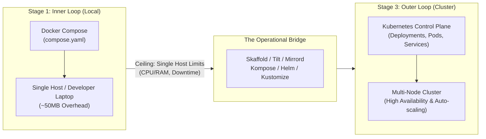
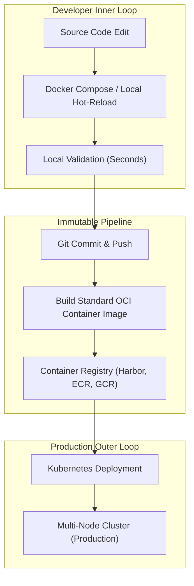

# From One Machine to Many: The Complete Guide to Learning Docker Compose and Kubernetes

**Date:** November 12, 2026

---

## Summary

Modern software applications are rarely monolithic blocks of code running in isolation. Instead, they operate as composed distributed systems—comprising frontend user interfaces, backend application servers, databases, caches, and asynchronous message workers.

As developers and platform engineers transition from running code locally to orchestrating multi-node production infrastructure, they encounter two industry-standard tools: [Docker Compose](https://docs.docker.com/compose/) and [Kubernetes](https://kubernetes.io/) (K8s). Rather than viewing them as competing paradigms, the most effective engineering mental model treats them as consecutive, complementary phases along the container lifecycle journey.

---

## The Container Scaling Journey

Container orchestration is not an all-or-nothing proposition. Development workflows and runtime environments demand different tradeoffs across resource footprint, deployment latency, and system resilience.



---

## Stage 1: Mastering the Basics with Docker Compose

Every distributed architecture starts on a single workstation. [Docker Compose](https://docs.docker.com/get-started/docker-concepts/the-basics/what-is-docker-compose/) was created to define, link, and run multi-container applications on a single Docker host. Through a single, declarative `compose.yaml` configuration file, an entire application topology can be launched using a single terminal command:

```bash
docker compose up -d
```

### Why Start Here?

Before managing fleets of distributed compute nodes, developers must understand how containerized processes interact over isolated networks and storage volumes. [Docker Compose](https://docs.docker.com/compose/gettingstarted/) eliminates remote cloud infrastructure overhead, allowing focus on three foundational building blocks:

1. **Service Networking**: How isolated containers locate and communicate with each other over virtual bridge networks using service names as automatic DNS records.
2. **Persistent Storage**: How named and bind-mounted volumes attach state to databases and file stores so data persists across container destruction and restarts.
3. **Environment Configuration**: How secrets, environment variables (`.env` files), and host port mappings enter runtime containers without hardcoding secrets into source code.

With a lightweight footprint (~50 MB runtime overhead), [Docker Compose](https://docs.docker.com/compose/install/) provides unmatched feedback velocity and offline debugging. Even within global enterprises operating thousands of Kubernetes nodes in production, developers rely on Docker Compose locally for swift, resource-friendly development cycles.

---

## Stage 2: Hitting the Single-Host Ceiling

While [Docker Compose](https://hub.docker.com/r/docker/compose) excels at local development, prototyping, and single-server deployments (e.g., small production apps on a single virtual private server), it encounters rigid physical and architectural constraints as user demand grows:

* **Hardware Boundaries**: Although a service can scale horizontally inside Compose using multiple container replicas (`replicas: 3`), all processes remain constrained by the physical CPU, memory, and I/O capacity of that single machine.
* **Single Point of Failure (SPOF)**: If the host machine suffers hardware failure, kernel panics, or cloud hypervisor reboots, the entire application stack drops offline.
* **Update Downtime**: Replacing container instances often induces brief service interruptions or dropped TCP sockets while existing containers stop and new ones spin up on the same network interface.

When an application requires continuous uptime, regional failover, or exceeds the capacity of vertical hardware upgrades, it outgrows single-host topology.

---

## Stage 3: Scaling Across Clusters with Kubernetes

[Kubernetes](https://kubernetes.io/docs/home/) addresses single-host bottlenecks by consolidating a cluster of physical or virtual servers (nodes) into an elastic, shared computing pool.

Instead of issuing imperative commands to run a container, engineers declare a desired system state—such as *"maintain three healthy replicas of the payment API behind a load balancer"*—and Kubernetes' control plane works continuously to reconcile real-world state with that specification.

### What Kubernetes Adds to the Stack

* **True High Availability**: When a physical host dies, Kubernetes detects heartbeat loss and automatically reschedules the affected Pods onto healthy compute nodes elsewhere in the cluster without human intervention.
* **Dynamic Autoscaling**: Built-in controllers—including the Horizontal Pod Autoscaler (HPA), Vertical Pod Autoscaler (VPA), and cluster-level node autoscalers—dynamically adjust replica counts and provision new compute nodes according to traffic surges and resource utilization.
* **Zero-Downtime Rolling Deployments**: Kubernetes deploys new revisions iteratively, verifying container readiness probes before rerouting live ingress traffic and decommissioning legacy instances.

### Operational Trade-Offs

These enterprise-grade capabilities come with tangible overhead:
* [Kubernetes](https://en.wikipedia.org/wiki/Kubernetes) requires substantial system resources (typically a minimum of ~2 GB of memory solely for control plane components like `etcd`, `kube-apiserver`, and `kube-controller-manager`).
* Systems require managing multiple modular YAML manifests (Deployments, Services, Ingresses, PersistentVolumeClaims, ServiceAccounts) rather than one concise file.

---

## Bridging the Gap: How Concepts Translate

Knowledge gained from Docker Compose translates directly into Kubernetes equivalents. Every foundational concept in Compose maps to a distributed primitive in [Kubernetes](https://kubernetes.io/docs/concepts/overview/):

| Application Need | Docker Compose (Single Host) | Kubernetes (Multi-Node Cluster) |
|---|---|---|
| **Running Containers** | `services` in `compose.yaml` | Deployments, ReplicaSets & Pods |
| **Internal Communication** | Bridge networks & service DNS | Services (`ClusterIP`, `Headless`) & CoreDNS |
| **Public Ingress Traffic** | Host port binding (`ports: "8080:80"`) | Ingress Controllers & `LoadBalancer` Services |
| **Configuration & Secrets** | `.env` files & `environment` directives | ConfigMaps & Secrets |
| **Stateful Persistence** | Named & bind-mounted volumes | PersistentVolumes (PV) & PersistentVolumeClaims (PVC) |
| **Container Scheduling** | Direct assignment to host Docker daemon | `kube-scheduler` targeting cluster nodes |

---

## Common Anti-Patterns and Developer Friction

Friction between [Compose](https://products.containerize.com/devops/compose/) and [Kubernetes](https://www.redhat.com/en/topics/containers/what-is-kubernetes) typically emerges when organizations attempt to force one runtime to act like the other.

### 1. Forcing "Kubernetes Everywhere" (Local Dev Friction)

* **The Intent**: Platform engineers attempt to achieve absolute environment parity by running local mini-clusters on developer laptops to eradicate *"works on my machine"* anomalies.
* **The Problem**: Requiring feature developers to master raw Kubernetes YAML, local Ingress controllers, Helm charts, and custom resource definitions (CRDs) destroys iteration velocity. Rebuilding images, pushing to local registries, and waiting for Pod readiness drains developer laptops of battery, RAM, and time.

### 2. Forcing "Compose in Production" at Scale (Ops Friction)

* **The Intent**: Small teams lean into Compose's straightforward ergonomics and attempt to scale it across multiple cloud servers using shell scripts, cron jobs, and manual HAProxy/Nginx configurations.
* **The Problem**: Operations engineers become trapped maintaining fragile, custom orchestration scripts. These home-rolled solutions lack native health healing, self-service rollbacks, granular network policy isolation, and centralized secret encryption.

### 3. Configuration Drift (The Dual-Maintenance Trap)

* **The Intent**: Developers maintain `compose.yaml` for day-to-day coding, while DevOps teams independently maintain Kubernetes manifests or Helm charts for staging and production.
* **The Problem**: When a developer introduces a new environment variable, cache dependency, or volume mount locally, staging or production deployments break because the corresponding Kubernetes manifests were updated out of band.

---

## The Seamless Bridge: Operating Across Both Worlds

Leading engineering organizations bridge this divide by aligning tools to their intended strengths: **optimizing Compose for inner-loop developer speed and Kubernetes for outer-loop cluster scale**.



### 1. Standardize the Artifact, Not the Runtime

Both Docker Compose and Kubernetes consume standard OCI (Open Container Initiative) container images. Standardizing on immutable container images built once in CI ensures that what developers test locally in Compose runs identically inside production Kubernetes Pods, without imposing cluster complexity on local machines.

### 2. Implement Inner-Loop Bridge Tooling

Modern tooling lets developers preserve fast local iteration cycles while remaining tethered to Kubernetes resources:

* **[Skaffold](https://skaffoldapp.com/) & [Tilt](https://docs.tilt.dev/product_faq.html)**: Monitor local source code on your development machine, automatically rebuild images, synchronize code directly into active containers, and stream cluster logs without manual `kubectl` invocations.
* **[Mirrord](https://www.mirrord-app.com/pricing)** & **Telepresence**: Allow engineers to run a single service locally inside an IDE debugger while bidirectionally mirroring and proxying network traffic, environment variables, and database connections from a remote staging Kubernetes cluster. This eliminates the requirement to execute 20+ microservices on a single laptop.
  > *Note on Licensing & Monetization:* While mirrord and Telepresence maintain open-source cores, both offer commercial, enterprise-tier editions with advanced team sharing, role-based access, and identity integrations. Similarly, Docker Desktop operates under commercial subscription tiers for enterprise organizations.

### 3. Adopt Golden Templates and Workload Specifications

Rather than handcrafting raw Kubernetes manifests:
* **[Kompose](https://kompose.dev/)**: Automatically translates standard `compose.yaml` files directly into foundational Kubernetes Deployment and Service definitions.
* **[Helm](https://helm.sh/) and [Kustomize](https://kustomize.io/)**: Enable platform engineering teams to maintain standardized base manifests and parameterized values, allowing developers to define environment-specific variables without duplicating manifest architecture.
* **Application Workload Specifications (e.g., Score)**: Emerging developer-centric workload specifications allow engineers to define workload requirements once (e.g., ports, environment variables, storage) and compile them dynamically into Compose configurations for local work and Helm charts for Kubernetes deployments.

---

## Step-by-Step Action Plan

To master both tools systematically:

1. **Build Locally with Docker Compose**:
   Create a multi-container three-tier application (e.g., a React/Vue frontend, a Node.js/Go backend API, and a PostgreSQL database). Master volume persistence, container healthchecks, and environment variables.
2. **Experiment with Scaling Limits**:
   Scale the backend service (`docker compose up --scale backend=3`) behind a reverse proxy like Nginx or Traefik. Observe load distribution, port bindings, and what happens when one container is stopped abruptly.
3. **Spin Up a Local Kubernetes Cluster**:
   Enable the integrated Kubernetes cluster inside [Docker Desktop](https://www.docker.com/products/docker-desktop/), or install [Minikube](https://minikube.sigs.k8s.io/) or lightweight distributions like Kind or K3s on your machine.
4. **Translate Compose into Kubernetes Manifests**:
   Map your `compose.yaml` services into Kubernetes `Deployment`, `Service`, `ConfigMap`, and `PersistentVolumeClaim` manifests. Use [Kompose](https://kompose.dev/) to inspect the automated conversion, then refine the generated YAML manually.
5. **Adopt Live Bridge Tools**:
   Integrate [Skaffold](https://skaffoldapp.com/features/) or Tilt into your workflow to test continuous image build, sync, and hot-reload against your local or remote Kubernetes sandbox.

---

## Conclusion

Docker Compose and Kubernetes are not rivals; they are two sides of the modern containerization coin. Docker Compose optimizes for human developers—delivering immediate feedback, minimal cognitive friction, and fast local workflows. Kubernetes optimizes for resilient, multi-node cloud systems—providing self-healing orchestration, autoscaling, and zero-downtime rollouts.

By understanding the direct conceptual mapping between the two and implementing bridge tooling to prevent dual-maintenance drift, teams can maximize developer velocity without sacrificing production-grade stability.

---

## References & Documentation

* [Docker Compose Documentation](https://docs.docker.com/compose/)
* [Docker Concepts: What is Docker Compose?](https://docs.docker.com/get-started/docker-concepts/the-basics/what-is-docker-compose/)
* [Docker Compose Getting Started Guide](https://docs.docker.com/compose/gettingstarted/)
* [Docker Compose Installation](https://docs.docker.com/compose/install/)
* [Docker Hub: Docker Compose Image](https://hub.docker.com/r/docker/compose)
* [Docker Desktop](https://www.docker.com/products/docker-desktop/)
* [Kubernetes Official Documentation](https://kubernetes.io/docs/home/)
* [Kubernetes Concepts Overview](https://kubernetes.io/docs/concepts/overview/)
* [Kubernetes - Wikipedia](https://en.wikipedia.org/wiki/Kubernetes)
* [Red Hat: What is Kubernetes?](https://www.redhat.com/en/topics/containers/what-is-kubernetes)
* [Containerize: Docker Compose Product Overview](https://products.containerize.com/devops/compose/)
* [Kompose: Docker Compose to Kubernetes Translation](https://kompose.dev/)
* [Skaffold Application Workflow](https://skaffoldapp.com/)
* [Skaffold Features Overview](https://skaffoldapp.com/features/)
* [Tilt Product Documentation & FAQ](https://docs.tilt.dev/product_faq.html)
* [Mirrord Pricing and Capabilities](https://www.mirrord-app.com/pricing)
* [Helm Package Manager for Kubernetes](https://helm.sh/)
* [Kustomize Configuration Customization](https://kustomize.io/)
* [Minikube Local Kubernetes](https://minikube.sigs.k8s.io/)

