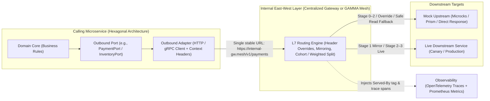
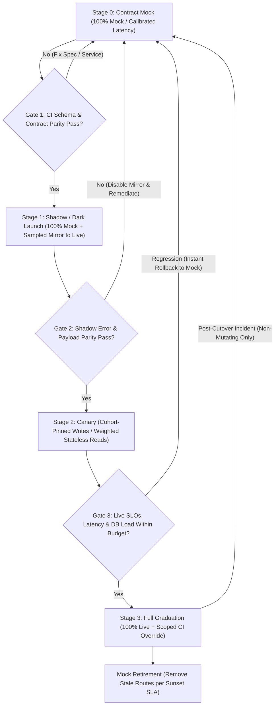

# East-West API Gateways and Hexagonal Architecture: Decoupling Mock-to-Live Traffic Graduation

**Date:** November 28, 2026
**Last Updated:** November 28, 2026
**Review:** [Expert & Architecture Review Report](../../reviews/devops/east-west-api-gateway-hexagonal-architecture-mock-to-live-review.md)

> **Scope & Licensing Note:** This article strictly covers pure open-source systems. Premium, proprietary/vendor-locked, and community-edition (open-core) systems are currently not included.

## Summary

Parallel microservice delivery frequently stalls on the same integration bottleneck: upstream teams are blocked waiting for unfinished downstream APIs, teams scatter brittle mock conditionals across polyglot callers, and "big bang" cutovers turn launch day into an all-or-nothing gamble. Combining an **internal East-West API Gateway** (handling internal service-to-service traffic, distinct from **North-South** external ingress) with **Hexagonal Architecture (Ports and Adapters)** decouples service-to-service communication from deployment and release mechanics. A calling microservice communicates exclusively with a single stable internal gateway endpoint through an outbound adapter, while pure open-source infrastructure—such as **Envoy Proxy**, **Apache APISIX**, or **Kubernetes Gateway API** controllers—manages contract-driven mocking, dark-launch traffic mirroring, safe canary graduation, and full cutover without touching or redeploying the caller.

## Key Points

* **Zero Deployment Coupling in Application Code:** The domain core invokes an abstract **Outbound Port** (`PaymentPort`, `InventoryPort`), while a thin **Outbound Adapter** targets one stable internal gateway endpoint—never knowing whether a response comes from a mock server, a canary replica, or a production fleet.
* **Three Layered Mocking Patterns at the Gateway:** Combine contract-driven mock servers, gateway-native direct responses, and header-based overrides—calibrated with realistic latency profiles—to unblock integration early without embedding stubs in callers.
* **Four-Stage Mock-to-Live Graduation:** Progress safely from **Stage 0 (Contract Mock)** → **Stage 1 (Shadow / Dark Launch)** → **Stage 2 (Canary / Cohort-Pinned)** → **Stage 3 (Full Graduation)** purely through declarative gateway or mesh routing updates.
* **Non-Negotiable Operational Guardrails:** Prevent silent regressions by enforcing CI schema parity, isolating shadow traffic and connection pools, pinning stateful canaries by tenant or cohort, stripping override headers at the North-South perimeter, and tagging every response and trace with the resolved upstream.

---

## 1. How Hexagonal Architecture Maps to East-West Routing

In **Hexagonal Architecture** (originally formulated by Alistair Cockburn as *Ports and Adapters*), the business domain sits at the center and interacts with the outside world strictly through explicit interfaces (**Ports**) and swappable infrastructure implementations (**Adapters**). When applied to internal microservice communication (**East-West traffic**, as opposed to **North-South** external client-to-cluster ingress), this separation ensures the calling service's business logic never knows—or cares—whether a downstream dependency is a contract mock, a shadow-tested build, a canary slice, or a fully graduated production service.



Each layer owns a single, well-bounded responsibility:

* **Domain Core:** Executes pure business rules and invokes an **Outbound Port**—a technology-agnostic interface such as `InventoryPort` or `PaymentPort`. No mock flags, environment switches, or canary checks leak into domain logic.
* **Outbound Adapter:** Implements the port using a standard HTTP or gRPC client pointed strictly at the internal routing boundary (for example, `https://internal-gw.mesh/v1/payments`). Its infrastructure responsibilities are bounded to payload serialization, strict timeouts, idempotency key propagation, W3C distributed trace context (`traceparent` and `tracestate`), tenant/cohort identifiers, and explicit handling of non-2xx responses.
* **East-West L7 Routing Plane:** Evaluates declarative **L7** (Layer 7, application-layer HTTP and gRPC) routing rules to direct each request to a **Mock Upstream**, a **Live Service**, or both (via mirroring) without requiring code changes or redeployments in the calling service.

### Two Pure Open-Source East-West Topologies

In Kubernetes environments using **Kubernetes Gateway API** (`Apache-2.0`), East-West L7 routing maps to two distinct topologies—conflating them causes subtle manifest and scaling mistakes:

1. **Centralized Internal East-West Gateway (`parentRefs: kind: Gateway`):** Callers send traffic to an internal **Gateway** resource addressed by `spec.hostnames` (for example, `internal-gw.mesh`). This topology is supported by **Envoy Gateway** (`Apache-2.0`, a `Gateway`-bound controller), **Apache APISIX** (`Apache-2.0`), **Istio** (`Apache-2.0`, CNCF Graduated), and **Cilium** (`Apache-2.0`, CNCF Graduated), or standalone **Envoy Proxy** (`Apache-2.0`, CNCF Graduated) fleets. It excels when teams want a single shared policy and mocking boundary—at the cost of an extra network hop and a shared gateway blast radius.
2. **Decentralized Service Mesh via GAMMA (`parentRefs: group: "", kind: Service`):** Under the **GAMMA** (*Gateway API for Mesh Management and Administration*) initiative, **Istio** and **Cilium** attach `HTTPRoute` or `GRPCRoute` resources directly to a Kubernetes `Service` (with `spec.hostnames` omitted per the GAMMA specification). Local sidecar or ambient node proxies enforce routing rules inline without hairpinning traffic through a central proxy tier. (**Envoy Gateway** targets `Gateway` resources rather than GAMMA mesh `Service` attachments.)

Section 5 compares both topologies against in-process hexagonal test doubles across latency, blast radius, cost, and operational complexity.

### Why Keeping Routing Out of the Adapter Matters

Without an East-West routing layer, teams often fall back to conditional logic inside the outbound adapter (`if (useMock) callMockClient() else callLiveClient()`). Even when backed by an application-level feature flag (see [OpenFeature API Specification](openfeature-api-spec.md) for when runtime application flags remain the better fit), embedding routing switches inside callers couples deployment topology to application code and forces synchronized rollouts across polyglot services.

Moving mock/live dispatch into the East-West plane keeps the outbound adapter static—yet production-hardened—across the entire lifecycle of the downstream service:

```typescript
// Outbound Port (Domain boundary — zero infrastructure awareness)
export interface PaymentPort {
  authorize(req: PaymentRequest, ctx: RequestContext): Promise<PaymentResult>;
}

export class PaymentGatewayError extends Error {
  constructor(
    public readonly status: number,
    public readonly servedBy: string,
    public readonly retryable: boolean,
  ) {
    super(`Payment gateway request failed with HTTP ${status} (served-by=${servedBy})`);
  }
}

// Outbound Adapter (Targets one stable East-West route forever)
export class GatewayPaymentAdapter implements PaymentPort {
  // Default to HTTPS/mTLS; plaintext http:// is only safe when a local sidecar
  // or ambient proxy transparently intercepts and upgrades traffic to SPIFFE mTLS.
  constructor(private readonly gatewayBaseUrl = "https://internal-gw.mesh") {}

  async authorize(req: PaymentRequest, ctx: RequestContext): Promise<PaymentResult> {
    const headers: Record<string, string> = {
      "Content-Type": "application/json",
      "Idempotency-Key": ctx.idempotencyKey,
      "traceparent": ctx.traceparent,
      "Tenant-Id": ctx.tenantId,
    };
    if (ctx.tracestate) headers["tracestate"] = ctx.tracestate;
    if (ctx.tenantCohort) headers["Tenant-Cohort"] = ctx.tenantCohort;

    const res = await fetch(`${this.gatewayBaseUrl}/v1/payments`, {
      method: "POST",
      headers,
      body: JSON.stringify(req),
      signal: AbortSignal.timeout(ctx.timeoutMs),
    });

    const servedBy = res.headers.get("Served-By") ?? "unknown";
    if (!res.ok) {
      throw new PaymentGatewayError(
        res.status,
        servedBy,
        res.status === 503 || res.status === 504,
      );
    }

    return (await res.json()) as PaymentResult;
  }
}
```

When the downstream `payments` service transitions from a contract mock to a dark-launched candidate, a cohort-pinned canary, and finally 100% production traffic, not a single line of `GatewayPaymentAdapter` changes—while strict timeouts, idempotency keys, trace context, and explicit `HTTP 503` handling keep failures bounded and observable at every stage.

---

## 2. Implementing Mocks at the Gateway Layer

Placing mock implementations behind the East-West gateway unblocks upstream and frontend teams immediately after an API contract is ratified (see [Design-First Partner APIs](design-first-partner-api-openapi-architecture.md) for spec-first governance)—allowing parallel integration weeks before the downstream service finishes implementation or infrastructure provisioning.

Three complementary patterns cover most mocking needs:

### 1. Contract-Driven Mock Servers

Generate a dedicated mock upstream directly from your OpenAPI or Protocol Buffers (`.proto`) specification and register it as a standard backend target in the gateway:

* **[Microcks](https://microcks.io/) (`Apache-2.0`, CNCF Incubating):** Ingests OpenAPI 3.x, Protocol Buffers/gRPC, AsyncAPI, and GraphQL specifications to serve realistic, example-driven or stateful mock responses—and doubles as a contract conformance test runner against the live service later. For lightweight deployments, its single-container `microcks-uber` distribution minimizes operational overhead.
* **[Stoplight Prism](https://github.com/stoplightio/prism) (`Apache-2.0`):** Provides a fast, stateless HTTP mock server directly from OpenAPI documents, with dynamic example generation and built-in request validation that flags schema mismatches early during upstream integration.

### 2. Gateway-Native Mock Plugins, Direct Responses, and Latency Realism

For lightweight stubs, health checks, or deterministic edge cases that do not justify running a separate mock container, return static or templated payloads directly from the gateway without an extra network hop:

* **Apache APISIX (`mocking` plugin, `Apache-2.0`):** Built directly into Apache APISIX, enabling routes to synthesize JSON responses, custom status codes, headers, and simulated latency (`mocking.delay` or the `fault-injection` plugin) inside the proxy layer.
* **Envoy Proxy (`direct_response` & `envoy.filters.http.fault`, `Apache-2.0`):** Returns inline static HTTP status codes, headers, and bodies directly from Envoy's routing table, and injects configurable response delays or aborts via its HTTP Fault Injection filter.

> **Calibrate Mock Latency Early:** A mock server responding in 2 ms creates a dangerous illusion of speed. When Stage 2 routes traffic to a live backend with a 150 ms p99 latency, callers configured with overly aggressive timeouts or unbounded retries can trigger **retry amplification storms**. Inject realistic p50/p99 latency distributions during Stage 0 using Apache APISIX `mocking.delay` / `fault-injection`, Envoy `envoy.filters.http.fault`, or Microcks delay profiles so caller timeouts, circuit breakers, and connection pools are exercised realistically before live cutover.

### 3. Header-Based Overrides and Fault Injection

Configure the East-West gateway to inspect explicit routing or scenario headers—standardizing on non-`X-` names such as `Route-Target: mock` and `Test-Scenario: timeout` in accordance with [IETF RFC 6648](https://datatracker.ietf.org/doc/html/rfc6648) (supporting legacy `X-` aliases only during brownfield migrations where existing test harnesses require them)—before falling through to default traffic rules.

Header-based overrides let automated CI/CD suites, chaos drills, and local integration tests deterministically force mock responses, `HTTP 503` / gRPC `UNAVAILABLE` failures, or injected latency spikes on isolated requests while regular traffic flows undisturbed to live backends.

> **Security Boundary:** Untrusted external requests entering through a **North-South Edge API Gateway** must strip all internal routing and test-override headers (`Route-Target`, `Test-Scenario`, `Tenant-Cohort`, `Tenant-Id`, and any legacy `X-` aliases) at the perimeter, and East-West overrides must be gated by verified workload identity. See **Guardrail #4** in Section 4 for the complete perimeter and **mTLS** (mutual TLS) / **SPIFFE & SPIRE** enforcement model.

### Comparing the Three Gateway Mocking Patterns

| Mocking Pattern | Best Use Case | Protocol Support | Statefulness | Extra Network Hop | Pure Open-Source Tools |
| :--- | :--- | :--- | :--- | :--- | :--- |
| **Contract-Driven Mock Servers** | Full multi-endpoint integration, schema validation, and reusable CI contract suites. | REST/OpenAPI, gRPC/Protobuf, GraphQL, AsyncAPI (`Microcks`); OpenAPI HTTP (`Prism`). | Example-driven or scripted stateful (`Microcks`); stateless (`Prism`). | Yes (gateway → mock container). | **Microcks**, **Stoplight Prism** |
| **Gateway-Native Direct Responses** | Lightweight stubs, health probes, maintenance responses, and calibrated delay/error stubs. | HTTP/1.1, HTTP/2 (REST/JSON). | Stateless (static or templated payloads). | No (synthesized inline at proxy). | **Apache APISIX** (`mocking`, `fault-injection`), **Envoy Proxy** (`direct_response`, `fault` filter) |
| **Header-Based Overrides** | Deterministic CI/CD fault injection, chaos drills, and isolated QA/canary verification on shared clusters. | HTTP headers and gRPC metadata. | Depends on target upstream (mock or live). | Depends on resolved target. | **Envoy Proxy**, **Apache APISIX**, **Kubernetes Gateway API** (`HTTPRoute` / `GRPCRoute`) |

---

## 3. Traffic Graduation Strategy (Mock to Live)

Traffic graduation shifts requests progressively from the mock upstream to the real microservice as the downstream implementation matures, turning a high-risk "big bang" cutover into four observable, reversible stages governed by explicit promotion gates.



| Stage | Traffic Split | Routing Mechanism | Primary Goal |
| :--- | :--- | :--- | :--- |
| **0. Contract Mock** | 100% Mock / 0% Live | Default route to contract-driven mock server (`Microcks` / `Prism`) with realistic delay profiles. | Unblock upstream development and exercise caller timeouts/contracts early. |
| **1. Shadow (Dark Launch)** | 100% Mock (Sampled Live mirror) | Async traffic mirroring (`request_mirror_policies` in Envoy, `proxy-mirror` in APISIX, or `RequestMirror` in Gateway API). | Verify live service stability, serialization, and payload parity without risking caller impact. |
| **2. Canary / Cohort Graduation** | Cohort-pinned (stateful) or 10%–50% weighted (stateless) | Header-matched cohort routing for stateful APIs; weighted load balancing (`traffic-split`, weighted clusters, `HTTPRoute`/`GRPCRoute` weights) for stateless reads. | Validate real latency, error rates, and database load under controlled production-like traffic. |
| **3. Full Graduation** | 0% Mock / 100% Live | Default route to live service (mock retained only for explicit CI overrides or bounded read-only fallback until retired). | Complete cutover with fail-closed semantics on state-mutating paths and a clear mock sunset plan. |

### Declarative Graduation Examples (Kubernetes Gateway API)

With **Kubernetes Gateway API** (`Apache-2.0`), routing changes live in version-controlled **CRD** (*Custom Resource Definition*) manifests rather than application code. Both manifests below target a **centralized internal `Gateway`** (`parentRefs: kind: Gateway` with `spec.hostnames`, supported by **Envoy Gateway**, **Apache APISIX**, **Istio**, and **Cilium**).

> **Decentralized GAMMA Mesh Variant:** If you run **Istio** or **Cilium** in GAMMA service-mesh mode instead of a centralized internal gateway, replace `parentRefs` with `{ group: "", kind: Service, name: payments-svc }` and **omit `spec.hostnames`** per the GAMMA specification.

#### Stage 1 Snapshot: Sampled Dark-Launch Mirroring on a Read-Only Endpoint

During Stage 1, primary traffic still resolves from the mock upstream while a bounded percentage of safe, read-only traffic mirrors asynchronously to the live candidate using Gateway API v1.3+ `requestMirror` fractional sampling (GEP-3171):

```yaml
apiVersion: gateway.networking.k8s.io/v1
kind: HTTPRoute
metadata:
  name: payments-quotes-stage1-shadow
  namespace: mesh-internal
spec:
  parentRefs:
    - kind: Gateway
      name: internal-east-west-gw
  hostnames:
    - "internal-gw.mesh"
  rules:
    - matches:
        - path:
            type: PathPrefix
            value: /v1/payments/quotes
          method: GET
      filters:
        # Mirror 10% of read-only quote requests asynchronously to warm and test live pods
        - type: RequestMirror
          requestMirror:
            backendRef:
              name: payments-live-svc
              port: 8080
            percent: 10
        - type: ResponseHeaderModifier
          responseHeaderModifier:
            set:
              - name: Served-By
                value: mock-microcks
      backendRefs:
        - name: payments-mock-svc
          port: 8080
```

#### Stage 2 Snapshot: Cohort-Pinned Stateful Writes + Weighted Stateless Reads

Notice how Stage 2 separates **stateful payment mutations** (graduated deterministically by `Tenant-Cohort` header to avoid write-then-read split-brain) from **stateless read-only quotes** (safely split by 25%/75% random weights):

```yaml
apiVersion: gateway.networking.k8s.io/v1
kind: HTTPRoute
metadata:
  name: payments-east-west-stage2
  namespace: mesh-internal
spec:
  parentRefs:
    - kind: Gateway
      name: internal-east-west-gw
  hostnames:
    - "internal-gw.mesh"
  rules:
    # Rule 1: Deterministic CI/CD override
    # Note: Gateway API evaluates precedence by match specificity (path + header beats
    # path-only), not by YAML list order.
    - matches:
        - path:
            type: PathPrefix
            value: /v1/payments
          headers:
            - name: Route-Target
              value: mock
      filters:
        - type: ResponseHeaderModifier
          responseHeaderModifier:
            set:
              - name: Served-By
                value: mock-microcks
      backendRefs:
        - name: payments-mock-svc
          port: 8080

    # Rule 2: Stateful Stage 2 — Pin dogfood/canary cohorts 100% to live (no split-brain)
    # Tenant-Id pinning follows the exact same header-match pattern for single tenants.
    - matches:
        - path:
            type: PathPrefix
            value: /v1/payments
          headers:
            - name: Tenant-Cohort
              value: dogfood
      filters:
        - type: ResponseHeaderModifier
          responseHeaderModifier:
            set:
              - name: Served-By
                value: live-v1
      backendRefs:
        - name: payments-live-svc
          port: 8080

    # Rule 3: Stateless Read Stage 2 — Safe 25% Live / 75% Mock weighted canary split
    - matches:
        - path:
            type: PathPrefix
            value: /v1/payments/quotes
          method: GET
      backendRefs:
        - name: payments-live-svc
          port: 8080
          weight: 25
          filters:
            - type: ResponseHeaderModifier
              responseHeaderModifier:
                set:
                  - name: Served-By
                    value: live-v1
        - name: payments-mock-svc
          port: 8080
          weight: 75
          filters:
            - type: ResponseHeaderModifier
              responseHeaderModifier:
                set:
                  - name: Served-By
                    value: mock-microcks

    # Rule 4: Default stateful fallback for remaining cohorts still in Stage 0/1
    - matches:
        - path:
            type: PathPrefix
            value: /v1/payments
      filters:
        - type: ResponseHeaderModifier
          responseHeaderModifier:
            set:
              - name: Served-By
                value: mock-microcks
      backendRefs:
        - name: payments-mock-svc
          port: 8080
```

> **Gateway API Conformance & Header Notes:**
> * `ResponseHeaderModifier` placed inside `backendRefs[*].filters` is an **Extended** conformance feature in Kubernetes Gateway API. Always verify your controller accepted the filter by inspecting `HTTPRoute.status.parents[].conditions` before relying on per-backend `Served-By` headers.
> * The manifests above use RFC 6648-aligned headers (`Route-Target`, `Served-By`, `Tenant-Cohort`). If legacy test suites still send `X-Route-Target`, add a parallel match block during migration rather than mixing conventions indefinitely.

### Critical Production Mechanics & Protocol Nuances

* **Stage 1 Shadowing Mechanics (Beyond Naive Mirroring):**
  * **Host Header Suffixing in Envoy:** By default, Envoy's `request_mirror_policies` appends `-shadow` to the `Host`/`:authority` header of mirrored requests (e.g., `internal-gw.mesh-shadow`), which breaks backends enforcing strict host or SNI validation. In Envoy v1.31+, explicitly set `disable_shadow_host_suffix_append: true` when strict virtual-host matching is active.
  * **Verifying Payload Parity Without Blocking Callers:** Proxy mirrors discard shadow responses by design, so HTTP `200` status counts alone cannot prove response-body parity. Validate shadow outputs by emitting response-schema validation metrics from shadow-side **OpenTelemetry** instrumentation, capturing sampled request/response pairs via Envoy's `tap` filter, or running an asynchronous response-diffing consumer against mirrored logs.
  * **Bounding Mirror Volume and Backpressure:** Always cap initial mirror ratios during cold start—using Gateway API v1.3+ `requestMirror.percent`/`fraction`, Apache APISIX `proxy-mirror` `sample_ratio`, or Envoy `runtime_fraction`—and assign dedicated connection pools and strict timeouts to the shadow cluster so a stalled live candidate cannot exhaust proxy buffers and degrade primary mock latency.
* **gRPC / Protobuf Routing (`GRPCRoute`) & HTTP/2 Multiplexing:** For internal Protobuf services, use Kubernetes Gateway API **`GRPCRoute`** (Standard channel since v1.1) instead of `HTTPRoute`. Standard L4 `kube-proxy` load balancing pins long-lived HTTP/2 TCP connections to a single pod, completely defeating weighted canary splits. An L7 East-West gateway or GAMMA mesh terminates and re-multiplexes HTTP/2 streams per RPC so `GRPCRoute` weights and metadata header matches (`Route-Target`, `Tenant-Cohort`) take effect accurately on every call.
* **Automating Progressive Promotion & Rollback:** Rather than manually editing traffic weights during Stage 2, pair declarative Gateway API routes with a pure open-source progressive delivery controller such as **Argo Rollouts** (`Apache-2.0`, CNCF Graduated) and its Gateway API Traffic Router plugin. Backed by **Prometheus** error-rate and p99 latency queries, Argo Rollouts automatically advances weights on healthy intervals and triggers immediate rollback to the prior target on SLO breach.
* **Fail-Closed Semantics on Mutating Paths (Stage 3):** Retaining a mock route as a circuit-breaker fallback is reasonable for non-critical, read-only enrichment endpoints (such as catalog metadata or recommendations). **Never** silently fall back to synthetic mock responses on state-mutating financial, compliance, or inventory-reservation paths in production—fail explicitly with `HTTP 503` (or gRPC `UNAVAILABLE`) so the calling domain can execute compensating logic safely (see [The Saga Pattern](../distributed-systems/saga-pattern-distributed-transactions.md)).

### Mock-to-Live Stage Promotion & Rollback Checklist

| Transition | Mandatory Entry / Exit Gates | Immediate Rollback Trigger |
| :--- | :--- | :--- |
| **Stage 0 → Stage 1 (Shadow)** | OpenAPI/Protobuf spec ratified; CI contract gates (`oasdiff`, self-hosted `Pact Broker`, `Microcks`) passing; Stage 0 latency profiles calibrated; shadow endpoints confirmed read-only or isolated via idempotency / shadow DB. | Mirroring causes >10% proxy buffer/CPU spike or increases primary mock p99 latency by >15%. |
| **Stage 1 → Stage 2 (Canary)** | Live candidate sustains ≥99.9% non-5xx rate under sampled shadow load; shadow response-schema/payload parity diffs resolved; stateful endpoints wired with `Tenant-Cohort` / `Tenant-Id` pinning rules. | Any split-brain state error, 5xx/gRPC `UNAVAILABLE` rate exceeding SLO budget, or retry amplification spike. |
| **Stage 2 → Stage 3 (100% Live)** | Dogfood/canary cohorts pass full business-transaction reconciliation; p95/p99 latency, DB lock contention, and downstream async events match production NFR targets; fail-closed `503`/`UNAVAILABLE` behavior verified. | SLO breach or elevated error budget burn on non-mutating paths (mutating paths fail closed and roll forward/hotfix rather than falling back to mocks). |
| **Stage 3 → Mock Retirement** | 14–30 days stable at 100% live; CI tests migrated to ephemeral contract runners; sunset ticket approved to remove permanent mock pods and stale gateway rules. | Re-enable ephemeral contract mock in CI only—never restore retired production fallback routes ad hoc. |

---

## 4. Key Operational Guardrails

Decoupling routing from application code shifts complexity from the codebase into runtime contract governance, failure isolation, and traffic operations. Five operational guardrails keep mixed mock/live topologies safe and debuggable:

### Guardrail 1: Enforce Schema Parity, Behavioral NFRs, and Latency Realism in CI
* **Risk:** Mock servers that drift from live schemas—or respond in ~2 ms while live backends take ~150 ms—create false confidence and trigger Stage 2 parsing failures, retry amplification storms, pagination bugs, database lock contention, or missing async event side effects.
* **Control:** Gate every pull request on automated breaking-change detection and consumer-provider contract verification against the exact artifacts serving the mock upstream. Inject realistic Stage 0 latency distributions into mocks, and pair schema tests with staging integration suites that validate pagination boundaries, lock contention, and asynchronous event emission before Stage 2 promotion.
* **Pure OSS Tooling:** Offline **`oasdiff`** CLI (`Apache-2.0`), self-hosted open-source **Pact** & **Pact Broker** (`MIT`), **Microcks** (`Apache-2.0`), **Schemathesis** (`MIT`), plus latency injection via **Apache APISIX** (`mocking.delay` / `fault-injection`) or **Envoy Proxy** (`envoy.filters.http.fault`).

### Guardrail 2: Isolate Shadow Traffic & Guard Against Proxy Backpressure (Stage 1)
* **Risk:** Mirroring mutating `POST` or `DELETE` requests without isolation risks double-charging customers, corrupting inventory, or firing duplicate webhooks; unbounded mirroring or slow shadow/mock upstreams can exhaust gateway connection pools and buffers, degrading primary traffic.
* **Control:** Restrict Stage 1 mirroring to read-only (`GET` / `HEAD`) operations unless the live service strictly enforces `Idempotency-Key` semantics or writes exclusively to an isolated shadow datastore (see [Data Isolation Strategies](../cloud-native/data-isolation-multi-tenant-multi-stage.md)). Cap mirror ratios (`percent`/`fraction`, `sample_ratio`, `runtime_fraction`), handle Envoy's `-shadow` `Host` suffix (`disable_shadow_host_suffix_append: true` in v1.31+), isolate shadow connection pools and upstream timeouts, and verify shadow response parity asynchronously via telemetry or `tap` capture.
* **Pure OSS Tooling:** **Kubernetes Gateway API** (`RequestMirror` with `percent`/`fraction`), **Envoy Proxy** (`request_mirror_policies`, `tap` filter, outlier detection), **Apache APISIX** (`proxy-mirror`), and **OpenTelemetry** (`Apache-2.0`).

### Guardrail 3: Tag Every Response and Distributed Trace
* **Risk:** Mixed mock/live topologies breed elusive "phantom" bugs when responders cannot immediately tell whether an anomalous payload originated from a mock server, a canary replica, or a production pod (see [Phantoms in Development and Debugging](../philosophy/phantoms-in-development-and-debugging.md)).
* **Control:** Configure the East-West routing layer to inject an explicit `Served-By` response header (`Served-By: mock-microcks` vs. `Served-By: live-v1`) on every route, record the resolved upstream cluster as a span attribute on distributed traces, and segment golden-signal metrics (latency, error rate, saturation) by upstream target.
* **Pure OSS Tooling:** **Kubernetes Gateway API** (`ResponseHeaderModifier`), **OpenTelemetry** (`Apache-2.0`, CNCF Graduated), and **Prometheus** (`Apache-2.0`, CNCF Graduated).

### Guardrail 4: Prevent Header Spoofing Across Traffic Planes
* **Risk:** If an external client injects `Route-Target: mock`, `Test-Scenario: timeout`, or a forged `Tenant-Cohort` header, attackers could bypass live business logic, poison canary metrics, or trigger synthetic outages in production.
* **Control:** Strip or overwrite all internal routing and cohort headers (`Route-Target`, `Test-Scenario`, `Tenant-Cohort`, `Tenant-Id`, and any legacy `X-` aliases) unconditionally at the **North-South Edge API Gateway** perimeter. Inside the East-West plane, enforce cryptographic workload identity via **mTLS** (*mutual TLS*) and gate `Route-Target: mock` or fault-injection rules exclusively to authorized CI/CD runner identities or dedicated non-production namespaces.
* **Pure OSS Tooling:** **SPIFFE / SPIRE** (`Apache-2.0`, CNCF Graduated) workload identities, **Envoy Proxy** / **Apache APISIX** header-sanitization filters, and **Istio** / **Cilium** L7 authorization policies.

### Guardrail 5: Bound Blast Radius, Automate Rollback, and Enforce Mock Retirement
* **Risk:** A single monolithic internal gateway creates a Tier-0 single point of failure; manual weight edits invite human error; and unretired mock routes ossify into permanent shadow infrastructure that teams must patch long after live cutover.
* **Control:** Shard centralized East-West gateways by business domain (or adopt decentralized GAMMA mesh proxies), enforce upstream timeouts and circuit breaking/outlier detection so a failing mock container never cascades across domains, automate Stage 2 promotions/rollbacks via GitOps and SLO gates, and attach a mandatory 14–30 day sunset SLA to every temporary mock route.
* **Pure OSS Tooling:** **Argo Rollouts** (`Apache-2.0`, CNCF Graduated) with its Gateway API Traffic Router plugin, **Prometheus** (`Apache-2.0`), and **Envoy Proxy** circuit-breaking / outlier-detection policies.

---

## 5. Trade-Offs, Socio-Technical Constraints, and Migration

Combining Hexagonal Architecture with an East-West API Gateway solves real cross-team bottlenecks in medium-to-large microservice estates, but it introduces measurable infrastructure, financial, and organizational overhead. Evaluating it honestly requires comparing the available topologies side by side.

### Architectural Topology & NFR Comparison Matrix (Pure Open-Source)

| Dimension | Centralized Internal East-West Gateway (`Envoy Gateway` / `Apache APISIX`) | Decentralized GAMMA Service Mesh (`Istio` / `Cilium`) | In-Process Hexagonal Test Double (Unit / Integration Harness) |
| :--- | :--- | :--- | :--- |
| **Added Latency & Hairpinning** | Medium (~1–3 ms extra network hop; potential cross-AZ hairpinning unless topology-aware routing is tuned). | Low (~0.2–1 ms via local sidecar or eBPF/ambient node proxy; no central hairpinning). | Zero network overhead (in-memory call within caller process). |
| **Blast Radius & SPOF** | High if monolithic; requires HA multi-replica fleets and domain-sharded gateways to cap Tier-0 risk. | Low per-workload blast radius (data plane distributed; control plane failure degrades config updates, not live traffic). | Isolated strictly to a single service's test process. |
| **Infrastructure & FinOps Cost** | Moderate–High: HA gateway pods + mock clusters (`Microcks`/`Prism`) + self-hosted `Pact Broker` (`MIT`). | Moderate–High: Per-node/sidecar memory & CPU overhead + mesh control plane + mock/contract tooling. | Negligible (runs inside existing CI runners only). |
| **Protocol & Mocking Ergonomics** | Strongest centralized policy, `mocking`/`direct_response` plugins, and unified team visibility for HTTP & gRPC. | Strong HTTP/2 gRPC L7 splitting (`GRPCRoute`) & native SPIFFE mTLS; gateway-native mocking plugins are leaner. | Full language-native flexibility, but zero live-traffic shadowing or canary graduation capability. |
| **Operational Complexity** | Moderate: Familiar gateway lifecycle, but requires GitOps self-service CRDs to avoid platform ticket queues. | High: Mesh upgrades, mTLS PKI lifecycle, eBPF/CNI kernel compatibility, and GAMMA spec maturity. | Low: Standard language testing frameworks; no cluster routing layer to maintain. |

> **FinOps & Operational Cost Reality:** Running highly available East-West gateways, dedicated `Microcks` or `Prism` mock fleets, and a self-hosted open-source `Pact Broker` (`MIT`) consumes real cluster CPU, memory, and engineering maintenance hours. That investment pays back rapidly when 5+ polyglot teams integrate asynchronously across shared contracts—and burns unnecessary budget when a 3-person team could test against in-process adapters instead.

### Socio-Technical Constraints: Beyond the Infrastructure Diagram

Architecture patterns fail far more often on human incentives than on YAML syntax. Adopting this pattern means trading application-level code coupling for disciplined organizational and operational craft:

* **Conway's Law & Contract-Ownership Incentives:** Spec-first mocking only works when producer and consumer teams share clear contract stewardship. If an upstream team can change a mock faster than the downstream owner approves a spec update, contracts fork silently; conversely, if every trivial schema adjustment requires a heavyweight governance board, teams will route around the gateway with ad-hoc endpoints.
* **The "Green Mock, Red Prod" False-Confidence Trap:** Weeks of green CI pipelines against clean, deterministic mocks create a powerful psychological bias that integration is "finished." Engineers routinely underestimate real-world friction—network jitter, database deadlocks, eventual consistency, and partial writes—until Stage 2 exposes them under live load.
* **On-Call Cognitive Load & Hybrid Accountability:** During a Stage 2 outage, an on-call responder faces three suspects instead of one: the caller, the gateway/mesh rule, or a mixed mock/live upstream. Without `Served-By` headers, clean dashboards, and unambiguous ownership over who owns each `HTTPRoute` CRD, incident triage slows to finger-pointing between platform and product teams.
* **Traffic-Shift Governance:** Changing a `weight` from `25` to `100` or flipping a cohort header is a production deployment. Define explicitly who is authorized to authorize live weight shifts—enforcing GitOps pull-request review, automated **Argo Rollouts** SLO gates, and auditable change logs rather than ad-hoc `kubectl edit` interventions.

### 3-Step Brownfield Migration Path

Teams inheriting legacy microservices cluttered with `if (USE_MOCK)` environment variables do not need a rewrite to adopt this pattern:

1. **Wrap & Route (Zero Behavior Change):** Extract an explicit Outbound Port (`PaymentPort`) in the caller and point its adapter through the East-West gateway while temporarily retaining the legacy flag behind a thin shim—verifying baseline latency, mTLS, and OpenTelemetry tracing first.
2. **Stand Up Calibrated Mocks & Mirror:** Deploy contract-driven mocks (`Microcks` or `Prism`) with realistic latency profiles behind the gateway, turn on CI schema parity (`oasdiff` + self-hosted `Pact Broker`), and validate Stage 1 read-only mirroring on a single low-risk endpoint.
3. **Shift Authority & Delete Legacy Flags:** Move mock/live switching to declarative `HTTPRoute` / `GRPCRoute` manifests, confirm `Served-By` observability across dashboards, and permanently delete application-level mock conditionals and environment toggles.

### When Not to Use This Pattern

* **Small Estates & Early MVPs:** If you are building an early-stage MVP, modular monolith, or small-team product (fewer than ~5 services), in-process test doubles implementing `PaymentPort` during unit and integration tests give you 90% of the hexagonal benefit with zero proxy or mock-fleet infrastructure to run.
* **Sub-Millisecond Tight RPC Loops:** Ultra-low-latency internal RPC paths cannot absorb a centralized L7 gateway hop; prefer decentralized **GAMMA** sidecar/ambient mesh routing (or direct mTLS connections) instead.
* **Ticket-Gated Platform Teams:** If platform engineering cannot offer self-service declarative routing (such as GitOps-managed `HTTPRoute` / `GRPCRoute` CRDs per service team), manually filed gateway tickets will erode the very developer velocity this pattern is meant to unlock.

---

## Related Articles

- [Architecting High-Throughput API Gateways for Device Certification and Innovation Sandboxes](high-throughput-api-gateways-device-certification-sandboxes.md) — separating North-South edge gateways from East-West service meshes (`Envoy`, `Apache APISIX`, `Istio`, `Cilium`, and Kubernetes Gateway API GAMMA) with cryptographic identity and isolation guardrails.
- [Data Isolation Strategies: Keeping Multi-Tenant and Multi-Stage Data in a Data Silo](../cloud-native/data-isolation-multi-tenant-multi-stage.md) — isolating multi-stage and shadow datastores cleanly so Stage 1 dark launches and Stage 2 tenant-pinned canaries never leak state across boundaries.
- [The Saga Pattern: Managing Distributed Transactions and Eventual Consistency in Microservices](../distributed-systems/saga-pattern-distributed-transactions.md) — designing compensating transactions when Stage 3 state-mutating calls fail closed with `HTTP 503` or gRPC `UNAVAILABLE`.
- [The Architecture of the "Disposable" Core: Designing for Graceful Obsolescence](../design/architecture-of-disposable-core.md) — isolating domain cores behind strict interfaces so underlying implementations can evolve or be replaced cleanly.

---

## References

- [Alistair Cockburn — Hexagonal Architecture (Ports and Adapters)](https://alistair.cockburn.us/hexagonal-architecture/)
- [Envoy Proxy — Direct Response & Traffic Mirroring Documentation (Apache-2.0, CNCF Graduated)](https://www.envoyproxy.io/docs/envoy/latest/api-v3/config/route/v3/route_components.proto)
- [Envoy Proxy — HTTP Fault Injection Filter Documentation (Apache-2.0)](https://www.envoyproxy.io/docs/envoy/latest/configuration/http/http_filters/fault_filter)
- [Apache APISIX — `mocking`, `proxy-mirror`, and `traffic-split` Plugins (Apache-2.0)](https://apisix.apache.org/docs/apisix/plugins/mocking/)
- [Apache APISIX — `proxy-mirror` Plugin Documentation (Apache-2.0)](https://apisix.apache.org/docs/apisix/plugins/proxy-mirror/)
- [Apache APISIX — `traffic-split` Plugin Documentation (Apache-2.0)](https://apisix.apache.org/docs/apisix/plugins/traffic-split/)
- [Kubernetes Gateway API & GAMMA Initiative for East-West Mesh Routing (Apache-2.0)](https://gateway-api.sigs.k8s.io/mesh/)
- [Kubernetes Gateway API — `HTTPRoute`, `GRPCRoute`, and `RequestMirror` Fraction (GEP-3171) Specification (Apache-2.0)](https://gateway-api.sigs.k8s.io/reference/spec/)
- [Envoy Gateway — Kubernetes Gateway API Implementation (Apache-2.0)](https://gateway.envoyproxy.io/)
- [Argo Rollouts — Progressive Delivery Controller & Gateway API Plugin (Apache-2.0, CNCF Graduated)](https://argoproj.github.io/rollouts/)
- [Microcks — Open-Source Contract-Driven API Mocking and Testing (Apache-2.0, CNCF Incubating)](https://microcks.io/)
- [Stoplight Prism — Open-Source OpenAPI Mock Server (Apache-2.0)](https://github.com/stoplightio/prism)
- [Pact — Open-Source Consumer-Driven Contract Testing & Self-Hosted Pact Broker (MIT)](https://pact.io/)
- [oasdiff — OpenAPI Diff and Breaking Change Detection CLI (Apache-2.0)](https://github.com/oasdiff/oasdiff)
- [Schemathesis — Property-Based API Contract Testing (MIT)](https://github.com/schemathesis/schemathesis)
- [OpenTelemetry — Distributed Tracing and Observability (Apache-2.0, CNCF Graduated)](https://opentelemetry.io/)
- [Prometheus — Monitoring System and Time-Series Database (Apache-2.0, CNCF Graduated)](https://prometheus.io/)
- [SPIFFE / SPIRE — Workload Identity Standards (Apache-2.0, CNCF Graduated)](https://spiffe.io/)
- [W3C Trace Context Specification (`traceparent` and `tracestate`)](https://www.w3.org/TR/trace-context/)
- [IETF Draft — The `Idempotency-Key` HTTP Header Field](https://datatracker.ietf.org/doc/draft-ietf-httpapi-idempotency-key-header/)
- [IETF RFC 6648 — Deprecating the "X-" Prefix and Similar Constructs in Application Protocols](https://datatracker.ietf.org/doc/html/rfc6648)

---

## Changelog

- **Nov 28, 2026:** Completed multi-persona review (Reader, SME, Technical Architect); applied improvements ([Review Report](../../reviews/devops/east-west-api-gateway-hexagonal-architecture-mock-to-live-review.md)).
- **Nov 28, 2026:** Initial publication covering Hexagonal Architecture outbound ports/adapters paired with pure open-source East-West API Gateways (`Envoy Proxy`, `Apache APISIX`, Kubernetes Gateway API), contract-driven mocking (`Microcks`, `Prism`), 4-stage mock-to-live traffic graduation, and operational guardrails.
