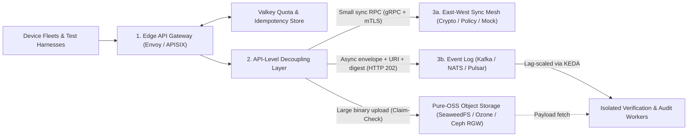
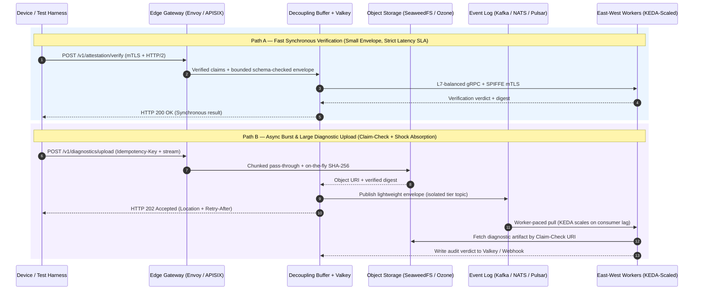

# Architecting High-Throughput API Gateways for Device Certification and Innovation Sandboxes

**Date:** November 26, 2026
**Last Updated:** November 28, 2026
**Review:** [Expert & Architecture Review Report](../../reviews/devops/high-throughput-api-gateways-device-certification-sandboxes-review.md)

> **Scope & Licensing Note:** This article strictly covers pure open-source systems. Premium, proprietary/vendor-locked, and community-edition (open-core) systems are currently not included.

## Summary

Device certification labs and hardware innovation sandboxes combine deterministic compliance workloads with unpredictable, payload-heavy stress and fuzzing bursts that quickly overwhelm traditional edge-only API gateways. By separating the edge **API Gateway** (north-south perimeter), an **API-Level Decoupling Layer** (contract normalization, Claim-Check storage, and event-log buffering), and a zero-trust **East-West Service Mesh**, platform teams isolate failure domains and let CPU-bound cryptographic workers scale independently. This guide lays out a pure open-source reference architecture, evaluates concrete NFR trade-offs across gateways, brokers, and meshes, and defines clear thresholds for progressive adoption.

## Key Points

* **Separate Traffic Planes by Responsibility:** Keep the edge gateway focused on TLS/mTLS termination, cryptographically verified tier routing, and bounded contract checks; move async shock absorption to a decoupling buffer and internal service governance to an east-west mesh.
* **Match Payload Handling to Inspection Depth:** True OS zero-copy (`sendfile`/`splice`) does not apply under userspace TLS termination and L7 inspection—split traffic into bounded control-plane envelopes and chunked streaming uploads backed by Claim-Check object storage.
* **Isolate Failure Domains End to End:** Separate Certification, Sandbox, and Fuzz workloads across dedicated ingress listeners, Valkey quota shards, and broker topics/consumer groups, with priority-aware load shedding and Dead-Letter Queues (DLQs).
* **Pair Complementary East-West Layers Correctly:** Combine L7 binary RPC (`gRPC` over `HTTP/2`) with L4 kernel acceleration (`Cilium` eBPF), and enforce L7 load balancing with bounded `max_connection_age` to prevent HTTP/2 connection pinning during autoscaling.
* **Adopt Incrementally and Respect Human Context:** Do not deploy a full three-plane mesh stack for low-concurrency (<1,000 RPS) or sub-50 ms synchronous Hardware-in-the-Loop (HIL) rigs; evolve across three stages while preventing the decoupling layer from becoming a Conway's Law bottleneck.

Modern hardware ecosystems, automated compliance labs, and device-testing sandboxes place intense, asymmetric demands on edge and internal infrastructure. Unlike standard web applications serving uniform JSON payloads, device-testing platforms juggle deterministic vendor qualification runs alongside chaotic protocol fuzzing, large diagnostic uploads, and CPU-heavy cryptographic attestation.

At meaningful multi-tenant scale, keeping the edge **API Gateway** as a dedicated north-south traffic and contract plane—while delegating internal service-to-service communication (**east-west traffic**) to mesh and event-driven patterns—prevents edge proxies from turning into monolithic bottlenecks. Introducing an **API-level decoupling layer** between external contracts and internal execution engines allows teams to absorb burst loads gracefully, isolate noisy neighbors, and evolve verification pipelines without continually rewriting edge routing rules.

---

## 1. Governing North-South vs. East-West Traffic Boundaries

A single external API call from a hardware device or test harness often triggers a multi-step internal workflow: certificate chain validation, payload decryption, policy evaluation, synthetic fixture lookup, and tamper-evident audit logging. Routing every internal hop back through the external edge gateway compounds latency and tightly couples public API contracts to internal microservice topology.

| Traffic Plane | Direction & Scope | Primary Mechanism | Core Responsibilities |
| :--- | :--- | :--- | :--- |
| **North-South Plane** *(Edge API Gateway)* | External devices and test harnesses entering the platform boundary. | Centralized reverse-proxy fleet *(Envoy / Apache APISIX)*. | TLS/mTLS termination, verified tenant rate limiting, bounded OpenAPI/Protobuf validation, streaming pass-through, and coarse version routing (`/v1`, `/v2`). |
| **API-Level Decoupling Layer** *(Mediation & Buffer)* | Boundary bridge between external contracts and internal domains. | Stateless mediation adapters + pure-OSS object storage *(SeaweedFS / Apache Ozone / Ceph RGW)* + distributed event logs *(Apache Kafka / NATS JetStream / Apache Pulsar)*. | Contract normalization, Claim-Check offloading, sync-to-async buffering, idempotency enforcement, mode dispatching (`live` vs. `sandbox`), and fan-out. |
| **East-West Plane** *(Internal Service Mesh / Event Mesh)* | Internal communication across domain services and compute workers. | Decentralized sidecar or eBPF mesh *(Istio / Cilium)* or Kubernetes Gateway API GAMMA *(east-west mesh routing initiative)*. | Workload-to-workload mTLS (Zero-Trust), L7 load balancing, outlier detection, coordinated retries, traffic shadowing, and distributed tracing. |

### Architecture Preview & End-to-End Request Walkthrough

Before examining each layer's mechanics, the diagram below provides a unified mental model of how north-south perimeter controls, API-level decoupling, and east-west execution planes interact.



To make this boundary concrete, contrast two concurrent requests arriving at the same platform:

1. **Deterministic Vendor Certification Request:** A certified hardware test rig submits a signed 12 KB attestation request over mTLS (`HTTP/2`). The edge gateway validates the device's X.509 certificate, maps its `SAN` to the **Certification & Compliance Pool**, checks synchronous `Valkey` quota limits (fail-closed), validates the envelope schema, and forwards the request to the decoupling layer. If verification fits within the synchronous SLA, the decoupling layer dispatches an L7-balanced `gRPC` call into the real-time mesh; if it triggers a multi-stage audit, it stores the `Idempotency-Key`, publishes to the dedicated `cert-attestation` topic, and returns `HTTP 202 Accepted` with `Location` and `Retry-After` headers.
2. **Burst Fuzz-Testing Batch:** A vendor harness launches 20,000 malformed and oversized diagnostic uploads over a 60-second spike. The edge gateway assigns the traffic to the **Stress & Fuzz Testing Pool** via dedicated ingress listeners, streams multi-megabyte bodies directly to object storage under strict per-connection buffer caps, and sheds excess concurrency with `HTTP 429` once pool budgets saturate. Validated metadata references enter an isolated `fuzz-ingest` topic where malformed payloads are quarantined to a Dead-Letter Queue (DLQ)—leaving Certification latency and CPU headroom untouched.

### Control Plane vs. Data Plane Separation

At high requests per second (RPS), reloading or restarting proxy workers whenever a test suite or microservice deploys introduces tail-latency spikes and dropped connections. Both the edge gateway and the east-west service mesh separate the **Control Plane** (which watches service discovery and pushes dynamic configuration via `xDS` — dynamic proxy configuration API — or `etcd`) from the stateless **Data Plane** (which forwards packets and enforces policies in memory). This split lets edge proxies and internal workers scale horizontally without draining healthy long-lived connections.

---

## 2. High-Intensity North-South Isolation and Sandbox Routing

At the north-south perimeter, device-testing platforms face sharp workload asymmetry—from steady baseline telemetry to automated vendor stress tests and concurrent certification runs. Achieving predictable tail latency requires strict perimeter classification and multi-tier isolation (see also [Data Isolation Strategies: Keeping Multi-Tenant and Multi-Stage Data in a Data Silo](../cloud-native/data-isolation-multi-tenant-multi-stage.md)).

### Transport Selection: HTTP/2 vs. HTTP/3 (QUIC)

* **Wired Labs & Automated Harnesses (`HTTP/2`, RFC 9113):** Standardize deterministic lab rigs on `HTTP/2` over `TLS 1.3`, where TCP hardware offload, predictable congestion control, and mature observability tooling minimize overhead.
* **Cellular, Wireless & Mobile Device Testbeds (`HTTP/3` / QUIC, RFC 9114):** Enable `HTTP/3` at the edge for lossy wireless or mobile hardware fleets. QUIC eliminates transport-layer TCP Head-of-Line (HoL) blocking across multiplexed streams and supports connection migration across radio/IP handoffs without full TLS renegotiation.

### Cryptographically Verified Tier Classification

Untrusted client-supplied headers must **never** determine routing tier or rate-limit priority. In compliance with RFC 6648 (which deprecates the `X-` header prefix), strip or overwrite any external routing headers (such as `Tenant-Tier` or `Session-Mode`) at the ingress boundary, and derive internal routing metadata strictly from cryptographically verified credentials:

* **mTLS X.509 Certificate Attributes:** `Subject DN` (Distinguished Name), `SAN` (Subject Alternative Name), `EKU` (Extended Key Usage), or vendor-assigned custom `OID` (Object Identifier) extensions.
* **OAuth 2.0 / JWT Claims:** Signed, short-lived bearer tokens or certificate-bound access tokens (RFC 8705) validated against cached issuer keys.

### Isolation Tier Matrix

| Traffic Pool | Cryptographic Classification Signal | SLA & Scaling Posture | Rate-Limit, Circuit-Breaker & Fail Mode |
| :--- | :--- | :--- | :--- |
| **Certification & Compliance Pool** | Verified vendor mTLS `SAN` / custom compliance `OID` or signed certification token on dedicated ingress listener. | Strict p99 SLA; reserved baseline compute + priority autoscaling; deterministic routing (no canary drift). | Synchronous `Valkey` GCRA quota checks; conservative circuit breakers; **fail-closed** on revocation or quota-store uncertainty. |
| **Innovation & Experimental Sandbox Pool** | Sandbox-scoped mTLS `EKU` or OAuth 2.0 `sandbox` scope. | Burst-tolerant autoscaling; synthetic payload generators and opt-in fault-injection hooks. | Async `Valkey` quota leasing + latency-based load shedding; **fail-open** (with bounded local fallback caps) if quota store degrades. |
| **Stress & Fuzz Testing Pool** | Dedicated fuzzing client certificate (`SAN` prefix) pinned to isolated ingress node pool. | Isolated compute nodes and separate broker topics; never shares CPU or connection pools with Certification. | Aggressive concurrency caps and fast-trip circuit breakers; **shed first** (`HTTP 429`/`503` + `Retry-After`) under cluster saturation. |

### Static Quota Enforcement vs. Adaptive Concurrency Limiting

Rate limiting and overload protection solve different problems and should be layered explicitly:

* **Static Multi-Dimensional Quotas (Token Bucket / GCRA):** Key limits by device serial, vendor tenant, and test-suite session, backed by **Valkey** (`BSD-3-Clause`).
  * *Synchronous Valkey Checks:* Add ~0.5–1.5 ms per request on local cluster networks, providing tight global accuracy for the **Certification & Compliance Pool**.
  * *Asynchronous Quota Leasing:* Using local gateway memory with sub-second asynchronous syncs (such as Envoy's `RateLimitQuotaService`) sustains **tens of thousands of RPS** per cluster—assuming warm persistent `HTTP/2` mTLS connections and 2–8 KB control envelopes—without a per-request network hop.
  * *Eventual-Consistency Overshoot Bound:* Local leasing introduces a bounded multi-replica overshoot of up to `N × local_lease_window` across `N` gateway replicas during each sync interval. This trade-off works well for Sandbox and telemetry quotas, whereas strict compliance limits warrant synchronous checks or tighter lease windows.
* **Adaptive Concurrency Limiting (Load Shedding):** Static quotas cannot protect workers when payload complexity spikes unexpectedly. Layer dynamic **AIMD** (Additive Increase / Multiplicative Decrease) or gradient latency-based load shedding (such as Envoy's `adaptive_concurrency` filter) that automatically shrinks in-flight concurrency as downstream p95/p99 latency climbs.
* **Priority-Aware Shedding:** During cluster or broker saturation, shed **Stress & Fuzz** traffic first and **Innovation Sandbox** traffic second with `HTTP 429 Too Many Requests` or `HTTP 503 Service Unavailable` and an RFC 9110 `Retry-After` header, preserving reserved capacity for active formal certification runs.

### Long-Lived Hardware API Coexistence & Deprecation

Hardware firmware updates slowly—often across quarters or years—making abrupt breaking changes impractical. Support parallel coarse version routing (`/v1`, `/v2`) at the edge and signal upcoming migrations cleanly using standardized `Deprecation` (RFC 9745) and `Sunset` (RFC 8594) HTTP response headers alongside `Link` headers pointing to migration guides.

---

## 3. Offloading Payload and Cryptographic Intensity

Hardware telemetry and certification payloads frequently combine signed binary, XML, or JSON envelopes, encrypted sensor blocks, hardware attestation chains, and multi-megabyte diagnostic logs. Handling these safely requires separating memory-bounded inspection from streaming I/O and offloading CPU-bound cryptography.

### Bounded Buffering vs. Streaming Pass-Through

True OS kernel zero-copy primitives (`sendfile`/`splice`) **do not apply** when a userspace edge proxy terminates TLS and performs L7 payload inspection. Full OpenAPI/Protobuf body validation or `XMLDSig` (XML Digital Signature) canonicalization requires buffering the relevant bytes in memory. Treating every endpoint identically risks out-of-memory (OOM) crashes during concurrent diagnostic uploads.

Split edge traffic into two explicit handling profiles:

1. **Bounded Control-Plane & Metadata Envelope APIs:** Apply strict maximum body limits (e.g., 256 KB–1 MB) at the edge so OpenAPI or Protobuf schema pre-validation runs safely inside bounded memory buffers.
2. **Streaming Binary Diagnostic Upload Paths:** Bypass full-body schema inspection at the edge. Configure chunked streaming pass-through with explicit per-connection memory backpressure (e.g., Envoy's `per_connection_buffer_limit_bytes`, typically 256 KB–1 MB per stream) while computing an incremental on-the-fly `SHA-256` digest as chunks flow to storage.

### Decoupling Network I/O from Cryptographic Compute

Signature verification—`XMLDSig` (XML Digital Signature), `JWS` (JSON Web Signature, RFC 7515), and `COSE` (CBOR Object Signing and Encryption, RFC 9052)—alongside full X.509 certificate path validation and payload decryption are heavily CPU-bound. Keep the edge gateway focused on mTLS termination, routing, and envelope pre-validation, and offload cryptographic verification cleanly:

* **Same-Host / Same-Pod IPC (`UDS`):** Use **Unix Domain Sockets (UDS)** strictly for co-located, same-Pod or same-node processes—such as a local Envoy `ext_proc` (External Processing) sidecar or a node-local `SPIRE Agent` socket. UDS cannot span across Kubernetes nodes.
* **Horizontally Autoscaled Worker Pools (Persistent `gRPC` + mTLS):** Offload heavy verification to independently scaled remote **Cryptographic & Attestation Worker Pods** over persistent, mTLS-authenticated `gRPC` connection pools (via Envoy `ext_proc` or `ext_authz`).
* **Gateway Extensibility Choice (`ext_proc` vs. `Proxy-Wasm`):** Use **Proxy-Wasm** (in-process sandboxed WebAssembly filters) for lightweight, low-latency header manipulation or custom token parsing where an extra network hop hurts; use **Envoy `ext_proc`** (out-of-process bidirectional gRPC streaming) for heavy cryptographic compute, complex XML/COSE parsing, or libraries that benefit from independent pod autoscaling and memory isolation.
* **XMLDSig Security Hardening:** Any worker verifying `XMLDSig` envelopes must disable external entities and DTDs (preventing XXE and XML bomb / "billion laughs" DoS attacks) and enforce strict schema-bound reference resolution to defeat XML Signature Wrapping (XSW) attacks.

### Certificate Caching, Revocation Freshness & Hardware PKI Edge Cases

Repeated cryptographic handshakes across thousands of devices can stall TLS workers if certificate validation performs synchronous network calls.

* **Gateway Memory Architecture:** Tune caching to match your proxy's memory model rather than assuming a single shared heap:
  * **Envoy Proxy** uses a *thread-per-core, shared-nothing* architecture where TLS contexts and `SDS` (Secret Discovery Service) certificates are cached per worker thread and updated asynchronously from the main thread without cross-thread lock contention.
  * **Apache APISIX** (built on OpenResty/Nginx) combines cross-worker `lua_shared_dict` zones with per-worker `lrucache` layers to store vendor roots, `JWKS` (JSON Web Key Sets), and validation metadata.
* **Asynchronous Revocation & Stale-Window Trade-Off:** Never perform synchronous external CA `OCSP` (Online Certificate Status Protocol, RFC 6960) or `CRL` (Certificate Revocation List, RFC 5280) fetches on the TLS handshake hot path—a single slow CA endpoint will exhaust proxy worker threads. Instead, use **TLS 1.3 session resumption** (RFC 8446), **OCSP stapling**, and asynchronous background refresh jobs.
  * *Security-vs-Latency Trade-Off:* Aggressive CRL/OCSP caching and long TLS 1.3 session ticket lifetimes reduce CPU overhead but widen the **stale revocation window** during which a compromised device certificate remains accepted. On the **Certification & Compliance Pool**, mitigate this with short revocation cache TTLs (e.g., 1–5 minutes), bounded session ticket lifetimes, or event-driven cache invalidation triggered when a vendor revokes a device certificate.
* **Hardware Fleet Edge Cases:**
  * *Embedded Clock Skew:* Field devices and prototype boards frequently drift without reliable RTC batteries. Enforce strict NTP/NTS clock alignment on formal Certification paths, while allowing explicit, bounded leeway windows (e.g., ±60–120 seconds) on experimental Sandbox telemetry when validating certificate `notBefore`/`notAfter` or JWT `nbf`/`exp` claims.
  * *Intermediate CA Rollover:* Maintain overlapping dual-trust CA bundles distributed dynamically via `SDS` and **cert-manager** (`Apache-2.0`) so intermediate CA rotations never sever active device fleets.

---

## 4. The API-Level Decoupling Buffer Layer

Sitting directly behind the edge gateway, the **API-Level Decoupling Layer** keeps the gateway bound to stable, canonical public contracts while translating requests into internal east-west workflows.

### Canonical Contract Normalization (Anti-Corruption Layer)

The edge gateway enforces a stable external contract (such as `POST /v1/attestation/verify` or `POST /v1/devices/{id}/telemetry`) using OpenAPI or Protobuf schemas governed in a pure open-source schema registry such as **Apicurio Registry** (`Apache-2.0`; see [Design-First Partner APIs: Treating Your OpenAPI Specification as an Independent Product](design-first-partner-api-openapi-architecture.md)). The decoupling layer translates canonical requests into internal domain commands so verification engines, hardware simulators, or compliance schemas can evolve without rewriting edge gateway filters.

### Sync-to-Async Buffering, Claim-Check & Backpressure Absorption

During peak load tests—for example, **50,000 simulated devices** submitting batched 4 KB telemetry envelopes (~200 MB burst) or multi-megabyte diagnostic dumps simultaneously—burst traffic easily outpaces CPU-bound verification workers even while edge sockets remain healthy.

1. **Claim-Check Pattern for Large Payloads:** Distributed event brokers default to modest message limits (typically 1–5 MB) and degrade under oversized binary blobs. Stream multi-megabyte diagnostic artifacts directly to pure open-source object storage—**SeaweedFS** (`Apache-2.0`), **Apache Ozone** (`Apache-2.0`), or **Ceph RGW** (`LGPL-2.1`/`GPL-2.0`)—and publish only a compact metadata envelope containing the object URI, `SHA-256` digest, device claims, and correlation ID onto **Apache Kafka**, **NATS JetStream**, or **Apache Pulsar** (see [Lightweight Apache Kafka Alternatives](../distributed-systems/lightweight-apache-kafka-alternatives.md) for deeper broker selection context).
2. **Idempotency & RFC 9110 Async Semantics:** Require an `Idempotency-Key` header on state-changing submissions, deduplicated in `Valkey` over a configurable retention window so client timeouts and retries never trigger duplicate certification runs. On accepted async jobs, return `HTTP 202 Accepted` with RFC 9110 `Location: /v1/jobs/{correlationId}` and `Retry-After` headers to pace client polling cleanly.
3. **Topic Isolation, Partition Skew & Poison-Pill Defenses:**
   * *Dedicated Topics & Consumer Groups:* Isolate Certification, Sandbox, and Fuzz streams into separate topics/subjects and consumer groups so a fuzz burst cannot cause Head-of-Line blocking for compliance audits.
   * *Preventing Device-Serial Hot-Partition Skew:* Partitioning solely by `device_serial` allows a single misbehaving test harness to saturate one broker partition. Use composite salted keys such as `(tenant_id, hash(device_serial) % K)` when strict per-device global ordering is not required.
   * *Dead-Letter Queues (DLQs) & Broker Backpressure:* Route malformed or repeatedly failing fuzz payloads to a quarantined DLQ after bounded retries. If broker storage or lag exceeds safe thresholds, propagate explicit backpressure to the edge as `HTTP 429` or `HTTP 503` with `Retry-After` rather than letting queues grow unbounded.
4. **Lag-Driven Autoscaling with KEDA:** Standard Kubernetes CPU-based Horizontal Pod Autoscalers (HPA) react too slowly to sudden queue spikes. Deploy **KEDA** (`Apache-2.0`, CNCF Graduated) to scale Cryptographic and Compliance Worker Pods directly on broker consumer lag or pending message depth, draining bursts smoothly while capping peak compute per tier.
5. **Asynchronous Result Delivery:** Once evaluation completes, persist status and verification digests in a fast read model (`Valkey` backed by durable audit storage) or push results back to test harnesses via WebSockets, Server-Sent Events (SSE), or signed webhooks.

### Synchronous vs. Asynchronous Flow Comparison



---

## 5. High-Performance East-West Service Communication

Once a request crosses the decoupling layer, internal microservices—certificate validators, hardware simulators, policy engines, and compliance loggers—communicate continuously across the east-west plane.

### Separating Hardware Device Identity from Internal Workload Identity

Conflating external device credentials with internal service credentials weakens auditability and least-privilege enforcement (see [Sandbox and Ephemeral Identity Primitives](../cloud-native/sandbox-ephemeral-identity-primitive.md) and [Policy Brain: ABAC and the Future of Authorization](policy-brain-abac-and-future.md)):

* **North-South Device Identity:** Hardware devices authenticate at the edge via X.509 **IEEE 802.1AR DevID** certificates or **RFC 9334 RATS** (Remote Attestation Procedures) hardware evidence.
* **East-West Workload Identity:** Every internal microservice receives a short-lived cryptographic **SVID** (SPIFFE Verifiable Identity Document) managed by **SPIFFE/SPIRE** (paired with **cert-manager** for cluster PKI lifecycle rotation). Mutual TLS guarantees encrypted transport and strict service-level authorization—for instance, preventing the *Sandbox Mock Engine* from ever invoking production *Compliance Signing Workers*.
* **Propagating Verified Device Claims Internally:** After edge validation, the gateway or decoupling layer attaches verified device attributes (tenant ID, device serial, attestation tier) as cryptographically signed internal gRPC metadata or a short-lived delegated JWT. Downstream policy engines validate *both* the caller's SPIFFE SVID and the original verified device context.

### Complementary Transport Layers & Avoiding HTTP/2 Connection Pinning

Internal transport efficiency depends on pairing two **complementary layers** rather than treating them as interchangeable alternatives:

* **L7 RPC & Serialization (`gRPC` over `HTTP/2`):** Eliminates verbose JSON parsing overhead through binary **Protocol Buffers** serialization and multiplexes concurrent RPCs over persistent streams.
* **L4 Kernel Datapath Acceleration (`Cilium` eBPF):** Replaces `iptables`/`kube-proxy` packet traversal with kernel-level eBPF socket-level routing (`sockops` / socket-LB), reducing TCP/loopback latency. Because eBPF operates at L4/socket level, it **cannot** eliminate L7 JSON serialization—pairing `gRPC` (L7) on top of `Cilium` eBPF (L4) yields both gains.

**Preventing the HTTP/2 L4 Connection-Pinning Failure Mode:** Because `HTTP/2` multiplexes thousands of RPCs over a single persistent TCP connection, naive L4 Kubernetes Service load balancing pins all traffic to the pod that accepted the original TCP handshake. When `KEDA` or HPA spins up new **Cryptographic Worker Pods** during a burst, newly scaled pods sit idle while existing pods overload. Mitigate this with:

* **L7 Load Balancing:** Route internal `gRPC` through an L7-aware proxy (`Istio` Envoy or `Cilium` Envoy L7 proxy) or use gRPC client-side `xDS` / headless-DNS round-robin balancing.
* **Bounded Connection Lifetimes:** Configure server-side `max_connection_age` (e.g., 2–5 minutes with jitter) and `max_connection_age_grace` so long-lived `HTTP/2` connections recycle gracefully and rebalance across newly scaled pods.

### Coordinated Retry Budgets & Certification Determinism

* **Outlier Detection & Circuit Breaking:** Configure passive health checks and outlier ejection inside the east-west mesh so slow or failing worker pods are removed promptly from internal load-balancing pools (see [API Health and Future Capabilities: Non-Functional Requirements for APIs](api-health-and-nfr.md)).
* **Strict Determinism for Formal Certification:** Never apply progressive canary traffic splitting (such as **Kubernetes Gateway API GAMMA** weighted routes) to active formal vendor certification runs—version drift mid-qualification invalidates reproducible compliance audits. Restrict east-west canary rollouts strictly to **Innovation Sandboxes**, or use **passive traffic shadowing** (mirroring) to evaluate experimental compliance algorithms against live payloads without affecting authoritative responses.

> [!WARNING]
> **Avoid Compounding Retry Storms:** Stacking independent retries across the edge gateway (3 retries), decoupling buffer (3 retries), and east-west mesh (3 retries) turns a single transient worker timeout into up to `3 × 3 × 3 = 27×` amplified load. Assign retry ownership to **one layer per failure class** (typically bounded, jittered retries with a strict global retry budget at the east-west caller or consumer, while keeping edge gateways fail-fast on non-idempotent paths).

---

## 6. Reference Architecture & Open-Source Stack Trade-Offs

### Hardened Failure-Domain Reference Architecture

The blueprint below refines the end-to-end topology with explicit failure-domain isolation—separating ingress listeners, `Valkey` quota shards, Claim-Check object storage, per-tier event topics, and observability pipelines so stress and fuzz workloads cannot starve formal certification runs.

```text
[Certification Rigs]        [Innovation Clients]        [Stress / Fuzz Harnesses]
   (HTTP/2 + mTLS)            (HTTP/2 or HTTP/3)            (Isolated Listener)
         │                           │                              │
         ▼                           ▼                              ▼
┌───────────────────────────────────────────────────────────────────────────────┐
│ 1. Edge API Gateway Fleet (Envoy / Apache APISIX — Dedicated Pool Listeners)  │
│    • TLS 1.3 / mTLS & OAuth2 AuthN  • Async CRL/OCSP Cache + OCSP Stapling    │
│    • Bounded Schema Checks (Control) | Streaming Pass-Through (Diagnostics)   │
│    • Quotas ◄─► [Valkey: Cert Shard] / [Valkey: Sandbox & Fuzz Shard]         │
└───────────────────────────────┬───────────────────────────────┬───────────────┘
                                │ (Canonical Envelope)          │ (Chunked Upload)
                                ▼                               ▼
┌───────────────────────────────────────────────────┐   ┌───────────────────────┐
│ 2. API-Level Decoupling & Mediation Buffer        │   │ Pure-OSS Object Store │
│    • Anti-Corruption ACL (Apicurio Registry)      │◄──┤ (SeaweedFS / Ozone /  │
│    • Idempotency-Key Dedup (Valkey)               │   │  Ceph RGW — URI+SHA)  │
│    • Sync Aggregator & HTTP 202 Shock Absorber    │   └───────────┬───────────┘
└──────────────┬────────────────────────────────────┘               │
               │                                                    │ (Claim-Check
               │ (Sync L7 gRPC)              (Isolated Async Topics)│  Artifact Pull)
               ▼                                      ▼             │
════════════════════════════════════════════════════════════════════╪════════════
  EAST-WEST PLANE (Istio / Cilium eBPF  •  SPIFFE/SPIRE SVIDs  •  OTel / Prom)
┌────────────────────────────────────┐   ┌──────────────────────────▼───────────┐
│ 3a. Real-Time Execution Mesh       │   │ 3b. Async Compute & Event Backbone   │
│                                    │   │  [Kafka / NATS JetStream / Pulsar]   │
│  [Crypto & PKI] ◄───► [Policy]     │   │   ├── cert-topic    ─► [Cert Audit]  │
│        ▲                           │   │   ├── sandbox-topic ─► [Mock Engine] │
│        │ (Sandbox tier only)       │   │   └── fuzz-topic    ─► [Fuzz / DLQ]  │
│        └───► [Sandbox Mock Pool]   │   │  (Autoscaled via KEDA on Lag)        │
└────────────────────────────────────┘   └──────────────────────────────────────┘
```

### Pure Open-Source NFR & Trade-Off Comparison Matrix

Tools within each architectural layer are **not** interchangeable drop-ins. Choose components based on tail-latency budgets, memory footprint, compliance replay needs, and team operational maturity.

#### Edge API Gateways (North-South Plane)

| Pure-OSS Tool | Architecture & Language | Latency & Memory Profile | Extensibility & Config | Operational Trade-Off & Best Fit |
| :--- | :--- | :--- | :--- | :--- |
| **Envoy Proxy** *(Apache-2.0)* | C++, thread-per-core shared-nothing data plane. | Ultra-low tail latency; predictable memory; strong native gRPC/HTTP/2/HTTP/3 support. | Native `xDS` control plane; `ext_proc` (gRPC) and `Proxy-Wasm`. | Requires a control plane (e.g., Gateway API controller); steeper initial setup; ideal for strict high-RPS gRPC & mesh unification. |
| **Apache APISIX** *(Apache-2.0)* | OpenResty / Nginx + LuaJIT with `etcd` config store. | Very low latency; shared `lua_shared_dict` + per-worker `lrucache`. | Rich built-in plugin catalog (Lua, Wasm, external runners); hot-reloads in milliseconds. | Faster turnkey API-management onboarding without building custom `xDS` control planes; ideal when teams want batteries-included plugins. |

#### Decoupling Event Logs (Buffer Layer)

| Pure-OSS Tool | Consistency & Durability | Latency & Footprint | Operational Maintainability | Best-Fit Device-Testing Workload |
| :--- | :--- | :--- | :--- | :--- |
| **NATS JetStream** *(Apache-2.0)* | Raft-replicated streams with configurable file/memory retention. | Sub-millisecond p99; single lightweight Go binary; minimal RAM. | Lowest ops complexity; easy edge/lab deployment and multi-tenant accounts. | High-velocity Innovation Sandboxes, real-time telemetry fan-out, and small-to-medium platform teams. |
| **Apache Kafka (KRaft)** *(Apache-2.0)* | High-throughput partitioned log with durable ordered replay. | Low-to-moderate latency (ms); higher JVM heap & disk footprint. | Mature ecosystem; KRaft removes ZooKeeper, though partition/rebalance tuning remains nontrivial. | Formal Certification audit trails requiring long-term immutable replay and strict ordering guarantees. |
| **Apache Pulsar** *(Apache-2.0)* | Decoupled serving/storage with native tiered object-store offloading and multi-tenancy. | Low latency; heavier cluster footprint (Brokers + BookKeeper + metadata store). | Highest operational complexity due to multi-tier distributed storage architecture. | Large multi-vendor enterprises needing native namespace-level multi-tenancy and long-retention tiered storage. |

#### East-West Service Meshes

| Pure-OSS Tool | Datapath & Identity | Resource & Latency Overhead | Kernel / Platform Constraints | Best-Fit Use Case |
| :--- | :--- | :--- | :--- | :--- |
| **Istio** *(Apache-2.0)* | Envoy sidecar or Ambient (`ztunnel` + waypoint) proxy; native SPIFFE mTLS. | Higher memory/CPU in sidecar mode; reduced footprint in Ambient mode; rich L7 inspection. | Kernel-agnostic across standard Linux distributions. | Deep L7 gRPC load balancing, GAMMA traffic splitting, traffic shadowing, and fine-grained L7 authz policies. |
| **Cilium** *(Apache-2.0 userspace / GPL-2.0 kernel eBPF)* | Linux eBPF kernel socket bypass + optional Envoy L7 proxy; SPIRE integration. | Minimal per-pod L4 overhead; avoids sidecar proliferation for L3/L4 policy and encryption. | Requires modern Linux kernels (typically ≥5.10/5.15+ for full eBPF feature set). | High-density clusters prioritizing ultra-low L4 overhead, kernel-enforced network isolation, and unified CNI + mesh. |

---

## 7. When NOT to Use This Architecture, Progressive Adoption & Human Context

Architectural blueprints age poorly when treated as universal commandments rather than context-bound designs. Every extra plane adds network hops, configuration surface area, and failure modes that must pay for themselves in reliability or isolation.

### When This Stack Is Over-Engineered

Avoid deploying the full three-plane architecture (`Edge Gateway` + `Valkey` + `Mediation Buffer` + `Distributed Event Log` + `Service Mesh` + `SPIFFE/SPIRE`) when any of the following hold:

* **Low-Concurrency Labs (< 1,000 RPS):** If peak device traffic stays below ~1,000 RPS with small payloads (< 100 KB), a single stateless gateway fronting horizontally scaled verification services handles load cleanly without an event broker or service mesh.
* **Small Platform Teams Without Dedicated SRE Bandwidth:** Operating Kafka/Pulsar, eBPF/Istio meshes, and SPIRE PKI federation demands ongoing upgrades, certificate-rotation drills, and on-call expertise. A 1–3 engineer team will lose more reliability to operational misconfiguration than it gains from theoretical throughput headroom.
* **Deterministic Hardware-in-the-Loop (HIL) Rigs (< 50 ms Closed-Loop SLAs):** Physical test benches that require strict synchronous sub-50 ms request/response control loops cannot defer work to `HTTP 202 Accepted` async queues; keep those paths on dedicated, low-hop synchronous `gRPC` lanes.

### Three-Stage Evolutionary Rollout

Grow into this architecture incrementally as verified bottlenecks appear:

1. **Stage 1 — Lean Foundation:** Deploy a single edge gateway (`Envoy` or `Apache APISIX`) with verified mTLS tier routing, `Valkey` rate limiting, bounded request limits, and stateless verification workers.
2. **Stage 2 — Async Shock Absorber:** When burst tests or multi-megabyte diagnostic uploads saturate workers, introduce the API-level decoupling buffer, Claim-Check object storage (`SeaweedFS` or `Apache Ozone`), an event log (`NATS JetStream` or `Apache Kafka`), DLQs, and `KEDA` lag-based autoscaling.
3. **Stage 3 — Zero-Trust East-West Mesh:** Once multiple domain teams ship independent internal verification services or compliance audits mandate cryptographic service-to-service isolation, layer in `Cilium` or `Istio`, `SPIFFE/SPIRE` workload identities, `cert-manager`, and `GAMMA` traffic shadowing.

### Socio-Technical & Human-Context Constraints

Systems fail at organizational seams just as often as they fail at network seams:

* **Conway's Law & the Central ESB Trap:** If a single central platform team owns all translation code inside the API-Level Decoupling Layer, it rapidly degrades into a bureaucratic Enterprise Service Bus (ESB) bottleneck where every domain team waits in a ticket queue to update schemas. Mitigate this by making the decoupling layer a thin, self-service runtime governed by domain-owned OpenAPI/Protobuf contracts in `Apicurio Registry`.
* **Legacy Hardware & Vendor Migration Friction:** Existing lab test benches and embedded firmware rarely support `HTTP 202` async polling, strict mTLS `SAN` conventions, or W3C `traceparent` headers on day one. Expect to run thin backward-compatible edge adapters with clear `Deprecation`/`Sunset` timelines rather than mandating a flag-day cutover across external hardware partners.
* **Operator Cognitive Load During Incidents:** Tracing why a vendor's formal qualification run stalled across `HTTP 202` queues, Claim-Check object URIs, eBPF socket maps, and rotating SPIFFE certificates places real cognitive strain on on-call engineers. Invest early in unified correlation dashboards, automated trace links in error responses, and clear runbooks before adding another infrastructure layer.
* **Stated Assumptions & Boundary Conditions:** This architecture assumes multi-vendor concurrent testing, asymmetric burst-vs-compliance traffic, and a dedicated platform team capable of maintaining distributed stateful components. Revisit every layer periodically as team size, hardware payload profiles, and workload mix evolve.

---

## 8. Implementation Guardrails & Readiness Checklist

1. **Zero Implementation Leakage:** Bind north-south gateway routes to canonical API capabilities rather than internal worker names, broker topics, or simulator hostnames so internal refactors remain invisible to device clients.
2. **Non-Overlapping Retry Budgets:** Assign retry ownership explicitly across north-south and east-west boundaries, capping total retry amplification with global retry budgets and jittered backoff.
3. **Full-Stack Observability & Tamper-Evident Audits:** Generate a W3C `traceparent` at the edge gateway and propagate it through decoupling headers, east-west `gRPC` metadata, and event-log message headers. Instrument every plane with **OpenTelemetry** (`Apache-2.0`) and **Prometheus** (`Apache-2.0`) to track per-pool **RED** (Rate, Errors, Duration) and **USE** (Utilization, Saturation, Errors) SLOs, broker consumer lag, TLS handshake error rates, and append-only, hash-chained compliance audit records.
4. **Contract-First Governance:** Enforce automated backward-compatibility checks via **Apicurio Registry** (OpenAPI / Protobuf) across both external and internal service boundaries so teams deploy independently without breaking downstream consumers.

### Sync vs. Async Path Decision Matrix

| Workload Signal | Prefer Synchronous Path (`HTTP 200` / `gRPC`) | Prefer Asynchronous Path (`HTTP 202` + Event Log) |
| :--- | :--- | :--- |
| **Payload Size** | Small bounded envelopes (≤ 256 KB–1 MB). | Large binary dumps, firmware images, or batch diagnostics (> 1 MB via Claim-Check). |
| **Cryptographic & Compute Cost** | Fast verification (< 20–50 ms CPU, cached PKI). | Deep attestation chains, multi-stage compliance rules, or heavy decryption (> 100 ms–seconds). |
| **Caller Latency SLA** | Strict closed-loop HIL rigs requiring deterministic sub-50 ms responses. | Batch test harnesses, CI certification pipelines, or telemetry ingestion tolerant of polling/webhooks. |
| **Traffic Burstiness** | Steady, predictable concurrency within provisioned worker headroom. | Violent 10×–100× spikes (e.g., 50,000-device stress runs or fuzzing campaigns). |

### Architecture Readiness Checklist

- [ ] **Edge Buffering & Streaming:** Control-plane routes enforce strict max-body caps; binary upload routes use chunked streaming with explicit `per_connection_buffer_limit_bytes` and on-the-fly `SHA-256` hashing.
- [ ] **Verified Tier Isolation:** Untrusted routing headers are stripped at ingress; tiers derive strictly from mTLS X.509 or signed OAuth 2.0/JWT claims across separate listeners, Valkey shards, and broker topics.
- [ ] **PKI & Revocation Hygiene:** Asynchronous CRL/OCSP caching and OCSP stapling are active off the handshake hot path; revocation TTLs and TLS 1.3 session ticket lifetimes match compliance risk tolerances; intermediate CA rollover is tested.
- [ ] **Async Safety & Scaling:** `Idempotency-Key` deduplication, RFC 9110 `Location`/`Retry-After` responses, DLQs for malformed fuzz payloads, Claim-Check object storage, and `KEDA` lag-based autoscaling are verified under synthetic burst tests.
- [ ] **East-West L7 Balance & Retry Ownership:** Internal `gRPC` uses L7 load balancing with bounded `max_connection_age`; retry ownership is assigned to a single layer per failure mode; formal certification paths disable canary routing drift.
- [ ] **End-to-End Traceability:** W3C `traceparent`, OpenTelemetry traces, and Prometheus per-pool RED/USE dashboards correlate a single device request from edge TLS termination to final worker verdict.

---

## Related Articles

- [East-West API Gateways and Hexagonal Architecture: Decoupling Mock-to-Live Traffic Graduation](east-west-api-gateway-hexagonal-architecture-mock-to-live.md) — pairing hexagonal outbound ports/adapters with internal east-west gateways (`Envoy`, `Apache APISIX`, Kubernetes Gateway API) for contract-driven mocking and progressive mock-to-live cutovers.
- [Design-First Partner APIs: Treating Your OpenAPI Specification as an Independent Product](design-first-partner-api-openapi-architecture.md) — treating OpenAPI specs as an independent product with pure open-source edge contract validation (`Envoy` / `Apache APISIX`) and mock sandboxes.
- [Lightweight Apache Kafka Alternatives](../distributed-systems/lightweight-apache-kafka-alternatives.md) — evaluating lightweight pure open-source messaging and streaming alternatives (such as NATS JetStream) when full Kafka operational overhead is unnecessary.
- [Sandbox and Ephemeral Identity Primitives](../cloud-native/sandbox-ephemeral-identity-primitive.md) — pairing isolated execution sandboxes with short-lived SPIFFE/SPIRE and OIDC workload identities.
- [Data Isolation Strategies: Keeping Multi-Tenant and Multi-Stage Data in a Data Silo](../cloud-native/data-isolation-multi-tenant-multi-stage.md) — enforcing strict tenant and environment boundaries across live compliance and experimental workloads.

---

## References

- [Envoy Proxy (Apache-2.0, CNCF Graduated)](https://www.envoyproxy.io/)
- [Apache APISIX (Apache-2.0)](https://apisix.apache.org/)
- [Valkey — High-Performance Key-Value Store (BSD-3-Clause, Linux Foundation)](https://valkey.io/)
- [Apache Kafka (Apache-2.0)](https://kafka.apache.org/)
- [NATS JetStream (Apache-2.0, CNCF Incubating)](https://docs.nats.io/nats-concepts/jetstream)
- [Apache Pulsar (Apache-2.0)](https://pulsar.apache.org/)
- [SeaweedFS — Distributed Object Storage (Apache-2.0)](https://github.com/seaweedfs/seaweedfs)
- [Apache Ozone — Scalable Distributed Object Store (Apache-2.0)](https://ozone.apache.org/)
- [Ceph — Distributed Object Storage / RGW (LGPL-2.1 / GPL-2.0)](https://ceph.io/)
- [Istio Service Mesh (Apache-2.0, CNCF Graduated)](https://istio.io/)
- [Cilium — eBPF-Based Networking, Observability, and Security (Apache-2.0 userspace / GPL-2.0 kernel eBPF, CNCF Graduated)](https://cilium.io/)
- [SPIFFE / SPIRE — Workload Identity Standards (Apache-2.0, CNCF Graduated)](https://spiffe.io/)
- [cert-manager — Cloud-Native Certificate Management (Apache-2.0, CNCF Graduated)](https://cert-manager.io/)
- [KEDA — Kubernetes Event-Driven Autoscaling (Apache-2.0, CNCF Graduated)](https://keda.sh/)
- [OpenTelemetry — Observability Framework (Apache-2.0, CNCF Incubating)](https://opentelemetry.io/)
- [Prometheus — Monitoring System and Time-Series Database (Apache-2.0, CNCF Graduated)](https://prometheus.io/)
- [Apicurio Registry — Open-Source Schema & API Registry (Apache-2.0)](https://www.apicur.io/registry/)
- [Proxy-Wasm — WebAssembly for Proxies Specification (Apache-2.0)](https://github.com/proxy-wasm/spec)
- [Kubernetes Gateway API — GAMMA Initiative (East-West Mesh)](https://gateway-api.sigs.k8s.io/mesh/)
- [gRPC — High-Performance Open-Source RPC Framework (Apache-2.0, CNCF Incubating)](https://grpc.io/)
- [Protocol Buffers (BSD-3-Clause)](https://protobuf.dev/)
- [OpenAPI Specification](https://spec.openapis.org/oas/latest.html)
- [W3C Trace Context Specification (`traceparent`)](https://www.w3.org/TR/trace-context/)
- [IEEE 802.1AR — Secure Device Identity](https://1.ieee802.org/security/802-1ar/)
- [RFC 8446 — The Transport Layer Security (TLS) Protocol Version 1.3](https://datatracker.ietf.org/doc/html/rfc8446)
- [RFC 5280 — Internet X.509 Public Key Infrastructure Certificate and CRL Profile](https://datatracker.ietf.org/doc/html/rfc5280)
- [RFC 6960 — X.509 Internet Public Key Infrastructure Online Certificate Status Protocol (OCSP)](https://datatracker.ietf.org/doc/html/rfc6960)
- [RFC 8705 — OAuth 2.0 Mutual-TLS Client Authentication and Certificate-Bound Access Tokens](https://datatracker.ietf.org/doc/html/rfc8705)
- [RFC 7515 — JSON Web Signature (JWS)](https://datatracker.ietf.org/doc/html/rfc7515)
- [RFC 9052 — CBOR Object Signing and Encryption (COSE)](https://datatracker.ietf.org/doc/html/rfc9052)
- [RFC 9110 — HTTP Semantics (`202 Accepted`, `Location`, `Retry-After`)](https://datatracker.ietf.org/doc/html/rfc9110)
- [RFC 9113 — HTTP/2](https://datatracker.ietf.org/doc/html/rfc9113)
- [RFC 9114 — HTTP/3](https://datatracker.ietf.org/doc/html/rfc9114)
- [RFC 6648 — Deprecating the "X-" Prefix and Similar Constructs in Application Protocols](https://datatracker.ietf.org/doc/html/rfc6648)
- [RFC 9334 — Remote ATtestation procedureS (RATS) Architecture](https://datatracker.ietf.org/doc/html/rfc9334)
- [RFC 8594 — The Sunset HTTP Response Header Field](https://datatracker.ietf.org/doc/html/rfc8594)
- [RFC 9745 — The Deprecation HTTP Response Header Field](https://datatracker.ietf.org/doc/html/rfc9745)

---

## Changelog

- **Nov 28, 2026:** Added reciprocal cross-link to the East-West API Gateways and Hexagonal Architecture guide.
- **Nov 26, 2026:** Completed multi-persona review (Reader, SME, Technical Architect); applied improvements ([Review Report](../../reviews/devops/high-throughput-api-gateways-device-certification-sandboxes-review.md)).
- **Nov 26, 2026:** Initial publication.
