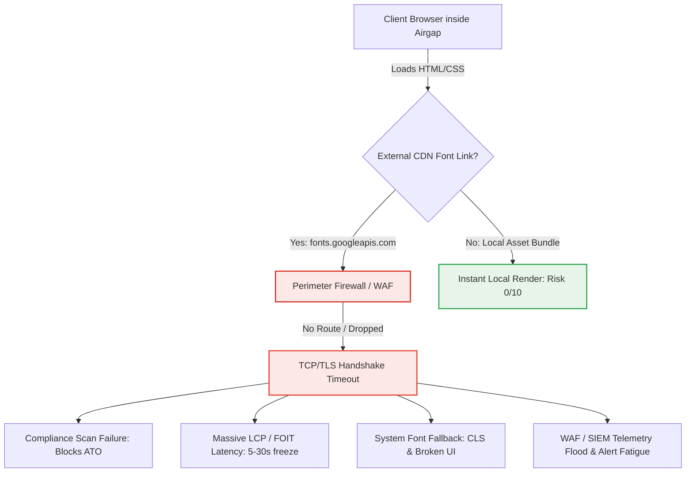
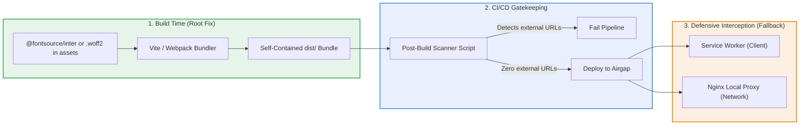

# Architectural Risk Assessment: Public Font CDNs in Airgapped Environments

**Date:** November 12, 2026  
**Companion Guide:** [Airgapped Production Font Deployment Guide](./airgapped-production-font-deployment.md)

## Summary

In modern frontend web engineering, referencing public Content Delivery Networks (CDNs)—such as [Google Fonts](https://fonts.google.com/) (`fonts.googleapis.com` and `fonts.gstatic.com`)—is standard practice for rapid delivery. However, from a technical architect's perspective, deploying applications with public font CDN references into an **airgapped production environment** is a severe architectural anti-pattern.

Because an airgapped environment is architected with zero outbound internet access by design, relying on external CDNs breaks fundamental security, performance, and operational assumptions. This article evaluates the composite **overall risk score of 9/10** associated with this anti-pattern, details the cascading failure modes across five critical operational domains, and outlines the prescriptive path to reducing the risk posture to **0/10**.

---

## The 9/10 Architectural Anti-Pattern

In an airgapped topology, client browsers and host servers are severed from the public internet. When web assets request remote fonts, the client encounters a blackholed perimeter:

Leaving public font CDN dependencies in production code triggers cascading failures across the stack, ranging from regulatory audit failures to degraded user experience and false-positive security alerting.

---

## Risk Breakdown & Impact Analysis

The table below breaks down the five core risk dimensions, ranked by severity from 0 to 10:

| Risk Category | Severity (0–10) | Architectural & Operational Impact |
| :--- | :--- | :--- |
| **Compliance & Security Audit Failure** | **10 / 10** | Strict airgap compliance standards (such as [NIST SP 800-53](https://csrc.nist.gov/publications/detail/sp/800-53/rev-5/final), [FedRAMP High](https://www.fedramp.gov/), and [DoD Cloud Computing SRG IL5/IL6](https://public.cyber.mil/)) strictly prohibit unauthorized outbound handshakes and untrusted external endpoints. Hardcoded third-party domains in compiled assets will trigger static analysis failures, fail compliance audits, and halt Authority to Operate (ATO) certification. |
| **Performance & Render-Blocking Latency** | **9 / 10** | When a browser initiates DNS resolution or TCP/TLS handshakes toward an unroutable CDN endpoint, the request hangs until timeout thresholds elapse (often 10–30 seconds per endpoint). This introduces severe Largest Contentful Paint (LCP) penalties and produces a prolonged Flash of Invisible Text (FOIT) on initial loads. |
| **UI / UX & Layout Degradation** | **7 / 10** | Once requests inevitably terminate in network errors, the browser falls back to default operating system fonts (e.g., Arial or Times New Roman). Without explicit font metric matching, unexpected glyph substitutions cause severe Cumulative Layout Shift (CLS), broken flexbox/grid alignments, button clipping, and unreadable components. |
| **Perimeter & WAF Alert Fatigue** | **6 / 10** | Hundreds of concurrent client sessions repeatedly polling dead external endpoints generate high volumes of blocked connection drops at the Web Application Firewall (WAF). These flood Security Information and Event Management (SIEM) systems with low-value telemetry, causing alert fatigue that masks genuine intrusion attempts. |
| **Supply Chain & Integrity Exposure** | **5 / 10** | In transitional or partially proxied networks, loading unpinned remote stylesheets without Subresource Integrity (SRI) leaves the runtime vulnerable to upstream CDN modifications or cache pollution, violating immutable artifact guarantees. |

---

## Architectural Recommendations: Reducing Risk to 0/10

To completely mitigate these vulnerabilities and drive the risk score from **9/10 down to 0/10**, engineering teams must eliminate network dependencies at build time rather than relying on perimeter workarounds.

### 1. Bundle Locally (Primary Architectural Fix)
- Install self-hosted npm font packages (such as `@fontsource/inter`) or transfer static `.woff2` binaries directly into `src/assets/fonts/`.
- Ensure modern frontend bundlers (such as Vite or Webpack) process fonts into relative local asset paths inside `dist/`.
- This ensures that 100% of typography assets are packaged into the immutable release artifact.

### 2. Enforce CI/CD Build Gatekeeping
- Implement automated assertions in your continuous integration pipeline to audit generated build outputs prior to artifact publishing.
- Run a scan script against `dist/` that fails the pipeline if strings such as `fonts.googleapis.com`, `fonts.gstatic.com`, `http://`, or `https://` appear inside compiled `.html`, `.js`, or `.css` files.
- Catching font leakage in CI guarantees that no external URLs reach production servers or airgapped staging zones.

### 3. Add Defensive Runtime Interception for Legacy Dependencies
- When third-party or legacy vendor packages inject immutable, hardcoded CDN requests that cannot be refactored at the source:
  - **Client-Side:** Register a Service Worker to intercept outgoing calls matching `fonts.googleapis.com` or `fonts.gstatic.com`, instantly returning local `.woff2` files from client cache.
  - **Infrastructure-Side:** Configure an internal DNS override pointing font domains to a local [Nginx](https://docs.nginx.com/) reverse proxy configured with SSL certificates to serve local stylesheets and font files.

---

## Tooling, Licensing & Monetization Notes

| Tool / Technology | Ecosystem Role | Licensing & Commercial Tiers |
| :--- | :--- | :--- |
| **[Google Fonts](https://fonts.google.com/)** | Upstream Typography | Free open-source directory; individual fonts are licensed under the SIL Open Font License (OFL) or Apache 2.0. |
| **Fontsource (`@fontsource/*`)** | Local Asset Packaging | Open-source under MIT; font files retain their upstream OFL/Apache open-source licenses. Free to use commercially. |
| **[Nginx](https://docs.nginx.com/)** | Reverse Proxy / Interception | Standard Nginx is open source and free (2-clause BSD). Enterprise deployments can utilize [NGINX Plus](https://www.f5.com/products/nginx) under commercial subscription for advanced monitoring and dynamic configuration. |
| **Vite / Webpack** | Frontend Bundlers | Free, open-source under MIT license. |

---

## Related Articles

- [Airgapped Production Font Deployment Guide](airgapped-production-font-deployment.md) — step-by-step migration, auditing, and self-hosted asset deployment in React.
- [Air-Gapped Environment Development and Deployment: Data Isolation Behind the Wall](../cloud-native/air-gapped-environment-development-deployment.md) — broader infrastructure patterns for disconnected software delivery.
- [Preventing MITM Attacks in React + Django](preventing-mitm-react-django.md) — enforcing strict CSP and eliminating untrusted third-party origins.

---

## References

- [Airgapped Production Font Deployment Guide](./airgapped-production-font-deployment.md) — Step-by-step React implementation, auditing, and Nginx/Service Worker configuration.
- [Google Fonts Repository](https://fonts.google.com/)
- [NIST Special Publication 800-53, Rev. 5: Security and Privacy Controls](https://csrc.nist.gov/publications/detail/sp/800-53/rev-5/final)
- [FedRAMP Compliance Guidelines](https://www.fedramp.gov/)
- [DoD Cloud Computing Security Requirements Guide (IL5/IL6)](https://public.cyber.mil/)
- [Nginx Documentation](https://docs.nginx.com/)
- [Fontsource Documentation](https://fontsource.org/)

