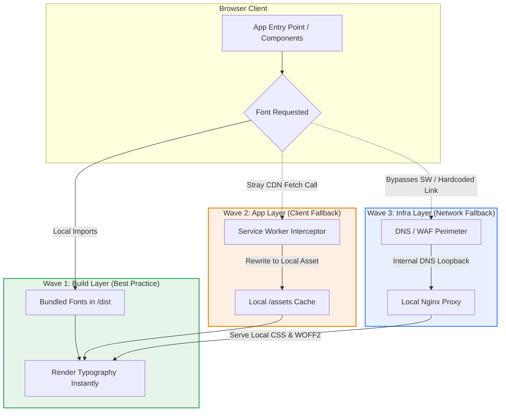

# Airgapped Production Font Deployment Guide

**Date:** November 11, 2026  
**Companion Analysis:** [Architectural Risk Assessment: Public Font CDNs in Airgapped Environments](./airgapped-font-cdn-anti-pattern.md)

## Summary

Deploying web applications in strict airgapped environments introduces hidden failure modes for external dependencies. One of the most common pitfalls is reliance on cloud-hosted typography services such as [Google Fonts](https://fonts.google.com/). Behind a strict perimeter Web Application Firewall (WAF) or inside an isolated network with no outbound internet access, browser attempts to connect to `fonts.googleapis.com` or [gstatic.com](http://gstatic.com/) will hang, time out, or fail outright. This causes massive Largest Contentful Paint (LCP) delays, layout shifts, or broken fallback typography.

This guide outlines an end-to-end strategy to audit, migrate, and isolate web fonts for modern React applications. It provides a three-tiered defense architecture spanning build-time bundling, runtime client interception (Service Workers), and infrastructure-level proxying ([Nginx](https://docs.nginx.com/)).

---

## The Airgap Typography Challenge

In standard internet-connected web development, adding web fonts typically involves inserting a stylesheet link targeting Google's CDN:

```html
<link rel="preconnect" href="https://fonts.googleapis.com">
<link rel="preconnect" href="https://fonts.gstatic.com" crossorigin>
<link href="https://fonts.googleapis.com/css2?family=Inter:wght@400;600;700&display=swap" rel="stylesheet">
```

Inside an airgapped environment, this architecture breaks completely:
1. **Unresolvable DNS & Blocked Outbound Handshakes**: The browser tries to contact `fonts.googleapis.com` (to fetch the CSS `@font-face` definitions) and `fonts.gstatic.com` (to download the binary `.woff2` files). The perimeter WAF or offline DNS blocks these calls.
2. **Cascading Render-Blocking Latency**: Browsers often wait several seconds attempting TCP/TLS handshakes before timing out, resulting in a flash of invisible text (FOIT) or delayed initial page renders.
3. **Security Audit Non-Compliance**: Airgapped compliance standards (such as NIST SP 800-53, FedRAMP High, or DoD IL5/IL6) strictly prohibit unauthorized external network calls in client builds.

---

## Architecture Overview: 3 Waves of Defense

To achieve 100% font isolation and resilience against stray dependencies, we structure font delivery into three progressive waves of defense:



1. **Wave 1 — Build Layer (Primary Target)**: Bundle all font binaries (`.woff2`) directly into the local application distribution artifact (`dist/`), ensuring zero external network requests.
2. **Wave 2 — App Layer (Fail-Safe)**: A Service Worker intercepts accidental or third-party CDN fetch requests in the client and remaps them to local assets.
3. **Wave 3 — Infra Layer (Perimeter Defense)**: Internal DNS points Google font domains to a local reverse proxy (such as [Nginx](https://docs.nginx.com/)) that serves local mock responses.

---

## Phase 1: Detect and Audit CDN Leakage

Before remediation, inspect your existing compiled artifacts (`dist/` or `build/`) to check whether any third-party UI libraries, component dependencies, or legacy CSS files inject external CDN references.

Execute these commands against your build directory:

```bash
# Scan for CSS delivery endpoints
grep -r "fonts.googleapis" dist/

# Scan for binary asset endpoints
grep -r "fonts.gstatic" dist/
```

If matches are discovered, trace the origin file (e.g., an icon set, a rich text editor CSS file, or an index HTML template) to eliminate the direct import.

---

## Phase 2: Implementation (Choose One Method)

### Method A: The Build Bundle Approach (Highly Recommended)

Use this method if your CI/CD environment or build station has upstream access to npm or an internal package mirror (like Nexus or Artifactory) before promoting the bundle to the airgapped server.

The Fontsource project provides modular, self-hosted open-source font packages.

#### 1. Install Decoupled Font Packages

```bash
npm install @fontsource/inter
```

#### 2. Import Weights in React Entry Point

Import the exact required font weights in your root file (`src/main.jsx` or `src/index.js`):

```javascript
import "@fontsource/inter/400.css";
import "@fontsource/inter/500.css";
import "@fontsource/inter/600.css";
import "@fontsource/inter/700.css";
```

#### 3. Configure Global Styles

In your primary stylesheet (`src/index.css` or Tailwind config):

```css
body {
  font-family: 'Inter', -apple-system, BlinkMacSystemFont, 'Segoe UI', Roboto, sans-serif;
}
```

#### 4. Compile

When running `npm run build`, Vite or Webpack copies the physical `.woff2` binaries directly into `dist/assets/`, writing relative URLs in your generated CSS. Zero external endpoints are contacted.

---

### Method B: Pure Manual Asset Hosting

Use this method if you are operating directly on a disconnected workstation and manually importing static assets into a locked-down repository.

#### 1. Obtain Asset Binaries

Download the desired font family bundle directly from [Google Fonts](https://fonts.google.com/) or the font author's repository on an internet-enabled transfer terminal.

#### 2. Organize Font Files

Extract and move the modern `.woff2` files into your project's assets folder:

```
src/
└── assets/
    └── fonts/
        ├── Inter-Regular.woff2
        ├── Inter-Medium.woff2
        ├── Inter-SemiBold.woff2
        └── Inter-Bold.woff2
```

#### 3. Declare `@font-face` Rules

Map the fonts explicitly in `src/index.css`:

```css
@font-face {
  font-family: 'Inter';
  font-style: normal;
  font-weight: 400;
  font-display: swap;
  src: url('./assets/fonts/Inter-Regular.woff2') format('woff2');
}

@font-face {
  font-family: 'Inter';
  font-style: normal;
  font-weight: 700;
  font-display: swap;
  src: url('./assets/fonts/Inter-Bold.woff2') format('woff2');
}

body {
  font-family: 'Inter', sans-serif;
}
```

---

## Phase 3: Runtime Interception (Fail-Safes)

If closed-source or legacy third-party UI dependencies fire hardcoded external network requests that cannot be refactored at the source level, deploy one of these safety nets.

### Option 1: Client-Side Interception (Service Worker)

A client-side Service Worker can intercept outgoing font requests at the browser network layer before they trigger browser errors or get blocked at the WAF.

Create `public/sw.js`:

```javascript
// public/sw.js
const LOCAL_FONT_PATH = '/assets/fonts/Inter-Regular.woff2';

self.addEventListener('fetch', (event) => {
  const targetUrl = event.request.url;

  // Intercept requests directed to Google font endpoints
  if (targetUrl.includes('fonts.googleapis.com') || targetUrl.includes('fonts.gstatic.com')) {
    event.respondWith(
      fetch(LOCAL_FONT_PATH).catch(() => {
        return new Response('Airgap Override Active', {
          status: 200,
          headers: { 'Content-Type': 'text/plain' },
        });
      })
    );
  }
});
```

Register the worker in `src/main.jsx`:

```javascript
if ('serviceWorker' in navigator && process.env.NODE_ENV === 'production') {
  window.addEventListener('load', () => {
    navigator.serviceWorker.register('/sw.js').catch((err) => {
      console.warn('Font ServiceWorker registration failed:', err);
    });
  });
}
```

---

### Option 2: Infrastructure-Side Redirection (Nginx Reverse Proxy)

In environments with internal DNS control, you can route domain queries for `fonts.googleapis.com` and `fonts.gstatic.com` directly to the local application host. [Nginx](https://docs.nginx.com/) can then serve local fallback files.

```nginx
# Catch font CSS requests (fonts.googleapis.com)
server {
    listen 443 ssl;
    server_name fonts.googleapis.com;

    ssl_certificate     /etc/ssl/certs/internal.crt;
    ssl_certificate_key /etc/ssl/certs/internal.key;

    location /css2 {
        root /usr/share/nginx/html/assets/css/;
        rewrite ^(.*)$ /local-inter-font.css break;
    }
}

# Catch binary font files (fonts.gstatic.com)
server {
    listen 443 ssl;
    server_name fonts.gstatic.com;

    ssl_certificate     /etc/ssl/certs/internal.crt;
    ssl_certificate_key /etc/ssl/certs/internal.key;

    location / {
        root /usr/share/nginx/html/assets/fonts/;
        try_files $uri /Inter-Regular.woff2;
    }
}
```

---

## CI/CD Gatekeeping & Automated Verification

To guarantee that no developer or npm dependency inadvertently reintroduces external CDN URLs into your production build, integrate an automated assertion into your `package.json` test scripts:

```json
{
  "scripts": {
    "build": "vite build",
    "audit:airgap": "node scripts/verify-airgap.js"
  }
}
```

Example gatekeeper script (`scripts/verify-airgap.js`):

```javascript
import fs from 'node:fs';
import path from 'node:path';

const DIST_DIR = path.resolve('dist');
const FORBIDDEN_PATTERNS = [
  'fonts.googleapis.com',
  'fonts.gstatic.com',
  'http://',
  'https://'
];

// Verify dist directory exists and check for external URLs
function auditDirectory(dir) {
  const files = fs.readdirSync(dir);
  let failed = false;

  for (const file of files) {
    const fullPath = path.join(dir, file);
    if (fs.statSync(fullPath).isDirectory()) {
      if (auditDirectory(fullPath)) failed = true;
    } else if (file.endsWith('.js') || file.endsWith('.css') || file.endsWith('.html')) {
      const content = fs.readFileSync(fullPath, 'utf8');
      for (const pattern of FORBIDDEN_PATTERNS) {
        if (content.includes(pattern)) {
          console.error(`[AIRGAP VIOLATION] Found "${pattern}" in ${fullPath}`);
          failed = true;
        }
      }
    }
  }
  return failed;
}

if (auditDirectory(DIST_DIR)) {
  console.error('Airgap audit failed: external references detected in build artifacts.');
  process.exit(1);
} else {
  console.log('Airgap audit passed: no external font endpoints detected.');
}
```

---

## Tooling & Licensing Notes

When implementing self-hosted fonts in enterprise and regulated stacks, review licensing and pricing tiers:

| Tool / Resource | Type | Licensing & Monetization |
| :--- | :--- | :--- |
| **[Google Fonts](https://fonts.google.com/)** | Font Directory | Free and open source; individual fonts are licensed under the SIL Open Font License (OFL) or Apache 2.0. |
| **Fontsource (`@fontsource/*`)** | NPM Distribution | Open source (MIT License). Font files bundled carry their respective original upstream licenses (primarily OFL). |
| **[Nginx](https://docs.nginx.com/)** | Web Server / Proxy | Open Source Nginx is free (2-clause BSD-like license). Commercial enterprise tiers ([NGINX Plus](https://www.f5.com/products/nginx)) are available via paid F5 subscriptions. |

---

## Related Articles

- [Architectural Risk Assessment: Public Font CDNs in Airgapped Environments](airgapped-font-cdn-anti-pattern.md) — why external font CDNs create compliance and availability failures.
- [Air-Gapped Environment Development and Deployment: Data Isolation Behind the Wall](../cloud-native/air-gapped-environment-development-deployment.md) — internal registries, artifact promotion, and disconnected CI/CD pipelines.
- [Preventing MITM Attacks in React + Django](preventing-mitm-react-django.md) — hardening frontend asset integrity and Content Security Policy headers.

---

## References

- [Architectural Risk Assessment: Public Font CDNs in Airgapped Environments](./airgapped-font-cdn-anti-pattern.md) — Architectural evaluation of the 9/10 risk anti-pattern and compliance impacts.
- [Google Fonts Repository & Directory](https://fonts.google.com/)
- [Google Static Asset Endpoint](http://gstatic.com/)
- [Nginx Official Documentation](https://docs.nginx.com/)
- [Fontsource Project Documentation](https://fontsource.org/)
- [MDN Web Docs: @font-face CSS At-rule](https://developer.mozilla.org/en-US/docs/Web/CSS/@font-face)

