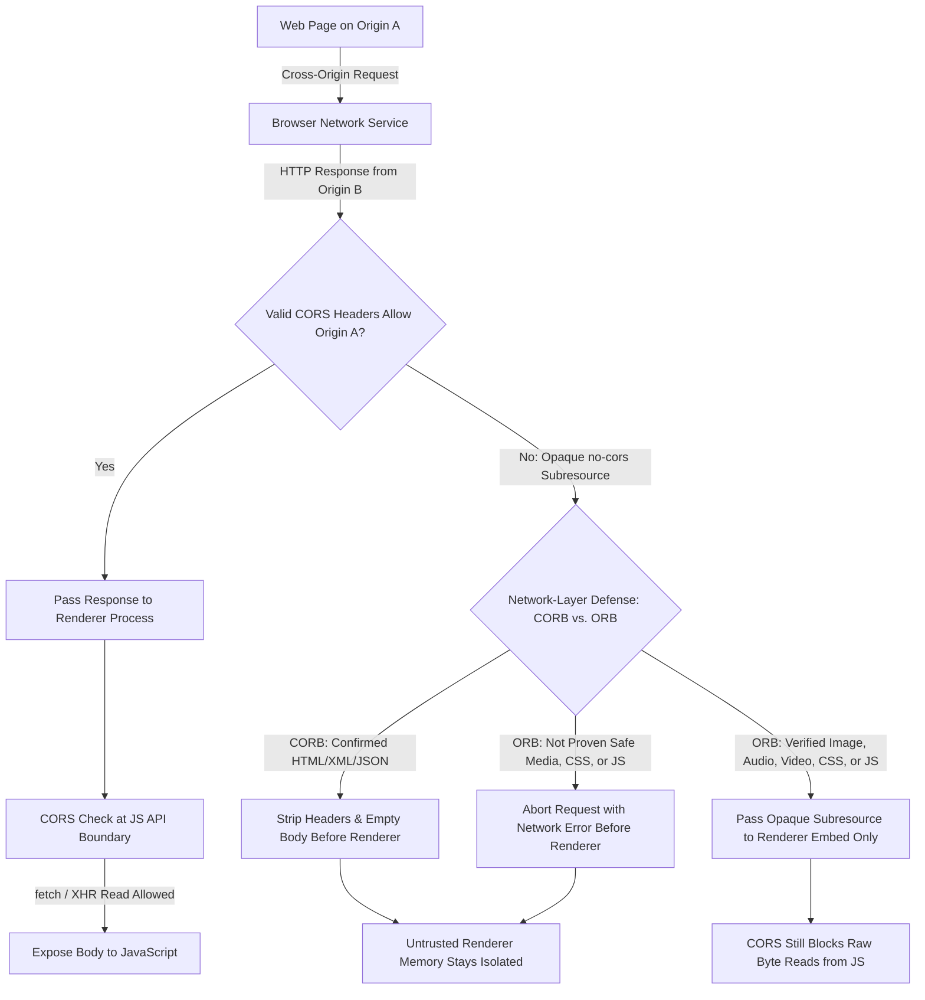

# CORS, CORB, and ORB: How Modern Browsers Enforce Cross-Origin Isolation

**Date:** November 22, 2026
**Last Updated:** November 22, 2026
**Review:** [Expert & Architecture Review Report](../../reviews/frontend/cors-corb-and-orb-browser-isolation-review.md)

> **Scope & Licensing Note:** This article strictly covers pure open-source systems. Premium, proprietary/vendor-locked, and community-edition (open-core) systems are currently not included.

## Summary

Modern web browsers act as untrusted code execution engines. Every time you visit a website, your browser downloads and runs JavaScript from servers you do not control.

To stop malicious scripts on `evil.com` from reading your bank balance on `bank.com`, browsers enforce strict isolation boundaries centered on **CORS**, **CORB**, and **ORB**—three related mechanisms operating at different layers of the browser stack against different classes of threats.

## Key Points

* **Same-Origin Policy (SOP):** The foundational boundary that permits cross-origin requests and certain subresource embeds while forbidding cross-origin JavaScript response reads.
* **CORS (Cross-Origin Resource Sharing):** An opt-in HTTP header protocol enforced at the JavaScript API boundary that lets a server selectively relax SOP for trusted origins.
* **CORB (Cross-Origin Read Blocking):** A Chromium defense that blocks sensitive `text/html`, `text/xml`, and `application/json` payloads from entering renderer memory, mitigating CPU timing side-channels such as Spectre.
* **ORB (Opaque Response Blocking):** The standardized successor to CORB in the WHATWG Fetch standard that uses a default-deny posture and aborts unverified `"no-cors"` opaque responses at the network layer.

---

## The Foundation: The Same-Origin Policy (SOP)

To understand CORS, CORB, and ORB, you first need to understand the **Same-Origin Policy (SOP)**.

An **origin** is defined by three components:

* **Scheme:** The protocol used for the request (for example, `https`).
* **Host:** The domain or hostname (for example, `example.com`).
* **Port:** The network port serving the endpoint (for example, `443`).

Under SOP, a script running on **Origin A** follows three baseline rules when interacting with **Origin B**:

* **Send requests:** Origin A may initiate HTTP requests toward Origin B.
* **Embed subresources:** Origin A may embed selected cross-origin resources (such as images via `` or stylesheets via `<link>`).
* **Block raw reads:** Origin A cannot read the raw response bytes returned by Origin B.

At the same time, modern web applications depend on legitimate cross-origin connectivity—such as querying weather APIs, loading fonts from CDNs, or rendering avatars from object storage. CORS, CORB, and ORB exist to balance strict isolation with safe cross-origin access.

---

## 1. CORS: Cross-Origin Resource Sharing

**CORS** is a standardized protocol that lets a server selectively relax the Same-Origin Policy. Instead of the browser blindly blocking every cross-origin read, CORS gives the destination server control over which origins may read its responses.

### How CORS Works

When a web app issues a cross-origin request via `fetch()` or `XMLHttpRequest`, the browser automatically attaches an `Origin` header identifying the caller:

```http
GET /api/user-profile HTTP/1.1
Host: api.example.com
Origin: https://app.example.com
```

The server inspects the `Origin` header and, if it trusts the requester, includes `Access-Control-Allow-Origin` in its response:

```http
HTTP/1.1 200 OK
Access-Control-Allow-Origin: https://app.example.com
Content-Type: application/json
```

The browser then enforces one of two outcomes:

* **Matching origin header:** Exposes the response body to the calling JavaScript code.
* **Missing or mismatched header:** Blocks JavaScript from accessing the response and logs a CORS error in the developer console.

For non-simple requests, the browser adds a preflight step:

* **Preflight trigger:** Requests using methods such as `PUT` or `DELETE`, or carrying custom headers.
* **Verification step:** The browser sends an HTTP `OPTIONS` **preflight request** first to confirm that the server allows the method and headers before transmitting the actual payload.

### Credentialed Requests & The Vary: Origin Caching Rule

When cross-origin requests carry user credentials (cookies, TLS client certificates, or `Authorization` headers via `credentials: "include"`), browsers tighten header rules:

* **No wildcard allowed:** The server must respond with `Access-Control-Allow-Credentials: true` and echo a single explicit origin in `Access-Control-Allow-Origin`—a wildcard `*` is rejected.
* **Shared-cache correctness (`Vary: Origin`):** Any server or reverse proxy that dynamically reflects `Access-Control-Allow-Origin` from an allowlist **must** include `Vary: Origin`. Without `Vary: Origin`, an intermediate CDN or shared cache can store a response generated for Origin A and mistakenly serve those headers to Origin B, causing either cross-origin failures or unintended cache sharing.

### The Crucial Limitation of CORS

CORS has an important architectural boundary:

* **Enforced at the JS API boundary:** CORS governs what the JavaScript runtime can read, not what crosses the network socket.
* **Bytes still reach renderer memory:** Even when a CORS check fails, the browser has often already downloaded the cross-origin payload into the renderer process's memory—it simply refuses to hand the bytes to JavaScript.

For years, hiding failed CORS responses from JavaScript APIs was considered sufficient. Hardware side-channel attacks broke that assumption.

---

## 2. CORB: Cross-Origin Read Blocking

In 2018, the disclosure of **Spectre** and **Meltdown** overturned a core premise of browser isolation:

* **Shared-process memory risk:** Any bytes residing in the same process memory as untrusted JavaScript can potentially be leaked via CPU timing side-channels—even when the JavaScript engine forbids direct API access.
* **Subresource bypass vector:** Tags like ``, `<script>`, or `<iframe>` bypass CORS preflights and place responses directly into the page's renderer process memory.
* **Concrete attack example:** A malicious page could embed ``. The `` tag fails to decode the JSON as an image, **yet the sensitive JSON bytes already sit in renderer memory**, exposed to Spectre extraction.

**CORB (Cross-Origin Read Blocking)** was introduced by Chromium to close this exact gap.

### How CORB Works

CORB inspects incoming cross-origin responses *before* they enter the renderer process hosting the web page:

1. **Identification:** Flags responses explicitly labeled as data—specifically `text/html`, `text/xml`, and `application/json` (along with related MIME variants).
2. **Confirmation:** Performs lightweight **content sniffing** on the first few payload bytes to verify the body actually looks like HTML, XML, or JSON rather than a mislabeled script or stylesheet.
3. **Interception:** If the response is cross-origin, lacks valid CORS headers permitting the read, and is confirmed as sensitive data, CORB **replaces the response body with an empty payload and strips its headers** before forwarding it to the renderer process.

As a result, the `` or `<script>` tag still fails gracefully as before, while sensitive bytes never touch untrusted process memory.

---

## 3. ORB: Opaque Response Blocking

While CORB closed the primary HTML, XML, and JSON leak vector, its **allowlist/blocklist MIME strategy** left structural blind spots:

* **Blind spots in MIME matching:** Newly introduced data formats, generic `Content-Type` headers (`text/plain` or `application/octet-stream`), and media byte-range responses could occasionally slip past CORB's rules.
* **Cross-engine standardization:** **ORB (Opaque Response Blocking)** is the standardized successor to CORB, developed jointly across open-source browser engines—**Chromium**, **Firefox (Gecko)**, and **WebKit**—under the **WHATWG Fetch** standard.

### How ORB Improves on CORB

When a cross-origin request runs in `"no-cors"` mode (such as via ``, `<script>`, `<audio>`, or `<video>`), the browser receives an **opaque response**. Instead of asking *"Is this response on a list of sensitive data formats?"*, ORB flips the security model to **default-deny**: *"Can we positively prove this response is a valid resource type allowed in a no-cors context?"*

ORB evaluates opaque responses through a strict three-stage pipeline:

1. **CORS Bypass Check:** Steps aside if valid CORS headers explicitly allow the requesting origin, since the response is no longer opaque.
2. **Safelisted Media & Script Verification:** Verifies that the payload is a valid image, audio stream, video stream, stylesheet, or JavaScript file using response headers (including `X-Content-Type-Options: nosniff`) and rigorous content sniffing.
3. **Full Network-Level Blocking:** Rather than forwarding an emptied shell like CORB, ORB **aborts the response outright at the network layer** as a network error whenever it cannot prove the payload is safe to embed.

By denying unknown or ambiguous responses by default, ORB provides much stronger protection against speculative execution leaks, cross-site script inclusion (XSSI), and MIME-confusion errors.

### ORB Edge Cases: Range Requests & Strict nosniff Enforcement

Two production behaviors frequently surprise teams migrating endpoints under ORB:

* **`206 Partial Content` Media Ranges:** For `<audio>` and `<video>` streaming, ORB validates `Accept-Ranges` and `Content-Range` metadata alongside media headers so non-media JSON or HTML responses cannot be sliced into fake byte-range media requests.
* **Strict `X-Content-Type-Options: nosniff` Interaction:** When `nosniff` is present alongside a generic or mismatched `Content-Type` (such as `text/plain` or `application/octet-stream` on a script or image), ORB skips permissive fallback sniffing and immediately aborts the fetch with `ERR_BLOCKED_BY_ORB`.

### Cross-Origin Interception Across the Browser Stack

The following diagram shows how network-service defenses (CORB and ORB) filter cross-origin payloads before they cross into renderer memory, while CORS controls JavaScript API access inside the renderer:



---

## 4. Beyond ORB: CORP, COOP, COEP, and Site Isolation

CORB and ORB protect pages even when servers send no opt-in isolation headers. Modern open-source browser engines—**Chromium** (`BSD-3-Clause`), **Firefox / Gecko** (`MPL-2.0`), and **WebKit** (`LGPL-2.0+` / `BSD-2-Clause`)—pair ORB with explicit response headers and OS-level process boundaries:

* **`Cross-Origin-Resource-Policy (CORP)`:** An explicit server response header (`same-origin`, `same-site`, or `cross-origin`) evaluated **before** ORB content sniffing. Setting `Cross-Origin-Resource-Policy: same-origin` lets a server deterministically block cross-origin `no-cors` subresource embedding (``, `<script>`), even for valid image or script formats.
* **`Cross-Origin-Opener-Policy (COOP)` & `Cross-Origin-Embedder-Policy (COEP)`:** Opt-in document headers (`COOP: same-origin` combined with `COEP: require-corp` or `credentialless`) that place a browsing context into a cross-origin isolated state (`window.crossOriginIsolated === true`), required to safely unlock high-resolution timers and `SharedArrayBuffer`.
* **Process-Level Site Isolation:** Browser engines combine network-layer filtering (ORB and CORP) with OS process boundaries keyed by site (`scheme + eTLD+1`). Even if a subresource or navigation occurs, separate sites do not share virtual address space in the same renderer process.

---

## Comparing CORS, CORB, and ORB

| Feature | CORS | CORB | ORB |
| --- | --- | --- | --- |
| **Full Name** | Cross-Origin Resource Sharing | Cross-Origin Read Blocking | Opaque Response Blocking |
| **Primary Purpose** | Opt-in protocol allowing servers to share resources across origins | Legacy defense keeping sensitive data out of renderer memory | Standardized successor to CORB blocking unsafe opaque responses |
| **Who Controls It?** | Server (via HTTP headers) & Browser (enforcement) | Browser automatically (no server opt-in needed) | Browser automatically (no server opt-in needed) |
| **Filtering Strategy** | Explicit origin & method allowlisting | Blocklist + sniffing for HTML, XML, and JSON | Default-deny unless verified as safe media, CSS, or JS |
| **Action on Failure** | Blocks JavaScript API from reading response | Strips headers and empties body before renderer process | Aborts with a network error before renderer process |
| **Primary Threat Mitigated** | Unauthorized cross-origin API reads (CSRF / data theft) | Side-channel memory reads (Spectre) via HTML/JSON/XML | Side-channel reads, XSSI, and arbitrary data leaks |

---

## Practical Takeaways for Web Developers

Because CORB and ORB operate transparently inside the browser, well-configured applications rarely encounter blocks. Legacy endpoints or misconfigured headers, however, can still break subresource loads. Follow these practices to avoid unexpected failures:

* **Always send accurate `Content-Type` headers:** Label JSON as `application/json` and JavaScript as `text/javascript`. Serving scripts or structured data under generic headers like `text/plain` or `application/octet-stream` causes ORB to block subresource tags.
* **Include `X-Content-Type-Options: nosniff`:** Prevent browsers from guessing MIME types so ORB validation stays deterministic and MIME-sniffing attacks are mitigated.
* **Use explicit CORS headers for data endpoints:** Configure `Access-Control-Allow-Origin` explicitly for cross-origin APIs instead of relying on legacy JSONP (`<script>` tag) workarounds, which ORB blocks when responses are not valid JavaScript.

### DevTools Triage & Diagnostic Matrix

| Mechanism | Console Error vs. Network Status | Response Body in DevTools | Typical Root Cause | Fix |
| --- | --- | --- | --- | --- |
| **CORS** | Console CORS error; Network tab may still show HTTP `200` | Visible in Network tab (blocked only from JS APIs) | Missing or mismatched `Access-Control-Allow-Origin`, missing `Vary: Origin`, or failed `OPTIONS` preflight | Configure explicit allowlisted origins, allowed methods/headers, and `Vary: Origin` |
| **CORB** | Console warning; subresource load completes with `0` bytes | Stripped headers and empty body before renderer | Cross-origin HTML, XML, or JSON loaded via `` or `<script>` without CORS opt-in | Consume data via `fetch()` with valid CORS headers instead of subresource tags |
| **ORB** | Network failure (`net::ERR_BLOCKED_BY_ORB`) | Aborted at network layer before renderer | Generic `Content-Type` (`text/plain` / `application/octet-stream`), `nosniff` mismatch, or invalid `206` media range | Send exact MIME types (`application/json`, `text/javascript`), valid `Content-Range`, or explicit CORS headers |
| **CORP** | Network failure (`ERR_BLOCKED_BY_RESPONSE.NotSameOrigin`) | Aborted before renderer | Server set `Cross-Origin-Resource-Policy: same-origin` / `same-site` on a cross-origin embed | Serve `Cross-Origin-Resource-Policy: cross-origin` (or use CORS under COEP) only for intentionally shared assets |

### Reference NGINX Open Source (`BSD-2-Clause`) Header Configuration

For teams self-hosting APIs and static assets behind **NGINX Open Source** (`BSD-2-Clause`), combine allowlisted origin reflection, `Vary: Origin`, strict MIME enforcement, and CORP defaults:

```nginx
map $http_origin $cors_origin {
    default "";
    "https://app.example.com" $http_origin;
}

server {
    listen 443 ssl;
    server_name api.example.com;

    add_header X-Content-Type-Options "nosniff" always;
    add_header Cross-Origin-Resource-Policy "same-site" always;
    add_header Vary "Origin" always;

    if ($cors_origin != "") {
        add_header Access-Control-Allow-Origin $cors_origin always;
        add_header Access-Control-Allow-Credentials "true" always;
    }
}
```

---

## Architectural Trade-Offs, Socio-Technical Pitfalls & When Not to Use CORS

Understanding browser isolation primitives also means recognizing where they stop and when a different architecture is cleaner:

* **Browser-Only Enforcement Boundary:** SOP, CORS, CORB, and ORB are enforced exclusively by compliant browser engines. Non-browser HTTP clients (`curl`, CLI scripts, server-to-server workers) ignore CORS and CORP headers completely—meaning CORS **never** replaces server-side authentication, authorization checks, or CSRF protections.
* **When Not to Use CORS (Same-Origin Reverse Proxying / BFF):** When a frontend SPA and backend API share the same product boundary, routing `/api/*` through a same-origin reverse proxy or Backend-for-Frontend (BFF) using pure open-source proxies (**NGINX Open Source**, **Caddy**, or **Envoy**) removes cross-origin `OPTIONS` preflight round-trip latency, simplifies cookie handling, and eliminates cross-origin credential friction entirely.
* **Guarding Against the "Engineer's Philosophy" Pitfall:** Overly permissive `Access-Control-Allow-Origin: *` configurations rarely happen simply because engineers misunderstand HTTP headers. In practice, they arise from organizational and tooling friction—when frontend and backend teams work across disconnected local ports or separate staging domains without shared proxy templates. Fixing the root cause requires shipping standardized local reverse-proxy templates and CI header checks rather than treating CORS misconfigurations as isolated developer mistakes.

---

## Related Articles

- [Preventing Man-in-the-Middle (MITM) Attacks in a Decoupled React + Django Architecture](preventing-mitm-react-django.md) — configuring strict CORS allowlists, CSRF tokens, and Content Security Policy (CSP) headers in production web apps.
- [Mitigating Man-in-the-Middle (MITM) Attacks in Heterogeneous Distributed Applications (React + Python)](../distributed-systems/mitm-in-heterogeneous-distributed-applications.md) — multi-layer origin, transport, and token defense across browser clients and backend gateways.
- [Architectural Risk Assessment: Public Font CDNs in Airgapped Environments](airgapped-font-cdn-anti-pattern.md) — how cross-origin subresource loading impacts security compliance and runtime reliability.
- [Sandbox and Ephemeral Identity Primitives](../cloud-native/sandbox-ephemeral-identity-primitive.md) — process and microVM isolation boundaries for executing untrusted code outside the browser.

## References

- [WHATWG Fetch Standard — CORB and Opaque Response Blocking (ORB)](https://fetch.spec.whatwg.org/)
- [WHATWG Fetch Standard — Cross-Origin-Resource-Policy (CORP)](https://fetch.spec.whatwg.org/#cross-origin-resource-policy-header)
- [WHATWG Fetch PR #1442 — Opaque Response Blocking (ORB) Architecture](https://github.com/whatwg/fetch/pull/1442)
- [Chromium Security — Cross-Origin Read Blocking (CORB) for Developers](https://www.chromium.org/Home/chromium-security/corb-for-developers/)
- [Chromium Security — Site Isolation Architecture](https://www.chromium.org/Home/chromium-security/site-isolation/)
- [MDN Web Docs — Cross-Origin Resource Sharing (CORS)](https://developer.mozilla.org/en-US/docs/Web/HTTP/CORS)
- [RFC 6454 — The Web Origin Concept](https://datatracker.ietf.org/doc/html/rfc6454)

## Changelog

- **Nov 22, 2026:** Completed multi-persona review (Reader, SME, Technical Architect); added credentialed CORS/`Vary: Origin` rules, ORB `206`/`nosniff` edge cases, CORP/COOP/COEP & Site Isolation section, NGINX Open Source headers, DevTools triage matrix, and architectural trade-offs ([Review Report](../../reviews/frontend/cors-corb-and-orb-browser-isolation-review.md)).
- **Nov 22, 2026:** Simplified formatting and structure (preserving all references and links).
- **Nov 22, 2026:** Initial publication.
