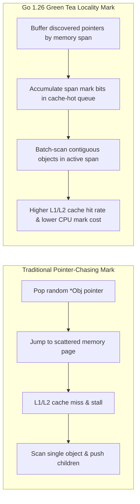

# Go 1.26: Key Changes and Features

**Date:** July 6, 2026
**Last Updated:** November 23, 2026
**Review:** [Expert & Architecture Review Report](../../reviews/tools/go-1-26-changes-review.md)

> **Scope & Licensing Note:** This article strictly covers pure open-source systems. Premium, proprietary/vendor-locked, and community-edition (open-core) systems are currently not included.

## Summary

Released on **February 10, 2026**, **Go 1.26** (BSD-3-Clause) pairs subtle language ergonomics with foundational runtime and cryptographic upgrades. Rather than introducing sweeping syntax changes, the release removes pointer-initialization boilerplate via expression-capable `new(expr)`, reduces memory-traversal cache misses through the locality-aware **"Green Tea" Garbage Collector**, trims `cgo` boundary latency, and brings standardized Hybrid Public Key Encryption (`crypto/hpke`) and post-quantum test harnesses (`crypto/mlkem/mlkemtest`, `testing/cryptotest`) directly into the standard library.

## Key Points

* **Ergonomic Pointer Initialization (`new(expr)`):** Built-in `new` now accepts arbitrary expressions instead of only type arguments, letting `p := new(42)` or struct-returning function calls allocate and initialize in one expression without temporary local variables.
* **Cache-Friendly Runtime & Lower FFI Friction:** The **Green Tea** garbage collector groups small-object mark work by memory span to reduce CPU L1/L2 cache misses, while faster `cgo` stack-transition paths and leaner `fmt.Errorf` / `io.ReadAll` allocations cut tail latency on hot paths.
* **Post-Quantum & Hybrid Cryptography in Stdlib:** New packages `crypto/hpke` (RFC 9180), `crypto/mlkem/mlkemtest` (NIST FIPS 203 deterministic test vectors), and `testing/cryptotest` establish pure open-source building blocks for verifiable cryptographic software.
* **Bounded Experimental Vectorization:** `simd/archsimd` (gated behind `GOEXPERIMENT=simd`) exposes explicit architecture-specific SIMD intrinsics for specialized compute kernels without diluting Go's portable compilation model.
* **Modernized Refactoring & Point-Release Hygiene:** An upgraded AST-driven `go fix` workflow automates migration across deprecated patterns, while point releases (`1.26.1`–`1.26.4`) reinforce Go's strict `N` and `N-1` security support policy.

---

## Go 1.26 Feature & Operational Impact Matrix

| Area | Change in Go 1.26 | Primary Operational Benefit | Production Caveat / Guardrail |
| :--- | :--- | :--- | :--- |
| **Language** | `new(expr)` accepts value expressions | Eliminates temp variables for optional struct/JSON fields | Compiler escape analysis still governs stack vs. heap placement |
| **Garbage Collector** | "Green Tea" span-locality mark phase | Fewer CPU cache misses on pointer-dense small-object graphs | Measure `pprof` & `runtime/metrics` under real allocation rates; not a fix for unbounded leaks |
| **FFI (`cgo`)** | Reduced call/stack transition overhead | Lower per-call latency when wrapping C libraries | Retains static-binary, cross-compile, and C memory-safety blast radius |
| **Cryptography** | `crypto/hpke`, `crypto/mlkem/mlkemtest`, `testing/cryptotest` | Standardized RFC 9180 / FIPS 203 workflows in pure Go | Validate protocol interoperability and key-schedule state in CI |
| **Experimental SIMD** | `simd/archsimd` (`GOEXPERIMENT=simd`) | Direct vector register access for hot numeric loops | Unstable API, architecture-coupled, unsafe to ship blindly across fleets |
| **Tooling & Core Stdlib** | Enhanced `go fix`; faster `fmt.Errorf` & `io.ReadAll` | Automated AST upgrades; fewer intermediate slice/string allocs | Audit `go fix` diffs in PRs; bound untrusted `io.ReadAll` readers with `io.LimitReader` |

---

## Language Changes: Expression-Initialized `new(expr)`

Before Go 1.26, obtaining a pointer to a primitive literal or the return value of a function required either declaring a throwaway local variable or maintaining generic pointer helper functions (a pervasive pattern in configuration structs, protobuf models, and PATCH request payloads). Go 1.26 extends the built-in `new` function to accept an expression `expr` of any assignable value type, inferring the pointer type `*T` from the expression's type `T` and initializing the allocated storage with the evaluated result.

```go
// Go 1.25 and earlier: boilerplate temp variables or custom Ptr[T] helpers
timeoutSec := 30
enabled := true
cfgLegacy := ServiceConfig{
	TimeoutSeconds: &timeoutSec,
	EnableRetry:    &enabled,
	TraceID:        ptrHelper(generateTraceID()),
}

// Go 1.26: single-expression allocation and initialization via new(expr)
cfgModern := ServiceConfig{
	TimeoutSeconds: new(30),
	EnableRetry:    new(true),
	TraceID:        new(generateTraceID()),
}
```

### Semantics, Evaluation Order, and Escape Analysis

* **Type Inference & Untyped Constants:** Untyped constants passed to `new(expr)` adopt their default type (for example, `new(42)` yields `*int`, `new("ok")` yields `*string`, and `new(3.14)` yields `*float64`), preserving exact consistency with short variable declarations (`:=`).
* **Single Evaluation & Order of Operations:** `expr` is evaluated once left-to-right at the call site before constructing the resulting `*T`, ensuring side effects in helper calls behave predictably inside composite literals.
* **Escape Analysis Reality:** Using `new(expr)` does **not** force a heap allocation. Go's compiler escape analysis determines whether the pointer escapes the current stack frame; non-escaping `new(expr)` values remain stack-allocated just like `&T{}` or `&v`.

---

## Garbage Collector & Runtime: The "Green Tea" GC and `cgo` Fast Paths

### How the "Green Tea" Garbage Collector Improves Locality

Traditional tri-color mark-sweep garbage collectors walk object graphs depth-first or FIFO by individual pointer targets. Because pointers stored inside a struct frequently point to objects scattered across distant virtual memory pages, each dereference risks an L1/L2 CPU cache miss and a TLB stall—especially on modern multi-core servers with wide memory hierarchies and millions of small heap objects.

Go 1.26's **Green Tea** garbage collector restructures small-object marking around **memory spans and page spatial locality** rather than isolated pointer chasing:



By batching mark work at the span level, the runtime amortizes page-table lookups and processes neighboring heap objects while their cache lines are still warm. Workloads dominated by small, short-to-medium-lived heap allocations (JSON/protobuf decoders, AST processors, and service proxies) see lower mark-phase CPU overhead without manual tuning flags.

### Reduced `cgo` Call Overhead

Go 1.26 optimizes the runtime's `cgo` entry and exit paths—streamlining goroutine-to-system-thread state transitions and metadata bookkeeping around C calls. Applications that must cross the Go/C boundary frequently (such as SQLite wrappers, hardware crypto modules, or media codecs) experience noticeably lower per-invocation latency, though `cgo`'s operational and build-portability constraints remain unchanged.

---

## Standard Library Additions: Post-Quantum & Hybrid Cryptography

Go 1.26 expands the standard library's pure open-source cryptographic suite (BSD-3-Clause) with three focused packages targeting standardized hybrid encryption and deterministic verification:

1. **`crypto/hpke` (RFC 9180):** Implements **Hybrid Public Key Encryption**, cleanly separating the Key Encapsulation Mechanism (KEM), Key Derivation Function (KDF), and Authenticated Encryption with Associated Data (AEAD) layers. Rather than rolling custom ECDH + HKDF + AES-GCM glue code prone to nonce reuse or context-binding mistakes, services can compose standard HPKE sender/recipient seals directly from the standard library.
2. **`crypto/mlkem/mlkemtest` (NIST FIPS 203):** Provides deterministic key-encapsulation test helpers for Go's Module-Lattice-Based Key-Encapsulation Mechanism (`crypto/mlkem`). Cryptographic engineers can verify known-answer test (KAT) vectors and reproducible decapsulation edge cases in CI without patching internal randomness sources.
3. **`testing/cryptotest`:** Establishes standardized compliance and contract tests for cryptographic primitives (such as `cipher.Block`, `cipher.AEAD`, and `hash.Hash` implementations), catching state-mutation, buffer-aliasing, and boundary-slice bugs in third-party or custom pure-Go crypto packages.

```go
package main

import (
	"crypto/hpke"
	"fmt"
)

func roundTripHPKE(pub hpke.PublicKey, priv hpke.PrivateKey, msg, aad []byte) ([]byte, error) {
	suite := hpke.NewSuite(hpke.KEM_X25519_HKDF_SHA256, hpke.KDF_HKDF_SHA256, hpke.AEAD_AES256GCM)

	enc, sender, err := hpke.NewSender(pub, suite, []byte("service-envelope-v1"))
	if err != nil {
		return nil, fmt.Errorf("init hpke sender: %w", err)
	}
	ciphertext, err := sender.Seal(aad, msg)
	if err != nil {
		return nil, fmt.Errorf("seal hpke payload: %w", err)
	}

	recipient, err := hpke.NewRecipient(enc, priv, suite, []byte("service-envelope-v1"))
	if err != nil {
		return nil, fmt.Errorf("init hpke recipient: %w", err)
	}
	return recipient.Open(aad, ciphertext)
}
```

---

## Experimental Features: Architecture-Specific SIMD (`simd/archsimd`)

For compute-bound kernels where scalar Go loops leave vector lanes idle, Go 1.26 introduces the experimental `simd/archsimd` package, enabled only when compiling with `GOEXPERIMENT=simd`.

* **Explicit Architecture Coupling:** Unlike compiler auto-vectorization—which makes unpredictable optimization passes behind the scenes—`simd/archsimd` exposes hardware-specific vector types and instructions explicitly, letting performance engineers reason directly about register widths and memory alignment.
* **No Backward-Compatibility Guarantee:** Like all `GOEXPERIMENT` features, `simd/archsimd` sits outside the Go 1 compatibility promise. APIs, package layouts, and supported instruction sets may break in Go 1.27+. Isolate any usage behind build tags (`//go:build goexperiment.simd`) paired with a tested pure-Go scalar fallback.

---

## Tooling & Core Library Optimizations

* **`go fix` AST Modernization:** Go 1.26 upgrades `go fix` into a modern static-analysis-backed refactoring tool capable of automatically rewriting legacy idioms to current standard-library equivalents. Teams upgrading multi-year codebases can review deterministic `go fix -diff ./...` patches before committing.
* **`fmt.Errorf` Allocation Reductions:** Formatting non-wrapped or simple error paths avoids unnecessary intermediate heap allocations and reflection overhead, lowering memory churn in validation-heavy API handlers where error construction previously showed up in allocation profiles.
* **`io.ReadAll` Buffer Growth Improvements:** `io.ReadAll` optimizes its internal slice allocation and growth strategy when reading streams of unknown length, cutting redundant buffer copies and reducing transient GC pressure. **Security reminder:** `io.ReadAll` still reads until `io.EOF`; always wrap untrusted network or upload bodies with `io.LimitReader` to prevent out-of-memory denial-of-service.

---

## Maintenance Releases & Support Lifecycle

Per Go's release policy, only the two most recent major releases (`N` and `N-1`, i.e., Go 1.26 and Go 1.25 until Go 1.27 ships) receive security patches and critical bug fixes. Running `1.26.0` unpatched leaves production binaries exposed to resolved CVEs:

| Version | Release Window | Key Scope & Operational Action |
| :--- | :--- | :--- |
| **Go 1.26.0** | February 10, 2026 | Initial feature release (`new(expr)`, Green Tea GC, `crypto/hpke`, `simd/archsimd`); supersede immediately in production |
| **Go 1.26.1** | March 2026 | Security fixes including `crypto/x509` certificate/chain validation hardening and standard library fixes |
| **Go 1.26.2** | April 2026 | Follow-up security patches and compiler/runtime bug fixes |
| **Go 1.26.3** | May 2026 | Targeted runtime, networking, and standard library stability/security patches |
| **Go 1.26.4** | June 2026 | Latest mid-cycle minor release covered in the 1.26 branch baseline; verify with `govulncheck` for any newer patch |

---

## Architectural Trade-Offs & When Not to Use Go 1.26 Features

Adopting every headline release feature indiscriminately adds architectural debt. Apply explicit boundaries before introducing these primitives into shared systems:

* **When NOT to Use `GOEXPERIMENT=simd` (`simd/archsimd`):** Avoid experimental SIMD in general business microservices, CRUD APIs, or shared libraries distributed to downstream consumers. Requiring `GOEXPERIMENT=simd` couples CI build flags, breaks reproducible default `go build` expectations, and locks code paths to specific CPU architectures (`amd64` AVX/SSE vs. `arm64` NEON) without Go 1 compatibility protection. Use it only for isolated, benchmark-proven codecs, cryptography, or vector-math kernels gated behind scalar fallbacks.
* **When NOT to Overuse `new(expr)`:** Although `new(expr)` cleans up optional pointer fields, it should not push value-oriented Go APIs toward pervasive `*int` / `*string` pointer parameters. Passing values directly keeps nil-pointer dereference panics impossible and simplifies zero-value semantics; reserve `new(expr)` for genuine tri-state optionality (absent vs. explicit zero) and DTO serialization boundaries.
* **When NOT to Rely on `cgo` Overhead Reductions:** Faster `cgo` transitions reduce per-call CPU tax, **not** architectural risk. `cgo` still disables pure-Go cross-compilation, complicates static `CGO_ENABLED=0` container images, introduces C memory-corruption blast radius (use-after-free, buffer overflows), and constrains goroutine stack flexibility. Prefer pure-Go implementations unless hardware drivers or vetted system libraries leave no alternative.
* **Green Tea GC Boundaries:** Span-locality marking optimizes throughput and cache behavior for typical small-object graphs, yet it cannot rescue services suffering from unbounded goroutine leaks, unclosed response bodies, or oversized request buffers. Fix allocation rates and apply bounded backpressure first.

---

## Socio-Technical Upgrade Realities & Avoiding the Silver-Bullet Trap

Language release notes often encourage an **"Engineer's Philosophy" trap**—treating systemic latency, security posture, or developer friction as simple technical bugs solved merely by bumping a toolchain directive in `go.mod`. In practice, upgrading a fleet to Go 1.26 is a socio-technical coordination problem:

1. **Toolchain & CI Drift Across Teams:** Enabling `go 1.26.4` in a shared module forces downstream services, local developer environments, container base images, and air-gapped build caches to move together. Without a clear `GOTOOLCHAIN` policy and coordinated base-image rebuilds, teams hit "works on my laptop, fails in CI" churn.
2. **Cryptographic Interoperability Delays:** Having `crypto/hpke` and `crypto/mlkem/mlkemtest` in the Go standard library does not magically migrate partner gateways, TLS terminators, or hardware security modules (HSMs). Post-quantum and HPKE adoption requires negotiated protocol versioning, key-rotation runbooks, and dual-stack fallbacks across organizational boundaries.
3. **Observability Before Celebration:** Never assume Green Tea GC or `io.ReadAll` improvements automatically lower your p99 latency. Measure heap allocations (`go tool pprof`), GC pause/CPU percentages (`runtime/metrics`), and benchmark regressions (`benchstat`) under realistic staging traffic before rolling out across production clusters.

---

## Production Upgrade & Verification Checklist

1. **Audit Vulnerable Dependencies & Runtime CVEs:** Run pure open-source `govulncheck ./...` (BSD-3-Clause) and confirm your build container targets at least `go1.26.4` (or the newest 1.26.x patch).
2. **Preview Automated Refactors Safely:** Execute `go fix -diff ./...` in a dedicated commit so reviewers can verify AST rewrites separately from feature changes.
3. **Validate Cryptographic Implementations:** Add `testing/cryptotest` suites for custom ciphers/hashes and `crypto/mlkem/mlkemtest` deterministic vector tests if using ML-KEM.
4. **Enforce Bounded I/O & `cgo` Discipline:** Audit `io.ReadAll` call sites for `io.LimitReader` bounds and keep `CGO_ENABLED=0` where pure-Go builds suffice.
5. **Baseline Runtime Telemetry:** Capture before/after `pprof` heap/CPU profiles and `runtime/metrics` `/gc/cycles/total:gc-cycles` counters during canary rollout.

---

## Related Articles

* [From Source to Sandbox: Decoupling the Modern Open-Source Code Editor](decoupling-modern-code-editor.md) — Explores containerized dev toolchains and reproducible sandboxed SDKs that keep multi-team Go 1.26 upgrades consistent across laptops and CI.
* [The Silent Architecture of Utility Modules: Designing Small Helpers That Don’t Break Large Systems](../design/silent-architecture-of-utility-modules.md) — Examines how small helpers (like custom pointer wrappers replaced by `new(expr)` or `io.ReadAll` wrappers) carry disproportionate blast radius across large systems.
* [Mitigating Man-in-the-Middle (MITM) Attacks in Heterogeneous Distributed Applications (React + Python)](../distributed-systems/mitm-in-heterogeneous-distributed-applications.md) — Connects Go 1.26's `crypto/hpke`, `crypto/x509` hardening, and post-quantum readiness to end-to-end transport and envelope security.
* [Ageless Programming: Timeless Software Design](../philosophy/ageless-programming.md) — Grounds language-level upgrades in enduring engineering principles: simplicity, explicit boundaries, and resisting hype-driven experimental flags.

## References

* [Official Go 1.26 Release Notes](https://go.dev/doc/go1.26)
* [The Go Programming Language Specification](https://go.dev/ref/spec)
* [A Guide to the Go Garbage Collector](https://go.dev/doc/gc-guide)
* [RFC 9180: Hybrid Public Key Encryption (HPKE)](https://www.rfc-editor.org/rfc/rfc9180)
* [NIST FIPS 203: Module-Lattice-Based Key-Encapsulation Mechanism Standard (ML-KEM)](https://csrc.nist.gov/pubs/fips/203/final)

## Changelog

- **Nov 23, 2026:** Completed multi-persona review (Reader, SME, Technical Architect); expanded `new(expr)` escape analysis, Green Tea GC locality pipeline diagram, RFC 9180 / FIPS 203 cryptography depth, architectural trade-offs, and production upgrade checklist ([Review Report](../../reviews/tools/go-1-26-changes-review.md)).
- **Jul 06, 2026:** Initial publication.
