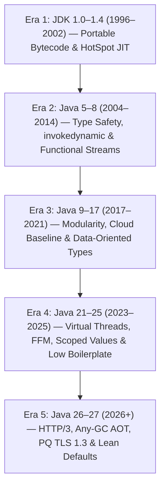
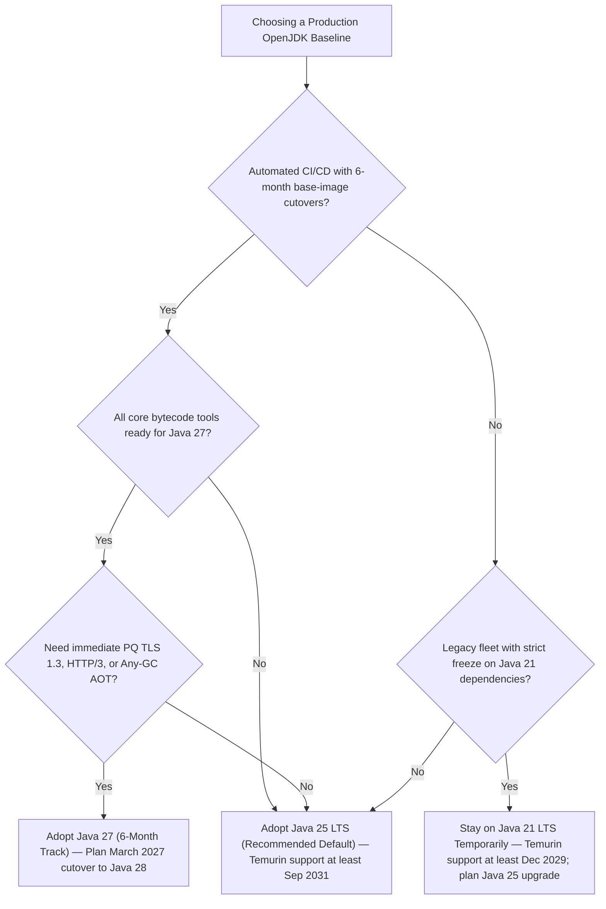

# Java Evolution (JDK 1.0 to Java 27): Version Milestones, LTS Support, and Modern JVM Architecture

**Date:** November 24, 2026
**Last Updated:** November 24, 2026
**Review:** [Expert & Architecture Review Report](../../reviews/tools/java-evolution-versions-and-lts-timeline-review.md)

> **Scope & Licensing Note:** This article strictly covers pure open-source systems. Premium, proprietary/vendor-locked, and community-edition (open-core) systems are currently not included.

## Summary

Over three decades—from **JDK 1.0 (1996)** to **Java 27 (September 2026)**—Java has evolved from a portable object-oriented runtime ("Write Once, Run Anywhere") into a high-density, cloud-native, post-quantum-ready platform governed by the open-source **OpenJDK** project (`GPL-2.0-only WITH Classpath-exception-2.0`). Understanding how the JVM reached this point is essential for engineering teams deciding today between multi-year Long-Term Support (LTS) baselines and the rapid 6-month feature track. Since shifting to a 6-month feature cadence in Java 9 and a 2-year LTS cycle starting with Java 17, OpenJDK has systematically retired long-standing operational bottlenecks—delivering Virtual Threads, algebraic data-oriented programming (closed type hierarchies checked exhaustively at compile time), 64-bit compact object headers, GC-agnostic Ahead-of-Time (AOT) object caching, native HTTP/3 over QUIC, post-quantum hybrid TLS 1.3, and JFR in-process data redaction.

## Key Points

* **Three Decades of Continuous Evolution Without Abandoning Compatibility:** Bytecode stability and the adaptive HotSpot JIT compiler allowed Java to layer generics, lambdas, modules, records, pattern matching, and virtual threads onto the same foundational VM model.
* **Predictable OpenJDK Release & Community Support Cadence:** Non-LTS feature releases ship every **6 months** (March and September) with 6 months of public updates; LTS baselines (Java 8, 11, 17, 21, and 25) receive multi-year security updates through upstream **OpenJDK Updates** projects and vendor-neutral builds such as **Eclipse Temurin** (minimum 4+ year LTS community commitment on a quarterly update schedule).
* **Era 4 (Java 21 – 25) Transformed Concurrency, Native Interop, and Developer Ergonomics:** Lightweight concurrency, bounded context propagation, a safe pure-Java native interface, leaner syntax, and smaller object headers removed decades-old throughput, verbosity, and heap-density penalties.
* **Era 5 (Java 26 – 27) Hardens Security and Container-First Defaults:** Out-of-the-box transport modernization, post-quantum TLS readiness, GC-agnostic startup caching, predictable small-container garbage collection, and in-process diagnostic redaction shift critical operational guardrails from manual tuning into standard JVM defaults.

---

## Complete Java Version, Support & Milestone Matrix (JDK 1.0 – Java 27)

The matrix below highlights watershed and LTS milestones—intermediate 6-month non-LTS releases (such as Java 12–16 and Java 18–20) rolled their finalized capabilities forward into their subsequent LTS baseline, while Java 22–24 are shown explicitly because they delivered pivotal runtime transitions ahead of Java 25 LTS.

| Version | Release Date | Type | Open-Source Community Support Horizon (OpenJDK Updates / Eclipse Temurin) | Key Milestones & Features |
| :--- | :--- | :--- | :--- | :--- |
| **JDK 1.0 – 1.4** | 1996 – 2002 | Legacy | **Oct 2008** (1.4.2) | JVM bytecode execution ("Write Once, Run Anywhere"), Collections Framework, Swing, HotSpot JIT compiler, NIO, and regex. |
| **Java 5** | Sep 2004 | Legacy | **Oct 2009** | **Type Safety & Metadata:** Generics, annotations, autoboxing, enums, enhanced `for` loops, and `java.util.concurrent`. |
| **Java 6** | Dec 2006 | Legacy | **Feb 2013** | **Runtime Maturity & Tooling:** Compiler API (`javax.tools`), Scripting API (`javax.script`), JDBC 4.0 driver discovery, pluggable annotation processing, and HotSpot synchronization optimizations. |
| **Java 7** | Jul 2011 | Legacy | **Apr 2015** (Public EOL) | **Developer Ergonomics:** `try-with-resources`, diamond operator (`<>`), NIO.2 file APIs, and `invokedynamic` bytecode (paving the way for lambdas). |
| **Java 8** | Mar 2014 | **LTS** | **At least Dec 2030** (`jdk8u` / Eclipse Temurin) | **Functional Paradigm:** Lambda expressions, Stream API, `Optional`, `java.time` (Date/Time API), and replacement of PermGen with Metaspace. |
| **Java 9 – 10** | Sep 2017 – Mar 2018 | Feature | **Mar 2018** (9) / **Sep 2018** (10) | **Modularity & Inference:** Java Platform Module System (Project Jigsaw), JShell, G1 as default server GC, and local variable type inference (`var`). |
| **Java 11** | Sep 2018 | **LTS** | **At least Oct 2027** (`jdk11u` / Eclipse Temurin) | **Cloud-Native Baseline:** Standardized HTTP/2 Client API, single-file source execution (`java Hello.java`), ZGC (experimental), and removal of Java EE/CORBA modules. |
| **Java 17** | Sep 2021 | **LTS** | **At least Oct 2027** (`jdk17u` / Eclipse Temurin) | **Data-Oriented Programming:** Sealed classes, finalized `record` types (from 16), text blocks (from 15), `switch` expressions (from 14), and strong encapsulation of JDK internals. |
| **Java 21** | Sep 2023 | **LTS** | **At least Dec 2029** (`jdk21u` / Eclipse Temurin) | **High-Throughput Concurrency:** Virtual Threads (JEP 444), Record Patterns, Pattern Matching for `switch`, Sequenced Collections, and opt-in Generational ZGC (JEP 439). |
| **Java 22 – 24** | Mar 2024 – Mar 2025 | Feature | **Sep 2024** (22) / **Mar 2025** (23) / **Sep 2025** (24) | **Runtime Modernization Bridge:** Foreign Function & Memory (FFM) API (JEP 454, 22), Generational ZGC default (JEP 474, 23) then sole mode (JEP 490, 24), Virtual Thread unpinning for `synchronized` (JEP 491, 24), Class-File API (JEP 484) & Stream Gatherers (JEP 485), ML-KEM/ML-DSA primitives (JEPs 496/497), and AOT Class Loading & Linking (JEP 483). |
| **Java 25** | Sep 2025 | **LTS** | **At least Sep 2031** (`jdk25u` / Eclipse Temurin) | **Boilerplate Reduction & Runtime Efficiency:** Scoped Values (JEP 506), Flexible Constructor Bodies (JEP 513), Compact Source Files & `java.lang.IO` (JEP 512), Module Imports (JEP 511), KDF API (JEP 510), Project Leyden AOT ergonomics/profiling (JEPs 514/515), JFR cooperative sampling & method tracing (JEPs 518/520), Generational Shenandoah (JEP 521), and opt-in Compact Object Headers (JEP 519). |
| **Java 26 – 27** | Mar – Sep 2026 | Feature | **Sep 2026** (26) / **Mar 2027** (27) | **Modern Security & Defaults:** HTTP/3 Client (JEP 517), AOT Object Caching with any GC (JEP 516), `final`-field mutation warnings (JEP 500), G1 throughput boost (JEP 522), Applet API removal (JEP 504) in **26**; PQ Hybrid TLS 1.3 (JEP 527), default Compact Object Headers (JEP 534), unconditional G1 GC default (JEP 523), and JFR In-Process Data Redaction (JEP 536) in **27**. |

> **Support Cadence Note:** Non-LTS feature releases receive public updates for exactly **6 months** until superseded by the next feature release. The LTS horizons above reflect the pure open-source **Eclipse Adoptium (Eclipse Temurin)** End-of-Availability schedule backed by upstream **OpenJDK Updates** projects (`jdk8u`, `jdk11u`, `jdk17u`, `jdk21u`, `jdk25u`), published at [adoptium.net/support/](https://adoptium.net/support/). Eclipse Adoptium commits to maintaining each LTS release for **at least 4+ years** (typically extended further while upstream OpenJDK Updates remain active), shipping **quarterly Critical Patch Updates (CPUs)** on the **third Tuesday of January, April, July, and October**.

> **Warning — Community vs. Commercial Support Blast Radius:** Never plan pure open-source OpenJDK upgrades around paid commercial extended-support calendars published by proprietary JDK vendors. Commercial extended windows frequently outlast upstream community maintenance by several years; teams that mistakenly anchor open-source container base images to commercial EOL dates risk running silently unpatched JVMs—missing critical TLS, deserialization, and memory-safety CVE fixes—long after community updates stop.

---

## Five Architectural Eras of the JVM

Viewing Java's timeline purely as a list of syntax features misses its deeper trajectory: every era solved a specific structural bottleneck in how software is compiled, scheduled, isolated, and operated in production.



---

### Era 1: Portable Bytecode and Adaptive Runtime Foundations (JDK 1.0 – 1.4)

Between **1996 and 2002**, Java established the architectural contract that still underpins the ecosystem: compile once into platform-neutral `.class` bytecode and let a managed runtime optimize execution for the host CPU at runtime.

* **HotSpot Adaptive JIT Compiler:** Rather than relying on slow interpretation or static ahead-of-time compilation alone, HotSpot profiled hot call paths dynamically, inlining virtual calls and applying speculative optimizations with safe deoptimization fallbacks.
* **Collections & Non-Blocking I/O:** The **Collections Framework** standardized data structures and iteration contracts, while **NIO** introduced buffer- and channel-based non-blocking I/O for scalable network servers.
* **Core Desktop & Text Primitives:** **Swing** provided portable UI components and `java.util.regex` brought built-in regular expressions directly into the standard library.

---

### Era 2: Type Safety, Bytecode Extensibility, and the Functional Shift (Java 5 – 8)

During the decade from **2004 to 2014**, Java matured from a verbose OOP language into an expressive enterprise and concurrent programming platform.

* **Java 5 (September 2004) — Type Safety & Concurrency Primitives:** Generics eliminated unsafe raw-collection casts at compile time, annotations unlocked declarative metadata frameworks, and `java.util.concurrent` (executors, concurrent collections, locks, and atomics) replaced brittle manual `synchronized`/`wait`/`notify` code with high-throughput concurrency primitives.
* **Java 6 (December 2006) — Compiler APIs & HotSpot Maturity:** Standardized programmatic compilation (`javax.tools`), scripting integration (`javax.script`), pluggable annotation processing, and JDBC 4.0 service-provider discovery, while HotSpot synchronization optimizations (such as lock coarsening and escape-analysis groundwork) narrowed the gap with native runtimes.
* **Java 7 (July 2011) — Resource Safety & Modern File I/O:** `try-with-resources` eliminated deterministic resource-leak boilerplate, the diamond operator (`<>`) trimmed generic repetition, and **NIO.2** (`java.nio.file`) replaced legacy `java.io.File` with an extensible, symlink-aware filesystem API.
* **Java 7 (July 2011) — `invokedynamic` Bytecode:** Originally introduced for dynamic JVM languages, the **`invokedynamic`** instruction provided a dynamic call-site bootstrap mechanism that later made Java lambdas and string concatenation fast and compact without generating thousands of synthetic anonymous inner classes.
* **Java 8 LTS (March 2014) — Functional Idioms & `java.time`:** Lambda expressions, the **Stream API**, `Optional`, and the immutable **`java.time`** Date/Time API reshaped everyday Java design.
* **Java 8 LTS (March 2014) — Metaspace Replaces PermGen:** Replacing **PermGen** (a fixed-size contiguous heap region storing class metadata) with **Metaspace** (dynamically resized native memory for class metadata) eliminated one of the most notorious `OutOfMemoryError` failure modes in dynamically deployed application servers.

---

### Era 3: Modularity, Cloud-Native Baseline, and Data-Oriented Programming (Java 9 – 17)

Beginning in **2017**, OpenJDK pivoted from multi-year monolithic feature drops to a **strict 6-month time-boxed release train**, enabling faster, lower-risk delivery of JVM and language capabilities.

* **Java 9 – 10 (2017 – 2018) — Modularity & Inference:** The **Java Platform Module System (Project Jigsaw)** broke the monolithic JDK into explicit, strongly encapsulated modules, enabling minimal custom runtimes via `jlink`. **JShell** added an official REPL, **G1** became the default server garbage collector, and Java 10 introduced local variable type inference (`var`) without sacrificing static typing.
* **Java 11 LTS (September 2018) — Cloud-Native Baseline:** Standardized the non-blocking **HTTP/2 Client API** (`java.net.http.HttpClient`), enabled direct single-file source execution (`java Hello.java`), introduced **ZGC** (experimentally) for ultra-low-latency heaps, and removed legacy Java EE and CORBA modules to shrink the core runtime footprint.
* **Java 17 LTS (September 2021) — Data-Oriented Programming:** Consolidated `record` classes (finalized in 16), `sealed` class hierarchies (17), text blocks (15), and `switch` expressions (14) into a cohesive long-term baseline.
* **Java 17 LTS (September 2021) — Strong Encapsulation of JDK Internals:** Closed off unsupported deep reflective access to `sun.*` and `jdk.internal.*` APIs—a deliberately uncomfortable boundary reset that mirrors the principle behind [The Architecture of the "Disposable" Core](../design/architecture-of-disposable-core.md): hard module interfaces make future internal evolution possible without silent ecosystem breakage.

---

### Era 4: High-Throughput Concurrency, Native Interop, and Boilerplate Reduction (Java 21 – 25 LTS)

The **2023–2025** releases dismantled three long-standing criticisms of Java: the memory cost of blocking I/O threads, the fragility of JNI native bindings, and the syntactic ceremony required for everyday programs and domain modeling.

#### Java 21 LTS (September 2023): Project Loom & Algebraic Pattern Matching

* **Virtual Threads (JEP 444, Project Loom):** Lightweight JVM-managed threads mounted on a small pool of OS carrier threads allow straightforward synchronous, blocking I/O code to scale to hundreds of thousands of concurrent tasks while preserving readable stack traces. On Java 21, engineers had to audit **`synchronized` pinning**—a limitation where a virtual thread blocked inside a `synchronized` monitor held onto its underlying OS carrier thread—and temporarily substitute `ReentrantLock` on hot I/O paths.
* **Record Patterns & Pattern Matching for `switch`:** Paired with `sealed` interfaces, Java gained **algebraic data-oriented programming** (closed type hierarchies whose variants can be destructured and checked exhaustively by the compiler).
* **Sequenced Collections:** `SequencedCollection`, `SequencedSet`, and `SequencedMap` unified first- and last-element access across ordered collections.
* **Generational ZGC (JEP 439, Opt-In):** Separated young and old object lifetimes to sustain sub-millisecond GC pauses at lower CPU and memory cost. Generational ZGC shipped **opt-in** in Java 21 (`-XX:+UseZGC -XX:+ZGenerational`), became the **default ZGC mode** in Java 23 (JEP 474), and **replaced non-generational ZGC** outright in Java 24 (JEP 490).

```java
// Data-Oriented Programming (Java 17–21): sealed types + records + exhaustive switch
sealed interface PaymentResult permits Approved, Declined {}
record Approved(String authCode, long amountCents) implements PaymentResult {}
record Declined(String reasonCode) implements PaymentResult {}

static String describe(PaymentResult result) {
    return switch (result) {
        case Approved(var code, var cents) -> "Approved (" + code + ") for " + cents + " cents";
        case Declined(var reason) -> "Declined: " + reason;
    };
}
```

#### Java 22 – 24 (March 2024 – March 2025): The Runtime Modernization Bridge

Although non-LTS releases, Java 22 through Java 24 finalized critical platform foundations that rolled directly into **Java 25 LTS**:

* **Foreign Function & Memory (FFM) API (JEP 454, Java 22):** Provides a safe, pure-Java replacement for brittle JNI (Java Native Interface) glue when calling native C libraries or managing off-heap memory deterministically.
* **Synchronize Virtual Threads without Pinning (JEP 491, Java 24):** Re-architected object monitors so virtual threads unmount cleanly inside `synchronized` blocks. On **Java 25 LTS**, auditing `synchronized` hot paths is no longer required—residual pinning is narrowed to native/JNI/FFM downcalls and class initialization (`<clinit>`), both observable via the JFR `jdk.VirtualThreadPinned` event.
* **Class-File API (JEP 484) & Stream Gatherers (JEP 485) (Java 24):** Standardized JDK bytecode parsing and generation (reducing ecosystem coupling to internal ASM forks) and introduced composable custom intermediate stream operations (`Stream::gather`).
* **Post-Quantum Cryptography Primitives (JEPs 496 & 497, Java 24):** Delivered standard **ML-KEM** (key encapsulation, NIST FIPS 203) and **ML-DSA** (digital signatures, NIST FIPS 204) implementations in the core crypto providers, laying the groundwork for Java 27's hybrid TLS 1.3 handshakes.
* **Ahead-of-Time Class Loading & Linking (JEP 483, Java 24):** Delivered the first finalized milestone of **Project Leyden** (OpenJDK's initiative to cut Java startup time, warmup latency, and footprint) by caching already-loaded and linked classes from a training run.

#### Java 25 LTS (September 2025): Leaner Syntax, Scoped Context, and Denser Heaps

Java 25 consolidated the Java 22–24 foundations alongside a cohesive wave of boilerplate-reducing and runtime-efficiency JEPs:

* **Scoped Values (JEP 506):** Provides immutable, bounded context propagation across call trees and child virtual threads—replacing error-prone, leak-susceptible mutable `ThreadLocal` patterns in high-concurrency servers.
* **Flexible Constructor Bodies (JEP 513):** Permits validation, normalization, and argument preparation in a constructor prologue *before* invoking `super(...)` or `this(...)`, preventing partially initialized subclass states without forcing static factory helpers.
* **Compact Source Files & Instance `main()` (JEP 512):** Removes mandatory class wrappers and `public static void main(String[] args)` ceremony for scripts and small utilities, introduces the `java.lang.IO` console API (`IO.println(...)`), and **implicitly imports all exported packages of `module java.base`**.
* **Module Import Declarations (JEP 511):** Allows any Java source file (including full explicit classes) to import every exported package of a module in one line (e.g., `import module java.net.http;` or `import module java.base;`), cutting sprawling import blocks.
* **Key Derivation Function (KDF) API (JEP 510):** Standardizes cryptographic key derivation (such as HKDF) in `javax.crypto.KDF` so applications avoid fragile custom key-derivation glue.
* **Project Leyden AOT Ergonomics & Profiling (JEPs 514 & 515):** Simplified AOT cache creation into a single training command (`-XX:AOTCacheOutput=app.aot`) and added **AOT Method Profiling** so HotSpot begins optimizing hot methods immediately on startup rather than waiting to collect cold profiles.
* **JFR Cooperative Sampling (JEP 518) & Method Timing and Tracing (JEP 520):** Improved the accuracy and safety of continuous low-overhead profiling while adding built-in JFR timing/tracing for targeted methods without third-party bytecode agents.
* **Generational Shenandoah (JEP 521) & Compact Object Headers (JEP 519):** Promoted Generational Shenandoah to production status and delivered **Project Lilliput** (OpenJDK's object-header downsizing initiative) as a product feature—shrinking HotSpot object headers from **96 bits** (with Compressed Class Pointers) or **128 bits** (uncompressed) down to **64 bits** (opt-in via `-XX:+UseCompactObjectHeaders` in Java 25).

```java
// Java 25 LTS: Compact Source File (JEP 512) implicitly imports module java.base
// (making Instant and List available with zero boilerplate), while JEP 511 imports java.net.http.
import module java.net.http;

static final ScopedValue<String> REQUEST_ID = ScopedValue.newInstance();

void main() {
    var client = HttpClient.newHttpClient();
    var endpoints = List.of("/health", "/ready");
    ScopedValue.where(REQUEST_ID, "req-2026-09").run(() -> {
        IO.println("[" + Instant.now() + "] Trace " + REQUEST_ID.get()
            + " (" + client.version() + ", endpoints=" + endpoints + ")");
    });
}
```

---

### Era 5: Modern Security, GC-Agnostic AOT, and Container-First Defaults (Java 26 – 27)

Released in **March 2026 (Java 26)** and **September 2026 (Java 27)**, the post-Java-25 feature releases demonstrate how rapidly the 6-month cadence delivers transport modernization, faster cold starts, quantum-safe cryptography, and safer operational defaults.

#### Java 26 (March 2026)

* **HTTP/3 in the Standard HTTP Client (JEP 517):** Extends `java.net.http.HttpClient` with native **HTTP/3** over **QUIC** (RFC 9114 / RFC 9000), eliminating TCP head-of-line blocking on high-latency or lossy networks. Operators control discovery behavior via `HttpOption.H3_DISCOVERY` (`ANY`, `ALT_SVC`, or `HTTP_3_URI_ONLY`); on a cold connection, default `ALT_SVC` discovery first negotiates over TCP/HTTP/2 via the `Alt-Svc` header (RFC 7838) and transparently falls back if UDP/443 is blocked by corporate firewalls or proxies.
* **Ahead-of-Time (AOT) Object Caching with Any GC (JEP 516):** Advances **Project Leyden** by streaming cached heap objects in a GC-agnostic format rather than mapping GC-specific memory layouts. Services running **ZGC** can now pair fast startup (`-XX:AOTCacheOutput=app.aot` during CI training, `-XX:AOTCache=app.aot` in production) with sub-millisecond GC pauses—though teams must keep classpaths, module graphs, and compatible JVM flags aligned between training and production to avoid cache invalidation.
* **Prepare to Make Final Mean Final (JEP 500):** Emits runtime warnings whenever libraries or application code mutate `final` fields via deep reflection (`Field::setAccessible` + `Field::set`), giving teams advance visibility before a future JDK release enforces `final` field integrity by default (mirroring the strong-encapsulation rollout in Java 9–17).
* **G1 GC Throughput Boost (JEP 522) & Applet API Removal (JEP 504):** Reduces synchronization overhead in G1's barrier paths (cutting post-write barrier costs for higher application throughput) and removes the obsolete `java.applet` API that browsers abandoned years ago.

```java
// Java 26+: Requesting HTTP/3 with explicit discovery control (JEP 517)
HttpClient client = HttpClient.newBuilder()
    .version(HttpClient.Version.HTTP_3)
    .build();

HttpRequest request = HttpRequest.newBuilder(URI.create("https://example.org/health"))
    .setOption(HttpOption.H3_DISCOVERY, HttpOption.Http3DiscoveryMode.ANY)
    .GET()
    .build();
```

#### Java 27 (September 2026)

* **Post-Quantum Hybrid Key Exchange for TLS 1.3 (JEP 527):** Enables hybrid post-quantum key exchange—defaulting to `X25519MLKEM768` (with `SecP256r1MLKEM768` and `SecP384r1MLKEM1024` also supported)—in `javax.net.ssl` TLS 1.3 handshakes to defend long-lived encrypted traffic against "harvest now, decrypt later" adversaries. Because hybrid key shares expand the TLS `ClientHello` to ~1,500–1,800 bytes (exceeding the standard 1,500-byte Ethernet MTU), legacy middleboxes or stateful DPI firewalls can occasionally stall handshakes; operators retain an explicit escape hatch via `-Djdk.tls.namedGroups`.
* **Compact Object Headers Enabled by Default (JEP 534):** Enables 64-bit Compact Object Headers (shrinking 96-bit compressed-class-pointer headers or 128-bit uncompressed headers to 64 bits) **by default** across 64-bit HotSpot JVMs. In OpenJDK's evaluation benchmarks, **SPECjbb2015** recorded up to **22% less heap usage, 8% less CPU time, and 15% fewer GCs**, while a **parallel JSON parser** benchmark ran **10% faster**. Real-world gains depend heavily on object density: pointer-dense object graphs benefit dramatically, whereas heaps dominated by large primitive `byte[]`/`int[]` arrays see negligible change, and workloads loading an extreme number of dynamic classes should note the 22-bit compressed class pointer ceiling (opt-out remains available via `-XX:-UseCompactObjectHeaders`).
* **G1 GC Default Across All Container & CPU Sizes (JEP 523):** Removes the legacy ergonomic rule that silently fell back to **Serial GC** on single-vCPU or sub-1,792 MB containers. Small Kubernetes pods now receive concurrent, predictable G1 behavior out of the box—though ultra-small (<256–512 MB) short-lived CLI or batch containers may still opt into `-XX:+UseSerialGC` to avoid G1's native-memory overhead (remembered sets and card tables).
* **JFR In-Process Data Redaction (JEP 536):** Hardens **JDK Flight Recorder (JFR)** by intercepting and redacting sensitive command-line arguments, environment variables, and system properties *inside the JVM* before `.jfr` files touch disk. Because out-of-the-box redaction relies on name-based glob patterns, it will miss non-standard variable names or credentials embedded inside connection URLs unless operators customize redaction rules via `-XX:FlightRecorderOptions`.

#### Modern JVM Defaults at a Glance: Java 21 vs. Java 25 vs. Java 27

| Runtime Capability | Java 21 LTS | Java 25 LTS | Java 27 (Feature) |
| :--- | :--- | :--- | :--- |
| **64-Bit Object Header Size** | 96-bit (compressed) / 128-bit | 64-bit opt-in (`-XX:+UseCompactObjectHeaders`) | **64-bit default** (JEP 534; opt-out via `-XX:-UseCompactObjectHeaders`) |
| **Small-Container (<2 vCPU / <1,792 MB) Default GC** | Serial GC | Serial GC | **G1 GC** (JEP 523; opt-out via `-XX:+UseSerialGC`) |
| **Virtual Threads `synchronized` Pinning** | Pins carrier thread (audit hot paths) | **Unpinned** (JEP 491); JNI/FFM/`<clinit>` only | **Unpinned** (JEP 491); JNI/FFM/`<clinit>` only |
| **Generational ZGC Status** | Opt-in (`-XX:+ZGenerational`) | Sole ZGC mode (since Java 24) | Sole ZGC mode |
| **AOT Cache & Object Caching** | AppCDS only | Class loading + profiling (`-XX:AOTCacheOutput`), G1/Parallel/Serial | **GC-agnostic AOT object caching** (JEP 516, works with ZGC) |
| **HTTP Client Transport** | HTTP/1.1 & HTTP/2 | HTTP/1.1 & HTTP/2 | **HTTP/3 over QUIC** (JEP 517, since Java 26) |
| **TLS 1.3 Key Exchange Default** | Classical ECDHE (`x25519` / `secp256r1`) | Classical ECDHE (ML-KEM API available) | **PQ Hybrid `X25519MLKEM768` default** (JEP 527) |
| **JFR In-Process Data Redaction** | Not built-in | Not built-in | **Enabled in-process** (JEP 536; tune via `-XX:FlightRecorderOptions`) |

> **On the Horizon — Active Preview & Incubator JEPs Toward Java 29 LTS (September 2027):** Distinguish finalized production capabilities above from actively evolving JDK 27 APIs that still require `--enable-preview` or `--add-modules`: **Structured Concurrency** (JEP 533, 7th Preview), **Primitive Types in Patterns** (JEP 532, 5th Preview), **Lazy Constants** (JEP 531, 3rd Preview), **PEM Encodings of Cryptographic Objects** (JEP 538, 3rd Preview), and the **Vector API** (JEP 537, 12th Incubator). Treat these as evaluation targets in staging rather than permanent production contracts until finalized.

Together, these five eras show a JVM that has shifted from merely surviving scale to encoding hard-won operational best practices directly into its defaults. Yet defaults are never universal—before choosing a release track, architects must weigh where modern JVM features help and where they introduce new failure modes.

---

## Architectural Trade-Offs and When NOT to Adopt New Defaults

Every major JVM optimization trades one resource—CPU, native RSS, CI complexity, or network compatibility—for another.

### Pure Open-Source JVM Garbage Collector NFR Comparison

| Garbage Collector | Flag | Pause Profile | Throughput | Native Memory / Footprint Overhead | Best Suited For | When NOT to Use |
| :--- | :--- | :--- | :--- | :--- | :--- | :--- |
| **G1 GC** | Default (`-XX:+UseG1GC`) | Predictable soft-target (~10–200 ms) | High (boosted by JEP 522 in Java 26+) | Moderate (remembered sets & card tables) | General-purpose microservices, APIs, balanced latency/throughput | Ultra-small (<256–512 MB) short-lived CLI/batch containers or strict sub-millisecond p99.9 SLAs |
| **Generational ZGC** | `-XX:+UseZGC` (generational-only since Java 24) | Ultra-low (<1 ms, largely heap-size independent) | Good (slight load-barrier CPU tax) | Higher heap headroom needed to avoid allocation stalls | Large heaps (multi-GB to TB), latency-sensitive trading/gateway/cache services | Tightly memory-constrained containers where spare heap headroom is unavailable |
| **Generational Shenandoah** | `-XX:+UseShenandoahGC -XX:ShenandoahGCMode=generational` (product in Java 25) | Very low (single-digit ms) | Good | Moderate-to-high (concurrent evacuation barriers) | Low-pause services on modest-to-large heaps needing tighter footprint than ZGC | Throughput-maximizing batch pipelines where pause spikes are irrelevant |
| **Parallel GC** | `-XX:+UseParallelGC` | High stop-the-world pauses | Highest raw throughput | Low | Offline ETL, scientific compute, CI/batch jobs where total wall-clock time beats tail latency | User-facing APIs or distributed systems sensitive to heartbeat/lease timeouts |
| **Serial GC** | `-XX:+UseSerialGC` | Single-threaded stop-the-world | Moderate on tiny heaps | Lowest native RSS & startup cost | Ultra-small (<256–512 MB) single-core CLI tools, sidecars, and short-lived serverless tasks | Multi-core or multi-GB production services where stop-the-world pauses degrade SLAs |

### Four "When NOT to Use" Boundaries

1. **Virtual Threads Anti-Use-Cases & Downstream Blast Radius:**
   * **Do not use Virtual Threads for CPU-bound workloads** (image encoding, cryptography loops, heavy parsing): virtual threads multiplex I/O wait, not CPU cores, and add scheduling overhead over fixed platform-thread pools.
   * **Never remove concurrency limits around scarce downstream resources:** Because spawning 100,000 virtual threads is cheap, an unthrottled traffic spike can instantly saturate database connection pools or upstream APIs. Replace legacy thread-pool sizing with explicit `Semaphore` or bulkhead limits.
   * **Pinning awareness differs by LTS:** On **Java 21**, audit `synchronized` blocks wrapping blocking I/O. On **Java 25+**, JEP 491 resolves `synchronized` pinning, leaving only native/JNI/FFM downcalls and `<clinit>` class initialization as pinning sources—monitor them continuously via `jdk.VirtualThreadPinned`.
2. **Opting Out of Java 27's Unconditional G1 Default:**
   * On ultra-small containers (**<256–512 MB RAM**) running brief CLI tasks, cron jobs, or tiny sidecars, G1's remembered sets and card tables consume disproportionate native RSS compared to the live heap. Explicitly setting `-XX:+UseSerialGC` remains the cleaner choice when startup latency and container memory ceiling matter more than concurrent pause smoothing.
3. **AOT Object Caching (Java 26+) & Compact Object Headers Trade-Offs:**
   * **Skip AOT Object Caching** for long-lived monoliths that restart once a week: maintaining a deterministic CI training run (`-XX:AOTCacheOutput=app.aot`), shipping larger container image layers, and guarding against classpath/module-graph/flag drift (which silently invalidates the cache) only pays off for autoscaled services, scale-to-zero workers, or rapid rolling deployments.
   * **Keep `-XX:-UseCompactObjectHeaders` in your rollback playbook** when validating workloads dominated by huge primitive arrays (where heap savings are near zero) or specialized frameworks that dynamically generate massive class counts approaching the 22-bit compressed class pointer ceiling.
4. **Network & Crypto Blast Radius (HTTP/3 & PQ Hybrid TLS 1.3):**
   * **Do not force `HTTP_3_URI_ONLY`** across corporate networks, strict egress proxies, or service meshes that drop **UDP/443** traffic; use `ANY` or `ALT_SVC` discovery and verify cold-start TCP `Alt-Svc` fallback paths in staging.
   * **Test JEP 527 PQ Hybrid TLS 1.3 against every external partner gateway** before rolling Java 27 to production: the ~1,500–1,800-byte `X25519MLKEM768` `ClientHello` spans multiple TCP segments across standard 1,500-byte Ethernet MTUs and can stall buggy legacy firewalls or DPI middleboxes. Keep `-Djdk.tls.namedGroups=x25519,secp256r1` documented as an emergency scoped fallback while upgrading broken middleboxes.

---

## Understanding OpenJDK Support Cadence and Upgrade Strategy

Choosing a Java version in production is a **risk-and-velocity trade-off** between multi-year community maintenance stability and rapid access to runtime improvements. Standardizing on pure open-source, vendor-neutral OpenJDK builds such as **Eclipse Temurin** also avoids the long-term licensing and support traps illustrated in [The Day the Observatory Went Dark: A Fable About Vendor Lock-in](../philosophy/vendor-lock-in-fable.md).

| Strategy | Target Releases | Open-Source Update Lifecycle | Best Suited For | Primary Operational Trade-Off |
| :--- | :--- | :--- | :--- | :--- |
| **LTS Baseline Track** | **Java 21 LTS** (`jdk21u`, Temurin through at least Dec 2029) or **Java 25 LTS** (`jdk25u`, Temurin through at least Sep 2031) | Minimum 4+ year Eclipse Adoptium commitment; quarterly CPUs (third Tuesday of Jan/Apr/Jul/Oct) via OpenJDK Updates | Regulated backends, shared platform base images, multi-team fleets with annual upgrade cycles | Defers newer defaults (HTTP/3, GC-agnostic AOT, PQ TLS 1.3, default Compact Object Headers) until **Java 29 LTS (Sep 2027)** |
| **6-Month Feature Track** | **Java 26 → Java 27 → Java 28** (rolling every 6 months) | Exactly **6 months** of public updates per feature release (Java 27 through Mar 2027) | Automated CI/CD services, high-density container workloads, teams wanting immediate AOT/PQ-TLS/heap wins | Requires disciplined semi-annual base-image rollouts; falling behind leaves production runtimes unpatched |



### When NOT to Adopt the 6-Month Feature Track

Even high-performing teams should pause before moving production fleets onto Java 26/27 if either of these constraints applies:

* **Bytecode-Manipulation Ecosystem Lag:** Open-source build tools, test frameworks, and observability agents that inspect or rewrite `.class` bytecode—most notably **Gradle**, **ASM**, **ByteBuddy**, **Mockito**, **Hibernate**, and the **OpenTelemetry Java agent**—often lag a newly released JDK by weeks or months on day 0. Adopting a feature release on launch week frequently forces awkward temporary flags or blocked dependency updates.
* **Fleet-Wide Semi-Annual Cutover Toil:** Across dozens or hundreds of microservices owned by separate teams, re-testing, re-certifying, and rolling base images every 180 days consumes substantial engineering capacity. For most multi-team organizations, **Java 25 LTS** in production paired with a non-blocking **Java 27** CI compatibility job delivers the cleanest balance of safety and early warning.

### Why Multi-LTS Hops Hurt More Than Incremental Upgrades

Teams still running **Java 8** or **Java 11** often delay migration until a community EOL horizon forces a multi-version jump directly to Java 21 or Java 25. That approach concentrates three distinct categories of technical friction into a single high-risk cutover:

1. **Removed Modules & Strong Encapsulation (8 → 17):** Removing `javax.xml.bind` (JAXB), `javax.activation`, and blocking deep reflection into JDK internals forces dependency upgrades across build plugins, mocking libraries, and serialization frameworks.
2. **Thread & Context Model Shifts (17 → 21/25):** Moving high-concurrency services to Virtual Threads requires replacing unbounded `ThreadLocal` caches with **Scoped Values** (Java 25) and tuning downstream connection-pool backpressure. Teams targeting **Java 21** must additionally audit `synchronized` pinning hot paths, whereas teams landing on **Java 25 LTS** benefit from JEP 491 unpinning and only need to watch native/JNI/FFM/`<clinit>` pinning via JFR's `jdk.VirtualThreadPinned` event.
3. **Integrity, Crypto & Security Defaults (21 → 27):** JEP 500 `final`-field mutation warnings, stricter TLS suites, oversized PQ hybrid `ClientHello` packets, and JFR redaction glob tuning expose outdated serialization libraries, test stubs, or legacy middleboxes that are far cheaper to fix incrementally in staging CI.

#### The Socio-Technical Reality Behind Slow Upgrades

Dismissing teams still on Java 8 or Java 11 as merely "behind" misses why migrations stall in the real world. Enterprises remain on older LTS lines because organizational incentives reward visible product features over invisible runtime maintenance; because deep transitive dependency trees lock legacy JARs to pre-`jakarta.*` namespaces (`javax.*`); because regulated industries pay steep re-certification costs for every runtime shift; and because operators suffer genuine upgrade fatigue after years of chasing framework churn.

Java's 30-year longevity deserves intellectual humility, not triumphalism. The platform made real architectural missteps along the way—fixed-size PermGen heaps, bundling heavyweight CORBA and Java EE stacks into the core runtime, an overly complex Security Manager that was eventually retired, and a multi-year pendulum swing toward callback-heavy reactive frameworks before Virtual Threads restored readable blocking code. What kept the JVM relevant was not perfection on the first try, but the unglamorous human craft of pragmatic backward compatibility and disciplined, reversible course corrections.

---

## Production Upgrade & Modernization Checklist

**Quick Version Selector:**
* **Greenfield Services & Modern Teams:** Start on **Java 25 LTS** (Eclipse Temurin, community updates through at least Sep 2031) for the best blend of Virtual Threads without `synchronized` pinning, Scoped Values, FFM, and Project Leyden AOT ergonomics.
* **Legacy Java 8 / 11 / 17 Migrations:** Target **Java 25 LTS** directly if your framework stack supports it, or step through **Java 21 LTS** (community updates through at least Dec 2029) if transitive dependencies temporarily cap you below Java 25.
* **Automated High-Density / Early-Adopter Fleets:** Adopt **Java 27** if you have automated semi-annual image rollouts and need immediate PQ Hybrid TLS 1.3, HTTP/3, GC-agnostic AOT object caching, or default Compact Object Headers.

**Step-by-Step Upgrade Checklist:**

1. **Standardize on a Pure Open-Source OpenJDK Build:** Pin reproducible, vendor-neutral **Eclipse Temurin** (or upstream OpenJDK) container images by immutable digest across local dev, CI, and production, aligned to Adoptium's quarterly CPU cycle (third Tuesday of Jan/Apr/Jul/Oct).
2. **Audit Near-EOL Community Baselines First:** As of November 2026, both **Java 11** and **Java 17** are less than a year away from their **October 2027** Eclipse Temurin / OpenJDK Updates community end-of-availability horizon. Prioritize migrating Java 8, 11, and 17 workloads onto **Java 25 LTS** (or **Java 21 LTS**) well ahead of the cutoff.
3. **Run Standard OpenJDK Static Audits Before Bumping Versions:** Catch broken internal JDK references and removed APIs early in CI using built-in OpenJDK CLI tools:
   ```bash
   # Flag unsupported internal JDK API usage (sun.* / jdk.internal.*)
   jdeps --jdk-internals --multi-release 25 build/libs/app.jar

   # Scan compiled bytecode for deprecated and for-removal APIs
   jdeprscan --release 25 --for-removal build/libs/app.jar
   ```
4. **Run a Non-Blocking Compatibility Job on Java 27:** Even if production stays on **Java 25 LTS**, run a continuous CI matrix job on **Java 27** to surface JEP 500 `final`-field mutation warnings, bytecode-agent compatibility lag, and JEP 527 PQ Hybrid TLS 1.3 middlebox handshakes months before Java 29 LTS arrives.
5. **Benchmark Runtime Efficiency & AOT Caching Under Realistic Load:** Measure live heap usage, native RSS, GC pause distributions, and cold-start time before adopting new flags—remembering to keep training and production classpaths/flags identical for AOT caching:
   ```bash
   # Step 1 (CI training run, JEP 514/516): record AOT cache
   java -XX:AOTCacheOutput=app.aot -jar app.jar --warmup-and-exit

   # Step 2 (Production run): reuse AOT cache (add -XX:+UseCompactObjectHeaders on Java 25; default on Java 27)
   java -XX:AOTCache=app.aot -jar app.jar
   ```
   For ultra-small (<256–512 MB) short-lived containers on Java 27, benchmark `-XX:+UseSerialGC` against the new G1 default.
6. **Harden Concurrency, Context Propagation, and Observability:** Replace mutable `ThreadLocal` request context with **Scoped Values** (`java.lang.ScopedValue`) on Java 25+, bound downstream I/O concurrency with `Semaphore` bulkheads when enabling Virtual Threads, monitor `jdk.VirtualThreadPinned` JFR events, and customize JFR In-Process Data Redaction patterns via `-XX:FlightRecorderOptions` on Java 27+ when diagnostic bundles leave isolated environments.

---

## Related Articles

* [Go 1.26: Key Changes and Features](go-1-26-changes.md) — Contrasts Go's `N`/`N-1` release cadence, locality-aware Green Tea GC, and NIST FIPS 203 post-quantum stdlib primitives with OpenJDK's 6-month/LTS model, Compact Object Headers, and TLS 1.3 hybrid key exchange.
* [TypeScript History, Features, and Timeline](../frontend/typescript-history-features-timeline.md) — Explores a parallel multi-year language evolution timeline showing how static typing, developer ergonomics, and compiler architecture mature over time.
* [Cloud-Native Applications: Architecture, Resilience, and Migration](../cloud-native/cloud-native-applications.md) — Connects modern JVM breakthroughs (container-first G1 defaults, Virtual Threads, AOT object caching, and smaller heap footprints) to cloud-native density and resilience.
* [Ageless Programming: Timeless Software Design](../philosophy/ageless-programming.md) — Grounds multi-decade language migrations in enduring software principles: backward compatibility, clean boundaries, and disciplined evolution over hype.

## References

* [OpenJDK Project & JDK Release Index](https://openjdk.org/projects/jdk/)
* [OpenJDK JEP Index (JDK Enhancement Proposals)](https://openjdk.org/jeps/0)
* [OpenJDK JDK 25 Release Overview](https://openjdk.org/projects/jdk/25/)
* [OpenJDK JDK 26 Release Overview](https://openjdk.org/projects/jdk/26/)
* [OpenJDK JDK 27 Release Overview](https://openjdk.org/projects/jdk/27/)
* [Eclipse Adoptium (Temurin) Support & Release Roadmap](https://adoptium.net/support/)
* [RFC 9114: HTTP/3](https://www.rfc-editor.org/rfc/rfc9114)
* [NIST FIPS 203: Module-Lattice-Based Key-Encapsulation Mechanism Standard (ML-KEM)](https://csrc.nist.gov/pubs/fips/203/final)
* [JEP 444: Virtual Threads](https://openjdk.org/jeps/444)
* [JEP 454: Foreign Function & Memory API](https://openjdk.org/jeps/454)
* [JEP 491: Synchronize Virtual Threads without Pinning](https://openjdk.org/jeps/491)
* [JEP 500: Prepare to Make Final Mean Final](https://openjdk.org/jeps/500)
* [JEP 506: Scoped Values](https://openjdk.org/jeps/506)
* [JEP 512: Compact Source Files and Instance Main Methods](https://openjdk.org/jeps/512)
* [JEP 514: Ahead-of-Time Command-Line Ergonomics](https://openjdk.org/jeps/514)
* [JEP 516: Ahead-of-Time Object Caching with Any GC](https://openjdk.org/jeps/516)
* [JEP 517: HTTP/3 for the HTTP Client API](https://openjdk.org/jeps/517)
* [JEP 519: Compact Object Headers](https://openjdk.org/jeps/519)
* [JEP 523: Make G1 the Default Garbage Collector](https://openjdk.org/jeps/523)
* [JEP 527: Post-Quantum Hybrid Key Exchange for TLS 1.3](https://openjdk.org/jeps/527)
* [JEP 534: Compact Object Headers by Default](https://openjdk.org/jeps/534)
* [JEP 536: JFR In-Process Data Redaction](https://openjdk.org/jeps/536)
* [RFC 8446: The Transport Layer Security (TLS) Protocol Version 1.3](https://www.rfc-editor.org/rfc/rfc8446)
* [RFC 9000: QUIC: A UDP-Based Multiplexed and Secure Transport](https://www.rfc-editor.org/rfc/rfc9000)
* [RFC 7838: HTTP Alternative Services](https://www.rfc-editor.org/rfc/rfc7838)

## Changelog

- **Nov 24, 2026:** Completed multi-persona review (Reader, SME, Technical Architect); applied improvements ([Review Report](../../reviews/tools/java-evolution-versions-and-lts-timeline-review.md)).
- **Nov 24, 2026:** Initial publication.
