# Why I Chose WezTerm over Alacritty and Kitty

**Date:** April 17, 2026
**Last Updated:** November 24, 2026
**Review:** [Expert & Architecture Review Report](../../reviews/tools/wezterm-choice-review.md)

> **Scope & Licensing Note:** This article strictly covers pure open-source systems. Premium, proprietary/vendor-locked, and community-edition (open-core) systems are currently not included.

## Summary

I chose **WezTerm** (MIT) as my daily terminal emulator over **Alacritty** (Apache-2.0 / MIT) and **Kitty** (GPL-3.0)—and alongside contemporary peer **Ghostty** (MIT)—because its trade-off profile best fits a cross-platform, keyboard-driven workflow that values native pane/tab management, programmable Lua configuration, and permissive OSI licensing. That choice is situational rather than universal: WezTerm trades a larger binary, an imperative configuration error surface, and a slower formal release cadence for integrated multiplexing and native Windows/Linux/macOS parity, while Alacritty + `tmux`/`Zellij`, Kitty, and Ghostty each win cleanly under different operational constraints.

## Key Points

* **Real GPU Acceleration Mechanics:** GPU-accelerated terminals improve glyph atlas rasterization, ligature and emoji shaping (via HarfBuzz), high-DPI compositing, and high-throughput scrollback or TUI redraw latency—not raw compiler or application execution speed.
* **Accurate Peer Positioning:** **Alacritty** is deliberately minimalist and actively maintained (2025–2026 releases `0.15`–`0.17`, including CSI 2026 synchronized output), not deprecated. **Kitty** is fast and protocol-rich; its GPL-3.0 license does **not** impose copyleft terms on code you write or run inside it. **Ghostty** (MIT) has emerged as a strong native-UI peer on macOS and Linux.
* **Multiplexing Failure Domains Matter:** Local GUI tabs and panes share a crash blast radius with the display compositor. WezTerm's `wezterm-mux-server` enables persistent local Unix and remote SSH/TLS sessions, but remote persistence requires a version-matched remote server binary—leaving server-side `tmux` (ISC) or `Zellij` (MIT) superior on locked-down, ephemeral, or multi-hop hosts.
* **Programmable vs. Declarative Config:** `wezterm.lua` unlocks dynamic per-OS branching and custom keybinding tables, matching Neovim workflows, at the cost of a Turing-complete runtime error surface that static `alacritty.toml`, `kitty.conf`, or Ghostty configs avoid.
* **2026 Lifecycle Reality:** Because WezTerm has gone long stretches since its `20240203-110809-5046fc22` stable tag, many practitioners track continuous nightly builds (`wezterm@nightly`) for modern Wayland, `WebGpu`, and protocol fixes.

---

## Problem Framing: Terminal Emulation, Multiplexing, and Licensing Clarity

Most developer terminal setups wrestle with the same friction: a single window quickly turns into an editor pane, a log tail, a test runner, and an SSH session. Solving that cleanly requires untangling four concepts that are often conflated:

* **What terminal multiplexing solves:** A *terminal multiplexer* splits a single terminal into panes and tabs and decouples running shell processes from the visible window. That lets you detach from a session, survive a closed laptop lid or dropped SSH link, and reattach later without losing running builds or editors.
* **What GPU acceleration actually speeds up:** Moving terminal rendering to the GPU does not accelerate your compiler or database. Instead, it offloads **glyph atlas rasterization**, **complex text shaping** (ligatures and emoji via HarfBuzz), **high-DPI monitor compositing**, and **frame pacing** during high-throughput log dumps or dense TUI (Text User Interface) redraws—keeping input-to-photon latency low and frames tear-free.
* **What permissive vs. copyleft OSI licensing actually means:** Every tool compared here—**WezTerm** (MIT), **Alacritty** (dual-licensed Apache-2.0 / MIT), **Kitty** (GPL-3.0), **Ghostty** (MIT), **tmux** (ISC), and **Zellij** (MIT)—is a pure OSI-approved open-source project. Running a GPL-3.0 terminal like Kitty imposes **zero** copyleft obligations on the code, scripts, or binaries you execute inside it. The legal boundary only matters if you link against its codebase, embed its components, or redistribute modified forks under non-GPL terms. In my own evaluation, preferring a permissive MIT/Apache Rust ecosystem over a GPL-3.0 C/Python/Go architecture was an ecosystem and runtime-profile preference, not a claim that GPL tooling infects user code.
* **What Lua scripting unlocks over static configs:** Declarative files (`alacritty.toml`, `kitty.conf`, Ghostty `config`) are easy to validate and impossible to crash with runtime logic bugs. Embedding a Lua interpreter (`~/.wezterm.lua`) lets one dotfile adapt dynamically across macOS, Linux Wayland, and Windows/WSL, compute keybinding tables programmatically, and render custom status-bar state—at the price of maintaining real code instead of static key-value pairs.

---

## Side-by-Side Comparison: WezTerm, Alacritty, Kitty, and Ghostty

### Feature, Licensing & Ecosystem Matrix

| Criterion | WezTerm | Alacritty (+ `tmux` / `Zellij`) | Kitty | Ghostty |
| :--- | :--- | :--- | :--- | :--- |
| **OSI License** | MIT | Apache-2.0 / MIT (`tmux`: ISC; `Zellij`: MIT) | GPL-3.0 | MIT |
| **Core Stack** | Rust (`wgpu` / OpenGL + Lua) | Rust (OpenGL / GLES) | C, Python, Go (kittens) | Zig (Metal / OpenGL) |
| **GPU Renderer** | `WebGpu`, `OpenGL`, or `Software` | OpenGL / OpenGL ES | OpenGL | Metal (macOS), OpenGL (Linux) |
| **Native Tabs & Panes** | Yes + built-in mux daemon (`wezterm-mux-server`) | No by design; pair with `tmux` or `Zellij` | Yes (native tabs, splits, layouts) | Yes (native OS tabs & splits; no remote mux daemon) |
| **Config Format** | Imperative Lua (`~/.wezterm.lua`) | Declarative TOML (`alacritty.toml`) | Declarative text (`kitty.conf`) + Python kittens | Declarative key-value (`config`) |
| **Cross-OS Support** | macOS, Linux (X11/Wayland), Windows / WSL | macOS, Linux (X11/Wayland), Windows / BSD | macOS, Linux (X11/Wayland); no native Windows | macOS, Linux (GTK/Wayland/X11) |
| **Best-Fit Profile** | Cross-OS power users wanting one Lua-driven stack | Minimalists & SSH-heavy `tmux`/`Zellij` fleets | Linux/macOS users wanting rich protocols & kittens | macOS/Linux users wanting native UI chrome & zero-code config |

### Non-Functional Requirements (NFR) & Architectural Trade-Offs

| NFR Dimension | WezTerm | Alacritty + `tmux` | Kitty | Ghostty |
| :--- | :--- | :--- | :--- | :--- |
| **Binary & Memory Footprint** | Larger binary & higher baseline RAM (Lua runtime, mux engine, WebGpu) | Minimal terminal footprint; `tmux` adds low, separate server overhead | Moderate (C core + Python control/kittens runtime) | Lean native binary with platform-native chrome |
| **GPU & Input Latency** | Very low; occasional backend variance between `WebGpu` and `OpenGL` | Consistently minimal input-to-photon latency | Consistently low latency with tuned OpenGL pipeline | Very low; native Metal path on macOS |
| **Multiplexing Failure Domain** | Shared with GUI unless routed through `unix_domains` or remote `wezterm-mux-server` | Fully decoupled: `tmux` server survives GUI crashes and SSH drops | Shared with GUI process (display reset closes tabs/splits) | Shared with GUI process (pair with `tmux`/`Zellij` for persistence) |
| **Config Maintainability Risk** | Higher: Turing-complete Lua can fail at runtime or drift across OS conditionals | Low: strict declarative TOML (`alacritty.toml`) + separate `tmux.conf` | Low-to-moderate: declarative `kitty.conf`, optional Python kittens | Low: declarative key-value format with strict validation |
| **Remote Session Persistence** | Native via `wezterm-mux-server` over SSH/TLS (requires remote install) | Ubiquitous via distro-packaged `tmux` over standard OpenSSH | Relies on `tmux`/`Zellij` remotely; `kitten ssh` eases terminfo/config sync | Relies on `tmux`/`Zellij` remotely over standard OpenSSH |

### Situating Each Contender Honestly

* **Why WezTerm fits my daily workflow:** I move between macOS, Linux, and occasional Windows/WSL environments and already configure Neovim in Lua. WezTerm gives me native tabs, splits, ligature/emoji shaping, inline graphics, and optional mux domains in a single MIT-licensed Rust codebase.
* **Alacritty — deliberately minimalist, actively maintained:** Early drafts of my notes unfairly framed Alacritty as stalled. In reality, Alacritty is intentionally scoped as a fast, single-purpose terminal emulator with an active 2025–2026 release cadence (`0.15` through `0.17`, adding features such as CSI 2026 synchronized output and Wayland refinements). It omits tabs and splits by philosophy so that dedicated multiplexers (`tmux` or `Zellij`) own session lifecycle cleanly.
* **Kitty — protocol pioneer with a different architecture:** Kitty pioneered widely adopted standards—including the Kitty Keyboard Protocol and Kitty Terminal Graphics Protocol—and offers excellent `kitten ssh` ergonomics. My hesitation came from two separate factors: wanting native Windows/WSL parity (which Kitty does not target) and preferring a permissive Rust ecosystem over a GPL-3.0 C/Python/Go stack, rather than any licensing risk to terminal workloads.
* **Ghostty — the 2026 MIT-licensed benchmark:** Written in Zig under the MIT license, Ghostty delivers native macOS/Linux UI integration, modern terminal protocol compliance, and a clean declarative config. It is a compelling alternative whenever native platform polish matters more than Lua programmability, Windows support, or a built-in remote mux daemon.

---

## Multiplexing Architecture & Failure Domains: WezTerm Domains vs. `tmux` and `Zellij`

Calling WezTerm a "one-stop replacement for terminal + `tmux` without extra dependencies" oversimplifies an important architectural boundary. Terminal multiplexing is not just drawing split borders—it is a **failure-domain decision** that determines what survives when a window manager crashes, a laptop sleeps, or a Wi-Fi link drops.

```mermaid
flowchart TD
    subgraph M1["1. Local GUI Multiplexing (Default Tabs & Panes)"]
        G1["Terminal GUI Process"] --> S1["Local Shell Panes"]
        G1 -. "Display / GUI crash kills all panes" .-> S1
    end

    subgraph M2["2. WezTerm Mux Domains (wezterm-mux-server)"]
        C2["Local WezTerm GUI (.wezterm.lua)"] -->|"Unix / SSH / TLS Domain"| D2["wezterm-mux-server (Version-Matched Binary)"]
        D2 --> S2["Persistent Shell Panes"]
        C2 -. "GUI exit detaches cleanly" .-> D2
    end

    subgraph M3["3. Minimal Terminal + Remote tmux / Zellij"]
        C3["Any Client Terminal (Alacritty / Kitty / Ghostty / WezTerm)"] -->|"Standard OpenSSH"| D3["Remote tmux (ISC) or Zellij (MIT)"]
        D3 --> S3["Persistent Server Panes"]
        C3 -. "Client crash or SSH drop detaches cleanly" .-> D3
    end
```



### Three Distinct Failure Domains

1. **Local GUI Pane Multiplexing:** Opening splits and tabs directly in WezTerm, Kitty, or Ghostty puts the UI renderer and child PTYs in the same crash domain. If the GUI exits or the display compositor resets, those local shells terminate.
2. **WezTerm's Decoupled Mux Architecture (`wezterm-mux-server`):** WezTerm separates the frontend GUI from a background multiplexer daemon over **Unix** (local), **SSH**, or **TLS** domains. Detaching or restarting the GUI leaves processes running inside the mux server.
3. **Server-Side `tmux` or `Zellij`:** The multiplexer runs as a standard remote daemon accessed over OpenSSH from *any* terminal emulator. Sessions survive local GUI crashes, network switches, and even changing client machines or terminals.

### Operational Edge Cases in WezTerm Multiplexing

Before replacing `tmux` with WezTerm domains, account for five real-world failure modes:

* **Remote binary & version coupling:** Persistent SSH multiplexing (`multiplexing = "WezTerm"`) requires installing a **version-matched `wezterm-mux-server` binary** on the remote host. If you fall back to `multiplexing = "None"` (plain SSH), you immediately lose detach/reattach persistence.
* **Built-in `libssh2` limitations:** WezTerm's integrated SSH domain uses `libssh2` rather than your system `ssh` binary, which causes friction with OpenSSH features such as `ForwardAgent`, complex `ProxyJump` chains, or custom `Match` blocks in `~/.ssh/config`.
* **Local persistence is opt-in:** Local GUI tabs and panes still close when the GUI quits unless you explicitly attach them to a persistent local Unix mux domain (`config.unix_domains`).
* **Non-login remote environments:** Remote mux servers spawned via non-interactive SSH or `systemd` often inherit a minimal `PATH` without login profile initialization, requiring explicit `remote_wezterm_path` settings or a login-shell `default_prog` (such as `{ "/bin/zsh", "-l" }`).
* **Asymmetric configuration ownership:** Your local `~/.wezterm.lua` governs fonts, themes, and keybindings, while the remote mux daemon only holds process and pane state—unlike `tmux`, where a single remote `~/.tmux.conf` follows the session across clients.

**Where `tmux` or `Zellij` remains strictly superior:** Locked-down production servers where installing custom binaries is prohibited, multi-hop bastion/jump-host topologies, ephemeral container-only environments, air-gapped networks relying on standard distro repositories, and workflows where multiple engineers connect from different terminal emulators.

---

## Protocols, Rendering Backends, Platform Parity & Security Boundaries

Day-to-day terminal reliability depends heavily on low-level rendering, protocol negotiation, and security defaults:

* **Graphics Backends (`front_end`):** WezTerm supports `WebGpu`, `OpenGL`, and `Software` front ends. `WebGpu` is the modern default (targeting Metal on macOS, Vulkan/DX12 on Linux/Windows), but outdated GPU drivers, headless virtual machines, or quirky Wayland compositors occasionally trigger rendering artifacts or high idle power draw—making explicit fallback to `OpenGL` or `Software` a practical escape hatch.
* **Inline Graphics & Unambiguous Keyboard Input:** WezTerm supports **Kitty Graphics Protocol**, **Sixel**, and the **`OSC 1337` (iTerm2) inline-image wire protocol**, making image previews in CLI tools portable. Enabling the **Kitty Keyboard Protocol** (`enable_kitty_keyboard = true`) disambiguates modifier combinations (such as `Ctrl+i` vs. `Tab` or `Ctrl+Shift+...` in Neovim) that legacy VT100 escape sequences collapse together.
* **`TERM` and `terminfo` Propagation:** Setting `TERM=wezterm` unlocks undercurls, colored underlines, and advanced capabilities, but remote servers without the `wezterm` terminfo entry will break curses apps (`less`, `vim`, `htop`). Either compile and install `wezterm.terminfo` remotely via `tic`, or fall back to `xterm-256color` on unmanaged hosts. (By comparison, Kitty's `kitten ssh` automates `xterm-kitty` terminfo propagation cleanly.)
* **Cross-OS Parity:** WezTerm and Alacritty provide first-class builds across **macOS, Linux (X11/Wayland), and native Windows/WSL**. Kitty and Ghostty focus on **macOS and Linux** without native Windows ports.
* **Security Boundaries (`OSC 52` & TLS Mux Hygiene):** The `OSC 52` escape sequence allows terminal applications (including remote SSH sessions) to interact with your local clipboard. Allow clipboard *writes* carefully, and avoid enabling unrestricted remote clipboard *reads* (`OSC 52` query responses), which would let an untrusted remote shell or malicious log line exfiltrate copied secrets. When using WezTerm **TLS domains** over untrusted networks, treat the generated PKI certificates like SSH keys—restrict filesystem permissions, avoid exposing mux ports publicly without firewalling/VPNs, and rotate certificates on host decommission.

---

## Practical Setup: 2026 Packaging & Starter `~/.wezterm.lua`

### Release-Cadence Reality & Cross-Platform Installation

WezTerm's last formal tagged stable release (`20240203-110809-5046fc22`) is now well behind `main`. Many critical Wayland, `WebGpu`, macOS, and protocol fixes live exclusively in continuous nightly builds, so most active practitioners evaluate nightly packaging alongside stable channels:

* **macOS (Homebrew):**
  * Stable release: `brew install --cask wezterm`
  * Continuous nightly (recommended for 2026 Wayland/macOS/WebGpu fixes): `brew install --cask wezterm@nightly`
* **Linux:** Install via your distribution repository, Fedora Copr (`wezfurlong/wezterm-nightly`), Flatpak (`org.wezfurlong.wezterm`), or official AppImage / `.deb` / `.rpm` nightly artifacts.
* **Windows / WSL:** Install via `winget install wez.wezterm` or Scoop (`scoop bucket add extras && scoop install wezterm`), and use `config.wsl_domains` for seamless WSL shell integration.

### Minimal, Production-Ready `~/.wezterm.lua`

This starter configuration uses `wezterm.config_builder()` for schema validation, selects `WebGpu`, enables the Kitty Keyboard Protocol, configures a `tmux`-style `CTRL+a` leader key for splits and Vim-style pane navigation, and registers both a persistent local Unix mux domain and a remote SSH domain:

```lua
local wezterm = require("wezterm")
local act = wezterm.action
local config = wezterm.config_builder()

-- Rendering backend & modern input protocol
config.front_end = "WebGpu" -- Fallback to "OpenGL" or "Software" if GPU drivers misbehave
config.enable_kitty_keyboard = true

-- Typography & appearance
config.font = wezterm.font("JetBrains Mono")
config.font_size = 13.0
config.color_scheme = "Catppuccin Mocha"
config.hide_tab_bar_if_only_one_tab = true

-- Persistent local Unix mux domain (survives GUI restarts)
config.unix_domains = {
  { name = "unix" },
}
-- Uncomment to attach new GUI launches to the local mux server by default:
-- config.default_gui_startup_args = { "connect", "unix" }

-- Remote SSH mux domain (requires version-matched wezterm-mux-server on target)
config.ssh_domains = {
  {
    name = "devbox",
    remote_address = "devbox.internal",
    username = "dev",
    multiplexing = "WezTerm", -- Switch to "None" for plain SSH without remote server
    -- remote_wezterm_path = "/usr/local/bin/wezterm", -- Needed if systemd/non-login PATH omits it
  },
}

-- tmux-style leader key (CTRL+a) for splits and pane navigation
config.leader = { key = "a", mods = "CTRL", timeout_milliseconds = 1000 }
config.keys = {
  { key = "|", mods = "LEADER|SHIFT", action = act.SplitHorizontal({ domain = "CurrentPaneDomain" }) },
  { key = "-", mods = "LEADER",       action = act.SplitVertical({ domain = "CurrentPaneDomain" }) },
  { key = "h", mods = "LEADER",       action = act.ActivatePaneDirection("Left") },
  { key = "j", mods = "LEADER",       action = act.ActivatePaneDirection("Down") },
  { key = "k", mods = "LEADER",       action = act.ActivatePaneDirection("Up") },
  { key = "l", mods = "LEADER",       action = act.ActivatePaneDirection("Right") },
  { key = "z", mods = "LEADER",       action = act.TogglePaneZoomState },
}

return config
```

---

## When NOT to Use WezTerm

WezTerm is the wrong default in several common scenarios:

* **Resource-constrained VMs or low-RAM laptops:** If minimizing binary footprint and idle memory matters above built-in multiplexing, **Alacritty** or **Ghostty** carries noticeably less overhead.
* **SSH-heavy fleets and locked-down servers:** When you routinely hop across bastions, ephemeral containers, or regulated hosts where installing `wezterm-mux-server` is forbidden, pairing any lightweight terminal with server-side **`tmux`** (or **`Zellij`**) gives stronger session survivability with zero custom remote dependencies.
* **Teams standardizing on zero-code declarative configs:** If you share terminal dotfiles across a team or want configs that cannot throw runtime scripting errors after an upgrade, static `alacritty.toml`, `kitty.conf`, or Ghostty `config` files are safer to audit and maintain.
* **Strict minimalism or native-chrome purism:** If you never want an embedded multiplexer or Lua engine inside your terminal emulator, Alacritty (strict minimalism) or Ghostty (native OS chrome on macOS/Linux) aligns far better with that philosophy.

---

## Human & Organizational Constraints (and When I Would Revisit This Choice)

Terminal debates often fall into an **"Engineer's Philosophy" trap**—treating workflow productivity as a pure benchmark of frame latency or feature checklists while ignoring human habits and team ergonomics:

* **Muscle-memory transfer costs:** Years of `tmux` prefix chords (`Ctrl-b` / `Ctrl-a`) do not evaporate overnight. Rebinding WezTerm with a `leader` key softens the transition, yet any divergence still surfaces the moment you SSH into a server that actually runs `tmux` inside your terminal (nested prefix friction).
* **Pairing and shared-session norms:** On engineering teams that pair over SSH or share long-lived maintenance terminals, `tmux attach` remains a universal lingua franca regardless of what emulator each teammate runs locally.
* **Cross-OS dotfile maintenance:** A Turing-complete `~/.wezterm.lua` with `wezterm.target_triple` conditionals across macOS, Linux Wayland, and Windows becomes a mini codebase you must keep tested as OS updates land.

**Conditions under which I would revisit this choice:**
1. If WezTerm's release maintenance stalls further or `WebGpu`/Wayland regressions require constant nightly workarounds.
2. If **Ghostty** reaches cross-platform Windows/WSL parity or my own daily work narrows exclusively to macOS/Linux where native UI integration outweighs Lua scripting.
3. If my workflow shifts predominantly to air-gapped or locked-down remote servers, where standardizing entirely on **Alacritty + `tmux`** eliminates duplicate keybinding layers.

---

## When to Choose What: Decision Checklist

* **Choose WezTerm (MIT)** if you work across macOS, Linux, and Windows/WSL, enjoy programmable Lua configuration, and want built-in tabs, splits, inline graphics, and optional local/remote mux domains in one tool.
* **Choose Alacritty (Apache-2.0 / MIT) + `tmux` (ISC) or `Zellij` (MIT)** if you want minimal latency and footprint, declarative TOML configuration, and rock-solid remote session persistence across arbitrary or locked-down SSH hosts.
* **Choose Kitty (GPL-3.0)** if you live on macOS or Linux, value leading-edge terminal protocol support (keyboard, graphics, `kitten ssh`), and prefer declarative configuration with optional Python extensibility.
* **Choose Ghostty (MIT)** if you work on macOS or Linux and want fast, standards-compliant rendering, native OS tabs and splits, and a clean zero-code declarative config without an embedded remote mux daemon.

---

## Related Articles

* [Mac OS Shells: A Dive into Open Source Power](./mac-os-shells-open-source.md) — Explores the shell layer sitting inside your terminal emulator and the macOS GPLv3 licensing parallels behind Apple's default shell choices.
* [Why Neovim Is the Future of Text Editing](./neovim-guide.md) — Connects directly to WezTerm's shared Lua configuration craft and keyboard-first modal developer ergonomics.
* [From Source to Sandbox: Decoupling the Modern Open-Source Code Editor](./decoupling-modern-code-editor.md) — Parallels the client-vs.-server execution split seen between local terminal UIs and remote `wezterm-mux-server` or `tmux` sandboxes.
* [File Over App: A Manifesto for Digital Longevity](../philosophy/file-over-app-manifesto.md) — Frames why plain-text, version-controlled dotfiles (`wezterm.lua`, `alacritty.toml`, `tmux.conf`) matter more over decades than any single terminal app.

## References

* [WezTerm Official Documentation](https://wezterm.org/) and [WezTerm GitHub Repository (`wezterm/wezterm`, MIT)](https://github.com/wezterm/wezterm)
* [Alacritty GitHub Repository (`alacritty/alacritty`, Apache-2.0 / MIT)](https://github.com/alacritty/alacritty) and [Alacritty Release Notes](https://github.com/alacritty/alacritty/releases)
* [Kitty Official Documentation](https://sw.kovidgoyal.net/kitty/) and [Kitty GitHub Repository (`kovidgoyal/kitty`, GPL-3.0)](https://github.com/kovidgoyal/kitty)
* [Ghostty Official Documentation](https://ghostty.org/) and [Ghostty GitHub Repository (`ghostty-org/ghostty`, MIT)](https://github.com/ghostty-org/ghostty)
* [tmux GitHub Repository (`tmux/tmux`, ISC)](https://github.com/tmux/tmux)
* [Zellij Official Documentation](https://zellij.dev/) and [Zellij GitHub Repository (`zellij-org/zellij`, MIT)](https://github.com/zellij-org/zellij)
* [Kitty Keyboard Protocol Specification](https://sw.kovidgoyal.net/kitty/keyboard-protocol/) and [Kitty Terminal Graphics Protocol Specification](https://sw.kovidgoyal.net/kitty/graphics-protocol/)
* [Synchronized Output Specification (CSI Mode 2026)](https://gist.github.com/christianparpart/d8a62cc1ab659194337d73e399004036)
* [XTerm Control Sequences Reference (OSC 52 Clipboard Operations)](https://invisible-island.net/xterm/ctlseqs/ctlseqs.html)
* [Open Source Initiative (OSI) Approved Licenses](https://opensource.org/licenses)

## Changelog

- **Nov 24, 2026:** Completed multi-persona review (Reader, SME, Technical Architect); applied improvements ([Review Report](../../reviews/tools/wezterm-choice-review.md)).
- **Apr 17, 2026:** Initial publication.
