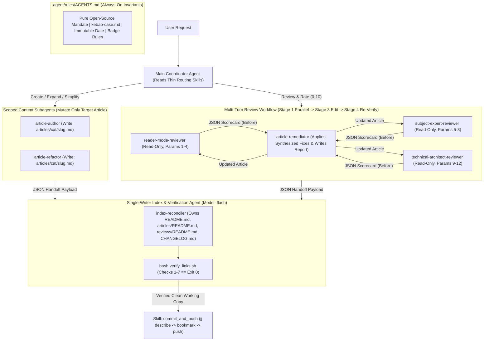

# 02 — Skills-to-Agents Evaluation & Target Architecture

**Parent Index:** [Architectural Plans Index](./README.md) | **Previous:** [01 — Capability & Scale Assessment](./01-skills-capability-and-scale-assessment.md)
**Assessment Role:** Technical / AI Architect

---

## 1. Paradigm Distinction: Skills vs. Isolated Agents

In the Antigravity customization architecture, converting a **Skill** into an **Agent** is not a cosmetic rename—it alters execution isolation, token economics, tool permissions, and concurrency behavior:

| Architectural Dimension | Workspace Skill (`skills/<name>/SKILL.md`) | Isolated Agent (`define_subagent` / `invoke_subagent` / `run_workflow`) |
| :--- | :--- | :--- |
| **Context Window** | Loaded into the active parent conversation via progressive disclosure. | Runs in an isolated conversation context; only final output returns to parent. |
| **Tool Permissions** | Inherits all parent write, shell, and network capabilities. | Enforces least-privilege boundaries (`EnableWriteTools: false` for read-only reviewers). |
| **Concurrency & Workspace** | Sequential execution in the parent turn. | Parallel fan-out via `parallel()` or `invoke_subagent` using `inherit`, `share`, or `branch`. |
| **Model Tiering** | Fixed to the parent session model. | Assignable per role (`pro` / `inherit` for architecture, `flash` / `flash_lite` for reconciliation/scanning). |
| **Output Validation** | Free-form prose and manual checklist adherence. | Supports strict JSON Schema enforcement (`run_workflow` `schema=`) via `finish`. |

**Core Architectural Principle:** Do **not** perform a naive 1-to-1 conversion of every skill into a standalone write-enabled agent. Converting skills that mutate global singleton files ([`README.md`](../README.md), [`articles/README.md`](../articles/README.md), [`articles/CHANGELOG.md`](../articles/CHANGELOG.md), [`reviews/README.md`](../reviews/README.md)) without separating responsibilities causes write contention and badge-rotation race conditions.

---

## 2. Skill-to-Agent Conversion Evaluation Rubric & Scorecard (`0–10`)

Each skill is evaluated across 6 architectural conversion parameters (`0.0–10.0`):

1. **Context Isolation Gain (`0–10`):** Reduction of intermediate token bloat (URL ingestion, 114-article scans, 3-persona critiques) from the primary conversation.
2. **Parallel Fan-Out Potential (`0–10`):** Suitability for concurrent execution across personas or multi-article batches (`run_workflow` `parallel()`).
3. **Least-Privilege Benefit (`0–10`):** Security and correctness gained from restricting write permissions (`EnableWriteTools: false` or single-file scope).
4. **Shared-State Safety (As-Is) (`0–10`):** Ability to execute concurrently without colliding on singleton indexes or VCS state *(lower = higher collision hazard without redesign)*.
5. **Model Tiering Efficiency (`0–10`):** Opportunity to offload deterministic checks/scans to `flash` / `flash_lite` while reserving higher reasoning tiers for deep synthesis.
6. **Schema Contract Determinism (`0–10`):** Amenability to strict JSON Schema validation (`SCORECARD_SCHEMA` / handoff payloads) before disk mutations occur.

| Current Skill | Context Isolation | Parallel Fan-Out | Least-Privilege | Shared-State Safety (As-Is) | Model Tiering | Schema Contract | **Conversion ROI (`0–10`)** | Target Architectural Role |
| :--- | :---: | :---: | :---: | :---: | :---: | :---: | :---: | :--- |
| [`review_article`](../.agent/skills/review_article/SKILL.md) | `9.5` | `10.0` | `9.5` | `6.0` | `8.5` | `9.5` | **`9.5`** | **Convert immediately** into 3 read-only Reviewer Agents + `run_workflow` orchestrator. |
| [`organize_readme`](../.agent/skills/organize_readme/SKILL.md) | `9.0` | `3.0` | `7.5` | `9.0` *(Single Writer)* | `9.0` | `9.0` | **`8.5`** | **Convert to Single-Writer `index-reconciler` Agent** (`flash` tier) owning all index/badge writes. |
| [`create_article`](../.agent/skills/create_article/SKILL.md) | `8.5` | `8.0` | `7.5` | `3.5` | `7.5` | `8.5` | **`8.0`** | **Convert to Scoped `article-author` Agent** (writes only `articles/<cat>/<slug>.md`). |
| [`simplify_article`](../.agent/skills/simplify_article/SKILL.md) | `7.5` | `8.5` | `7.0` | `4.0` | `8.5` | `8.0` | **`7.5`** | **Convert to Scoped `article-refactor` Agent** for isolated/batch readability refactoring. |
| [`update_article`](../.agent/skills/update_article/SKILL.md) | `6.0` | `6.5` | `6.5` | `3.5` | `7.0` | `7.5` | **`6.0`** | **Keep Hybrid:** Skill for minor direct edits; Subagent for multi-article cross-link backfills. |
| [`commit_and_push`](../.agent/skills/commit_and_push/SKILL.md) | `1.5` | `1.0` | `2.0` | `2.0` | `2.0` | `3.0` | **`2.0`** | **Do NOT convert to an agent.** Retain as a Skill with a mandatory pre-push `verify_links.sh` gate. |

---

## 3. Six Architectural Changes Required for Conversion

### Change 1 — Decouple Content Mutation from Index Mutation (Single-Writer Pattern)
* **Problem:** Today, `create_article`, `update_article`, `simplify_article`, and `review_article` all edit [`README.md`](../README.md), [`articles/README.md`](../articles/README.md), and [`articles/CHANGELOG.md`](../articles/CHANGELOG.md) directly. Running two authoring or review agents concurrently risks clobbering `[NEW]` / `[UPDATED]` cohorts and article totals.
* **Solution:**
  * Restrict content agents (`article-author`, `article-refactor`, `article-remediator`) to writing **only** their target `articles/<category>/<slug>.md` (and `reviews/<category>/<slug>-review.md`).
  * Promote `organize_readme` into a single-writer **`index-reconciler`** agent invoked at workflow fan-in to recompute Hybrid Window cohorts, sync both READMEs and `articles/CHANGELOG.md`, update `reviews/README.md`, and run `bash verify_links.sh`.

### Change 2 — Extract Shared Governance Invariants into `.agent/rules/AGENTS.md`
* **Problem:** Repository-wide rules (Pure Open-Source Systems Mandate, `Scope & Licensing Note`, `kebab-case.md` naming, immutable `**Date:**`) are duplicated across 4 `SKILL.md` files and are not automatically inherited by subagents unless manually pasted into prompts.
* **Solution:** Centralize invariant rules inside `.agent/rules/AGENTS.md` so Antigravity automatically loads them into workspace agents, shrinking skill/agent definitions and eliminating rule drift.

### Change 3 — Formalize `review_article` into Persistent Read-Only Agents + `run_workflow`
* **Problem:** [`review_article/SKILL.md`](../.agent/skills/review_article/SKILL.md) currently constructs ad-hoc subagent prompts in prose and relies on manual score extraction and Delta arithmetic.
* **Solution:**
  1. Define 3 persistent read-only reviewer personas (`EnableWriteTools: false`) backed by [`rubric-and-repo-alignment.md`](../.agent/skills/review_article/references/rubric-and-repo-alignment.md):
     * `reader-mode-reviewer` (Parameters 1–4)
     * `subject-expert-reviewer` (Parameters 5–8)
     * `technical-architect-reviewer` (Parameters 9–12)
  2. Orchestrate Stages 1–4 via a Python `run_workflow` script using `parallel()` and multi-turn persistent agent handles (`reviewer = agent(...)`) so Stage 4 (`After`) verification retains full memory of Stage 1 (`Before`) findings.
  3. Enforce a strict JSON Schema (`SCORECARD_SCHEMA`) on reviewer outputs so Persona Sub-Averages, Overall Composite Scores, and Deltas are computed deterministically in Python rather than by LLM arithmetic.

```python
SCORECARD_SCHEMA = {
    "type": "object",
    "required": ["persona", "scores", "sub_average", "recommendations"],
    "properties": {
        "persona": {"type": "string"},
        "scores": {
            "type": "array",
            "minItems": 4,
            "maxItems": 4,
            "items": {
                "type": "object",
                "required": ["param_id", "name", "score", "rationale"],
                "properties": {
                    "param_id": {"type": "integer"},
                    "name": {"type": "string"},
                    "score": {"type": "number", "minimum": 0, "maximum": 10},
                    "rationale": {"type": "string"}
                }
            }
        },
        "sub_average": {"type": "number"},
        "recommendations": {
            "type": "array",
            "items": {
                "type": "object",
                "required": ["priority", "section", "change"],
                "properties": {
                    "priority": {"type": "string", "enum": ["Critical", "High", "Medium", "Low"]},
                    "section": {"type": "string"},
                    "change": {"type": "string"}
                }
            }
        }
    }
}
```

### Change 4 — Standardize Structured JSON Handoff Contracts
* **Problem:** Content workflows currently rely on prose reminders to pass evicted badge information and revision summaries to `articles/CHANGELOG.md`.
* **Solution:** Require every content-mutating agent to return a structured JSON handoff object consumed by `index-reconciler`:

```json
{
  "action": "created | updated | simplified | reviewed",
  "article_path": "articles/devops/example-slug.md",
  "title": "Example Title",
  "date": "November 18, 2026",
  "last_updated": "November 18, 2026",
  "review_report_path": "reviews/devops/example-slug-review.md",
  "changelog_summary": "Applied multi-persona review and pure open-source comparison matrix.",
  "reciprocal_articles_touched": ["articles/devops/sibling-article.md"]
}
```

### Change 5 — Explicit Workspace Isolation Policies (`inherit` vs. `share`)
* **Single-Article & Read-Only Operations (`workspace: "inherit"`):** All 3 read-only reviewer agents and single-article runs operate directly in `inherit` mode without cloning overhead.
* **Batch Multi-Article Operations (`workspace: "share"`):** Parallelized multi-article runs (e.g., batch `simplify_article` or batch `review_article`) spawn workers with `workspace: "share"` so file edits never collide before merging and running [`verify_links.sh`](../verify_links.sh).

### Change 6 — Keep `commit_and_push` as a Guarded Procedural Skill
* **Problem:** [`commit_and_push/SKILL.md`](../.agent/skills/commit_and_push/SKILL.md) directly runs `jj describe`, `jj bookmark set main -r @`, and `jj git push` without validating repository health.
* **Solution:** Retain `commit_and_push` as a Skill (lowest ROI for an autonomous agent at `2.0 / 10`), remove `view_file` tool-specific coupling from `simplify_article/SKILL.md`, and add a mandatory **Pre-Push Verification Gate** (`bash verify_links.sh` must exit `0`) before `jj git push`.

---

## 4. Target Hybrid Architecture Topology & File Layout



### Target `.agent/` Directory Structure (Post-Migration)

```text
.agent/
├── rules/
│   └── AGENTS.md                                      # Shared invariants (OS-only, kebab-case, date/badge rules)
├── agents/
│   ├── reader-mode-reviewer.md                        # Read-only persona (Params 1-4)
│   ├── subject-expert-reviewer.md                     # Read-only persona (Params 5-8)
│   ├── technical-architect-reviewer.md                # Read-only persona (Params 9-12)
│   ├── article-author.md                              # Scoped authoring agent (articles/ only)
│   ├── article-refactor.md                            # Scoped readability/structure agent (articles/ only)
│   └── index-reconciler.md                            # Single-writer index, changelog & verify_links.sh agent
└── skills/
    ├── README.md                                      # Control plane overview & capability directory
    ├── commit_and_push/SKILL.md                       # Guarded jj workflow (pre-push verify_links.sh gate)
    ├── create_article/SKILL.md                        # Thin entry trigger -> article-author + index-reconciler
    ├── organize_readme/SKILL.md                       # Thin entry trigger -> index-reconciler
    ├── review_article/
    │   ├── SKILL.md                                   # Thin entry trigger -> run_workflow pipeline
    │   ├── scripts/run_review_workflow.py             # Deterministic parallel fan-out & score aggregation
    │   ├── references/rubric-and-repo-alignment.md
    │   └── resources/report-template.md
    ├── simplify_article/SKILL.md                      # Thin entry trigger -> article-refactor + index-reconciler
    └── update_article/SKILL.md                        # Hybrid edit guide + optional reconciler handoff
```

**Next Document:** [03 — Phased Migration Execution Plan](./03-phased-migration-execution-plan.md)
