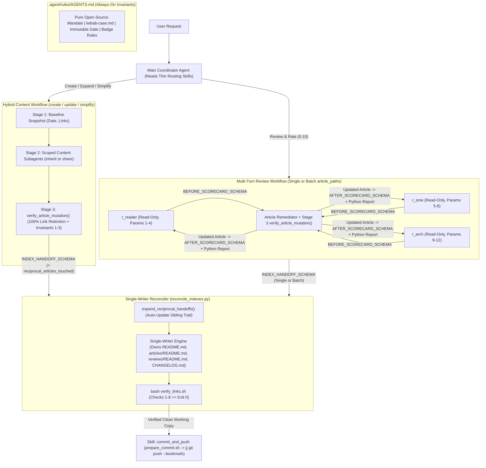

# 02 — Skills-to-Agents Evaluation & Target Architecture

**Parent Index:** [Architectural Plans Index](./README.md) | **Previous:** [01 — Capability & Scale Assessment](./01-skills-capability-and-scale-assessment.md)
**Assessment Role:** Technical / AI Architect

---

## 1. Paradigm Distinction: Skills vs. Isolated Agents

In the Antigravity customization architecture, converting a **Skill** into an **Agent** is not a cosmetic rename—it alters execution isolation, token economics, tool permissions, and concurrency behavior:

| Architectural Dimension | Workspace Skill (`skills/<name>/SKILL.md`) | Isolated Agent (`define_subagent` / `invoke_subagent` / `run_workflow`) |
| :--- | :--- | :--- |
| **Context Window** | Loaded into the active parent conversation via progressive disclosure. | Runs in an isolated conversation context; only final output returns to parent. |
| **Tool Permissions** | Inherits all parent write, shell, and network capabilities. | Enforces least-privilege boundaries (`EnableWriteTools: false` for read-only reviewers). |
| **Concurrency & Workspace** | Sequential execution in the parent turn. | Parallel fan-out via `parallel()` or `invoke_subagent` using `inherit`, `share`, or `branch`. |
| **Model Tiering** | Fixed to the parent session model. | Assignable per role (`pro` / `inherit` for architecture, `flash` / `flash_lite` for reconciliation/scanning). |
| **Output Validation** | Free-form prose and manual checklist adherence. | Supports strict JSON Schema enforcement (`run_workflow` `schema=`) via `finish`. |

**Core Architectural Principle:** Do **not** perform a naive 1-to-1 conversion of every skill into a standalone write-enabled agent. Converting skills that mutate global singleton files ([`README.md`](../README.md), [`articles/README.md`](../articles/README.md), [`articles/CHANGELOG.md`](../articles/CHANGELOG.md), [`reviews/README.md`](../reviews/README.md)) without separating responsibilities causes write contention and badge-rotation race conditions.

---

## 2. Skill-to-Agent Conversion Evaluation Rubric & Scorecard (`0–10`)

Each skill is evaluated across 6 architectural conversion parameters (`0.0–10.0`):

1. **Context Isolation Gain (`0–10`):** Reduction of intermediate token bloat (URL ingestion, 114-article scans, 3-persona critiques) from the primary conversation.
2. **Parallel Fan-Out Potential (`0–10`):** Suitability for concurrent execution across personas or multi-article batches (`run_workflow` `parallel()`).
3. **Least-Privilege Benefit (`0–10`):** Security and correctness gained from restricting write permissions (`EnableWriteTools: false` or single-file scope).
4. **Shared-State Safety (As-Is) (`0–10`):** Ability to execute concurrently without colliding on singleton indexes or VCS state *(lower = higher collision hazard without redesign)*.
5. **Model Tiering Efficiency (`0–10`):** Opportunity to offload deterministic checks/scans to `flash` / `flash_lite` while reserving higher reasoning tiers for deep synthesis.
6. **Schema Contract Determinism (`0–10`):** Amenability to strict JSON Schema validation (`SCORECARD_SCHEMA` / handoff payloads) before disk mutations occur.

| Current Skill | Context Isolation | Parallel Fan-Out | Least-Privilege | Shared-State Safety (As-Is) | Model Tiering | Schema Contract | **Conversion ROI (`0–10`)** | Target Architectural Role |
| :--- | :---: | :---: | :---: | :---: | :---: | :---: | :---: | :--- |
| [`review_article`](../.agent/skills/review_article/SKILL.md) | `9.5` | `10.0` | `9.5` | `6.0` | `8.5` | `9.5` | **`9.5`** | **Convert immediately** into 3 read-only Reviewer Agents + `run_workflow` orchestrator. |
| [`organize_readme`](../.agent/skills/organize_readme/SKILL.md) | `9.0` | `3.0` | `7.5` | `9.0` *(Single Writer)* | `9.0` | `9.0` | **`8.5`** | **Convert to Single-Writer `index-reconciler` Agent** (`flash` tier) owning all index/badge writes. |
| [`create_article`](../.agent/skills/create_article/SKILL.md) | `8.5` | `8.0` | `7.5` | `3.5` | `7.5` | `8.5` | **`8.0`** | **Convert to Scoped `article-author` Agent** (writes only `articles/<cat>/<slug>.md`). |
| [`simplify_article`](../.agent/skills/simplify_article/SKILL.md) | `7.5` | `8.5` | `7.0` | `4.0` | `8.5` | `8.0` | **`7.5`** | **Convert to Scoped `article-refactor` Agent** for isolated/batch readability refactoring. |
| [`update_article`](../.agent/skills/update_article/SKILL.md) | `6.0` | `6.5` | `6.5` | `3.5` | `7.0` | `7.5` | **`6.0`** | **Keep Hybrid:** Skill for minor direct edits; Subagent for multi-article cross-link backfills. |
| [`commit_and_push`](../.agent/skills/commit_and_push/SKILL.md) | `1.5` | `1.0` | `2.0` | `2.0` | `2.0` | `3.0` | **`2.0`** | **Do NOT convert to an agent.** Retained as a two-phase guarded Skill with [`prepare_commit.sh`](../.agent/skills/commit_and_push/scripts/prepare_commit.sh) pre-push `verify_links.sh` gate *(Implemented)*. |

---

## 3. Six Architectural Changes Required for Conversion

### Change 1 — Decouple Content Mutation from Index Mutation (Single-Writer Pattern) *(Implemented — Option A4)*
* **Problem:** Previously, `create_article`, `update_article`, `simplify_article`, and `review_article` all edited [`README.md`](../README.md), [`articles/README.md`](../articles/README.md), and [`articles/CHANGELOG.md`](../articles/CHANGELOG.md) directly. Running two authoring or review agents concurrently risked clobbering `[NEW]` / `[UPDATED]` cohorts and article totals.
* **Options Evaluated (`0–10` Architectural Matrix):**

| Required Attribute (`0–10`) | Weight | Option A1: Status Quo (Shared Skill) | Option A2: `branch` Clone + VCS Merge | Option A3: Pure-LLM `index-reconciler` | **Option A4: Scoped Writers + Script-Backed `reconcile_indexes.py` (Implemented)** |
| :--- | :---: | :---: | :---: | :---: | :---: |
| **Concurrency & Contention Safety** | `25%` | `2.0` | `5.0` | `8.5` | **`9.8`** |
| **Determinism & Invariant Fidelity (Checks 5–7)** | `20%` | `6.5` | `6.0` | `7.5` | **`9.8`** |
| **Blast-Radius Isolation & Least Privilege** | `15%` | `3.5` | `7.0` | `8.5` | **`9.5`** |
| **Token & Latency Efficiency** | `15%` | `5.0` | `4.0` | `6.5` | **`9.5`** |
| **Idempotency & Failure Recovery** | `15%` | `6.0` | `4.5` | `7.5` | **`9.5`** |
| **Operational Maintainability** | `10%` | `7.0` | `4.0` | `8.0` | **`9.0`** |
| **Weighted Composite Score (`0–10`)** | `100%` | **`4.7`** | **`5.2`** | **`7.8`** | **`9.6`** |

* **Why Option A4 and Not Others:**
  * *Why not A1 (`4.7`):* Zero concurrency safety; every content run wastes context re-reading 114+ entries in `articles/README.md`.
  * *Why not A2 (`5.2`):* Parallel `branch` workers editing the exact same header counters and 5-line badge blocks in `README.md` guarantee line-level merge conflicts at fan-in.
  * *Why not A3 (`7.8`):* Pure-LLM multi-file string editing across 114 files and 12 categories is slower, token-heavy, and vulnerable to off-by-one badge eviction errors.
  * *Why A4 (`9.6`):* Content workflows (`create_article`, `update_article`, `simplify_article`, and `review_article`'s `Article Remediator`) mutate **only** target article files and pass `INDEX_HANDOFF_SCHEMA` payloads to [`reconcile_indexes.py`](../.agent/skills/organize_readme/scripts/reconcile_indexes.py), which deterministically computes Hybrid Window `[NEW]` / `[UPDATED]` cohorts, updates all 4 singleton index files atomically, and executes `bash verify_links.sh`. *(Implemented in [`reconcile_indexes.py`](../.agent/skills/organize_readme/scripts/reconcile_indexes.py) and all 4 content skills.)*

### Change 2 — Extract Shared Governance Invariants into `.agent/rules/AGENTS.md` *(Implemented — Option 4)*
* **Problem:** Repository-wide rules (Pure Open-Source Systems Mandate, `Scope & Licensing Note`, `kebab-case.md` naming, immutable `**Date:**`, Hybrid Window `[NEW]` / `[UPDATED]` exclusivity) and procedural trail updates were previously duplicated across 4 `SKILL.md` files and not automatically inherited by subagents unless manually pasted into prompts.
* **Solution:** Centralized all declarative invariants inside [`.agent/rules/AGENTS.md`](../.agent/rules/AGENTS.md) so Antigravity automatically loads them into workspace conversations and subagents, and consolidated procedural `README.md` / `articles/README.md` / `articles/CHANGELOG.md` trail sync into [`organize_readme/SKILL.md`](../.agent/skills/organize_readme/SKILL.md), removing governance boilerplate across [`create_article`](../.agent/skills/create_article/SKILL.md), [`update_article`](../.agent/skills/update_article/SKILL.md), [`simplify_article`](../.agent/skills/simplify_article/SKILL.md), and [`review_article`](../.agent/skills/review_article/SKILL.md). *(Completed via Option 4.)*

### Change 3 — Formalize `review_article` into Stateful Multi-Turn Read-Only Agents + `run_workflow` *(Implemented — Option B4)*
* **Problem:** [`review_article/SKILL.md`](../.agent/skills/review_article/SKILL.md) previously constructed ad-hoc subagent prompts in prose and relied on manual score extraction and Delta arithmetic.
* **Options Evaluated (`0–10` Architectural Matrix):**

| Required Attribute (`0–10`) | Weight | Option B1: Markdown Prompt Templates | Option B2: Regex Scraper on Free Text | Option B3: Stateless `run_workflow` + JSON Schema | **Option B4: Stateful Multi-Turn `run_workflow` + Dual Schema + Python Renderer (Implemented)** |
| :--- | :---: | :---: | :---: | :---: | :---: |
| **Contract Enforcement & Type Safety** | `25%` | `3.0` | `5.0` | `9.0` | **`9.8`** |
| **Arithmetic & Scorecard Accuracy** | `20%` | `5.0` | `8.0` | `9.5` | **`10.0`** |
| **Before→After Audit Continuity (Anti-Inflation)** | `20%` | `6.0` | `5.5` | `6.0` | **`9.6`** |
| **Least-Privilege Enforcement (`Read-Only` Reviewers)** | `15%` | `6.5` | `6.5` | `9.5` | **`9.5`** |
| **Check 7 Compliance & Template Fidelity** | `10%` | `6.5` | `7.5` | `8.5` | **`9.8`** |
| **Context Window & Latency Efficiency** | `10%` | `6.0` | `6.0` | `7.5` | **`9.0`** |
| **Weighted Composite Score (`0–10`)** | `100%` | **`5.1`** | **`6.3`** | **`8.4`** | **`9.7`** |

* **Why Option B4 and Not Others:**
  * *Why not B1 (`5.1`):* Free-text prompts cannot fail-fast when a subagent omits a parameter or miscalculates sub-averages.
  * *Why not B2 (`6.3`):* Fragile regex scraping over prose shifts schema errors downstream instead of enforcing contracts at `finish`.
  * *Why not B3 (`8.4`):* Spawning fresh stateless reviewers in Stage 4 drops memory of Stage 1 deductions and duplicates input context tokens across 6 startups instead of 3 persistent sessions.
  * *Why B4 (`9.7`):* [`run_review_workflow.py`](../.agent/skills/review_article/scripts/run_review_workflow.py) instantiates 3 persistent read-only handles (`r_reader`, `r_sme`, `r_arch`) across Stage 1 (`BEFORE_SCORECARD_SCHEMA`) and Stage 4 (`AFTER_SCORECARD_SCHEMA`) via `parallel()`, while [`schemas.py`](../.agent/skills/review_article/scripts/schemas.py) enforces anti-inflation clamping (holding `After <= Before` if all linked recommendations remain `Deferred`), computes exact Python means/deltas (`compute_scorecard()`), and renders Check 7 compliant Markdown (`render_review_report()`). *(Live schemas & contracts defined in [`schemas.py`](../.agent/skills/review_article/scripts/schemas.py).)*

### Change 4 — Standardize Structured JSON Handoff Contracts *(Implemented — Option A4)*
* **Problem:** Content workflows previously relied on prose reminders to pass evicted badge information and revision summaries to `articles/CHANGELOG.md`.
* **Solution:** Standardized `INDEX_HANDOFF_SCHEMA` in [`schemas.py`](../.agent/skills/review_article/scripts/schemas.py) and wired [`create_article`](../.agent/skills/create_article/SKILL.md), [`update_article`](../.agent/skills/update_article/SKILL.md), [`simplify_article`](../.agent/skills/simplify_article/SKILL.md), and [`run_review_workflow.py`](../.agent/skills/review_article/scripts/run_review_workflow.py) to invoke [`reconcile_indexes.py`](../.agent/skills/organize_readme/scripts/reconcile_indexes.py) with validated payloads:

```json
{
  "action": "Reviewed & Updated",
  "article_path": "articles/devops/example-slug.md",
  "title": "Example Title",
  "date": "November 18, 2026",
  "last_updated": "November 19, 2026",
  "changelog_summary": "Applied multi-persona review and pure open-source comparison matrix.",
  "review_move": {
    "report_path": "reviews/devops/example-slug-review.md",
    "before_score": 7.5,
    "after_score": 9.0,
    "delta": "+1.5",
    "review_date": "Nov 19, 2026"
  },
  "reciprocal_articles_touched": ["articles/devops/sibling-article.md"]
}
```

### Change 5 — Explicit Workspace Isolation Policies (`inherit` vs. `share`)
* **Single-Article & Read-Only Operations (`workspace: "inherit"`):** All 3 read-only reviewer agents and single-article runs operate directly in `inherit` mode without cloning overhead.
* **Batch Multi-Article Operations (`workspace: "share"`):** Parallelized multi-article runs (e.g., batch `simplify_article` or batch `review_article`) spawn workers with `workspace: "share"` so file edits never collide before merging and running [`verify_links.sh`](../verify_links.sh).

### Change 6 — Keep `commit_and_push` as a Guarded Procedural Skill (`Pre-Push Gate & Tool-Agnostic Cleanup Implemented`)
* **Problem:** [`commit_and_push/SKILL.md`](../.agent/skills/commit_and_push/SKILL.md) previously ran `jj describe`, `jj bookmark set main -r @`, and `jj git push` without validating repository health, and [`simplify_article/SKILL.md`](../.agent/skills/simplify_article/SKILL.md) referenced a legacy `view_file` tool name.
* **Solution:** Retain `commit_and_push` as a Skill (lowest ROI for an autonomous agent at `2.0 / 10`), enforce a two-phase **Pre-Push Verification Gate** (`prepare_commit.sh` runs `bash verify_links.sh` before `jj describe` and `jj bookmark set <bookmark> -r @`; only then runs `jj git push --bookmark <bookmark>`), and make [`simplify_article/SKILL.md`](../.agent/skills/simplify_article/SKILL.md) tool-agnostic. *(Both [`prepare_commit.sh`](../.agent/skills/commit_and_push/scripts/prepare_commit.sh) and the `simplify_article` `view_file` cleanup are now **Implemented**.)*

### Change 7 — Grow to a Pure Hybrid Control Plane (`run_content_workflow.py` + `verify_article_mutation()` + Reciprocal Auto-Expansion) *(Implemented — Option H3)*
* **Problem:** After Options 4, A4, and B4, `review_article` and `organize_readme` operated as schema-validated Python/workflow engines, while `create_article`, `update_article`, and `simplify_article` remained prompt-only runbooks without pre/post link-retention checks, `reconcile_indexes.py` ignored `reciprocal_articles_touched`, and `run_review_workflow.py` lacked batch `article_paths`, configurable read-only `reviewer_type`, and Stage 3 invariant gating.
* **Options Evaluated (`0–10` Architectural Matrix):**

| Evaluation Dimension (`0–10`) | Weight | Option H1: Script Patches Only | Option H2: Full Subagent Spawning for Every Skill | **Option H3: Pure Hybrid Control Plane (Thin Skills + `run_content_workflow.py` + `verify_article_mutation()` + Enhanced `reconcile_indexes.py` & Batch `run_review_workflow.py`) (Implemented)** |
| :--- | :---: | :---: | :---: | :---: |
| **Determinism & Invariant Enforcement** | `25%` | `8.5` | `7.5` | **`9.8`** |
| **Context Window Isolation & Batch Scalability** | `20%` | `6.5` | `9.0` | **`9.7`** |
| **Least-Privilege & Single-Writer Safety** | `20%` | `8.0` | `6.5` | **`9.7`** |
| **100% Link/Citation Retention Guarantee** | `15%` | `7.0` | `7.0` | **`9.8`** |
| **Token & Model-Tiering Efficiency** | `10%` | `8.0` | `6.0` | **`9.4`** |
| **Maintainability & Verification Gate (Check 8)** | `10%` | `8.5` | `7.0` | **`9.6`** |
| **Weighted Composite Score (`0–10`)** | `100%` | **`7.7`** | **`7.3`** | **`9.7`** |

* **Why Option H3 (`9.7`):**
  * **Pre/Post Article Mutation & Link-Retention Gate:** Added `CONTENT_MUTATION_RESULT_SCHEMA`, `extract_markdown_links()`, and `verify_article_mutation()` to [`schemas.py`](../.agent/skills/review_article/scripts/schemas.py) so every `"Updated"`, `"Simplified"`, and `"Reviewed & Updated"` edit is deterministically validated for immutable `**Date:**`, `**Last Updated:**`, bottom section ordering (`## Related Articles` → `## References` → `## Changelog`), and **zero dropped links** before handoff.
  * **Unified Hybrid Content Workflow:** Deployed [`run_content_workflow.py`](../.agent/skills/create_article/scripts/run_content_workflow.py) supporting `mode: "create" | "update" | "simplify"`, single `article_path` (`inherit`) or parallel batch `article_paths` (`share`), `verify_article_mutation()` gating, optional `chain_review=True`, and `--self-test`.
  * **Reciprocal Auto-Expansion & Least-Privilege Batch Reviews:** Wired `expand_reciprocal_handoffs()` + `--self-test` into [`reconcile_indexes.py`](../.agent/skills/organize_readme/scripts/reconcile_indexes.py), and upgraded [`run_review_workflow.py`](../.agent/skills/review_article/scripts/run_review_workflow.py) with configurable `reviewer_type` (`"research"` / `"self"`), model tiering (`reviewer_model` / `remediator_model`), Stage 3 `verify_article_mutation()`, and batch `article_paths`.

---

## 4. Target Pure Hybrid Architecture Topology & File Layout



### `.agent/` Directory Structure (Live Pure Hybrid Control Plane)

```text
.gitignore                                             # Python bytecode, venv & uv/linter cache ignore rules [Live]
pyproject.toml                                         # uv project manifest, PEP 621 deps & pyright settings [Live]
requirements.txt                                       # pip/uv fallback dependency requirements list [Live]
pyrightconfig.json                                     # Static extraPaths & basic type-checking config for IDE/Pylance [Live]
.agent/
├── rules/
│   └── AGENTS.md                                      # Shared invariants (OS-only, kebab-case, date/badge rules) [Live]
└── skills/
    ├── README.md                                      # Control plane overview & capability directory [Live]
    ├── commit_and_push/
    │   ├── SKILL.md                                   # Guarded two-phase jj workflow [Live]
    │   └── scripts/
    │       └── prepare_commit.sh                      # Atomic pre-push verify_links.sh gate & jj bookmark stager [Live]
    ├── create_article/
    │   ├── SKILL.md                                   # Thin router -> run_content_workflow.py (create) & reconcile_indexes.py [Live]
    │   └── scripts/
    │       └── run_content_workflow.py                # Unified single/batch hybrid content orchestrator + --self-test [Live]
    ├── organize_readme/
    │   ├── SKILL.md                                   # Single-writer reconciler trigger & link-healing fallback [Live]
    │   └── scripts/
    │       ├── run_python.sh                          # uv-first / pip-fallback dependency & Python runner [Live]
    │       └── reconcile_indexes.py                   # Deterministic single-writer index, reciprocal expansion, badge & --self-test engine [Live]
    ├── review_article/
    │   ├── SKILL.md                                   # Thin trigger -> runpy.run_path('...run_review_workflow.py') [Live]
    │   ├── scripts/
    │   │   ├── schemas.py                             # 5 schemas, verify_article_mutation(), uv/pip helpers & Check 7 renderer [Live]
    │   │   └── run_review_workflow.py                 # Standard-Python single/batch run_pipeline() + offline mock --self-test [Live]
    │   ├── references/rubric-and-repo-alignment.md    # 12-parameter 0-10 rubric & philosophy checks [Live]
    │   └── resources/report-template.md               # Canonical review report template [Live]
    ├── simplify_article/SKILL.md                      # Thin router -> run_content_workflow.py (simplify, workspace="share") [Live]
    └── update_article/SKILL.md                        # Thin router -> run_content_workflow.py (update) & reciprocal handoff [Live]
```

**Next Document:** [03 — Phased Migration Execution Plan](./03-phased-migration-execution-plan.md)
